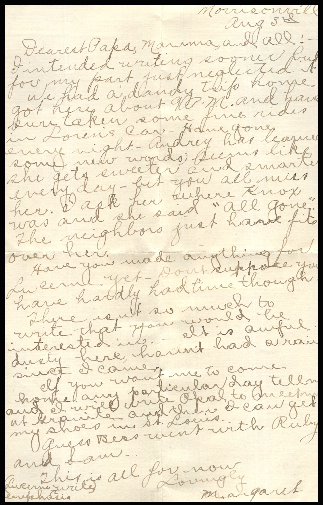
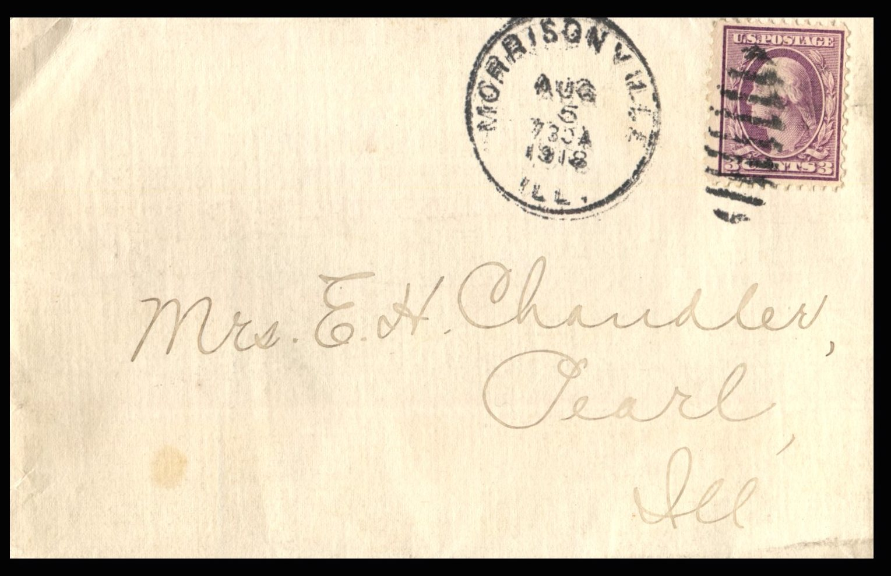

 From: Margaret Chandler, To: Jeanette Knox Chandler and Family  
Mailed From: Morrisonville, Illinois on August 3, 1918

Mrs. E.H. Chandler  
Pearl, Illinois

Morrisonville  
August 3  
Dearest Papa, Mamma, and all:  
I intended writing sooner but for my part just neglected it.  
We had a dandy trip home. Got here about 9 a.m. and have sure taken some fine rides in Loren’s car. Have gone every night. Audrey has learned some new words, seems like she gets sweeter and smarter every day. Bet you all miss her. I ask her where Knox was and she said “all gone.” The neighbors just have fits over her.  
Have you made anything for Lucerne yet? Don’t suppose you have hardly had time though.  
There isn’t so much to write that you would be interested in. It is awful dusty here, haven’t had a rain since I came.  
If you want me to come home any particular day tell me and I will write Opal to meeting at Granite and then I can get my shoes in St. Louis.  
Guess Bess went with Ruby and Sam.  
This is all for now.  
Lovingly,  
Margaret  
Lucerne write (emphasis)