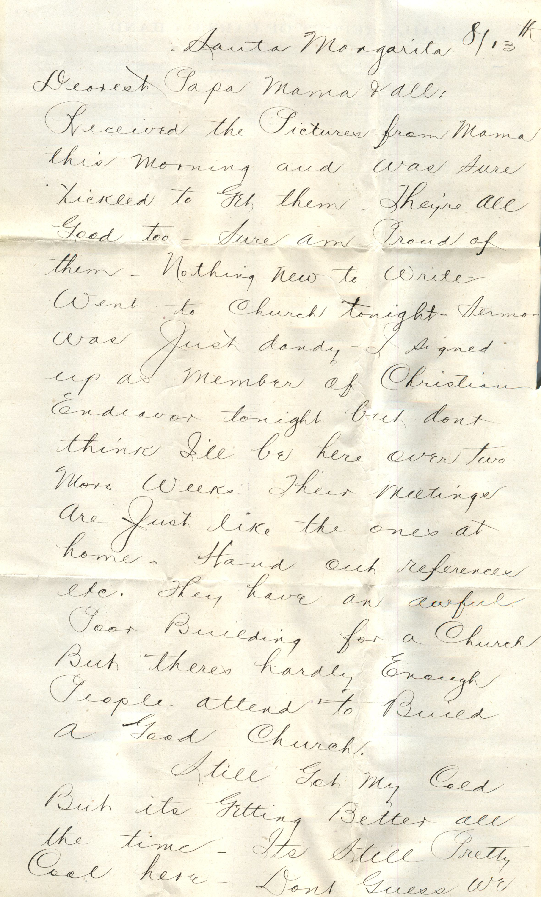
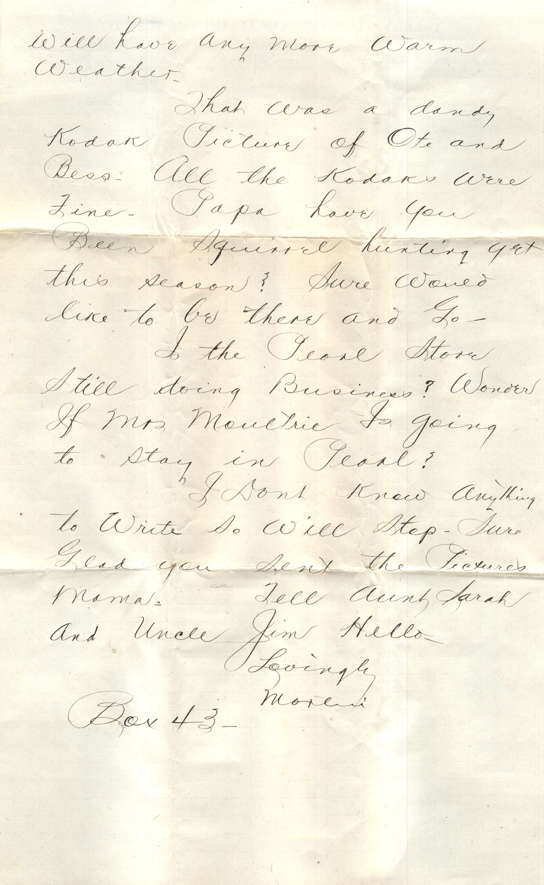
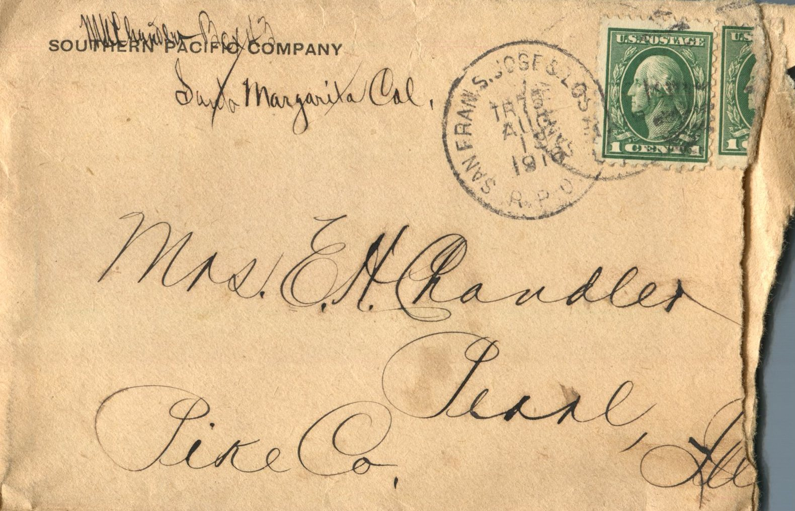

 

From: Martin Chandler, To: Elijah H. Chandler and Family  
Mailed From: Santa Margarita, California on August 13, 1918

M. Chandler  
Box 43  
Santa Margarita, Cal.

Santa Margarita 8/13th  
Dearest Papa, Mama, and All,  
Received the pictures from Mama this morning and was sure tickled to get them. They’re all good too. Sure am proud of them. Nothing new to write went to church tonight. Sermon was just dandy. I signed up as member of Christian Endeavor tonight but don’t think I’ll be here over two more weeks. Their meetings are just like the ones at home. Hand out references etc. They have an awful poor building for a church but theres hardly enough people attend to build a good church.  
Still got my cold but its getting better all the time. It’s still pretty cool here. Don’t guess we will have any more warm weather.  
That was a dandy Kodak picture of Ote and Bess. All the Kodaks were fine. Papa have you been squirrel hunting yet this season? Sure would like to be there and go.  
Is the Peore Store still doing business? Wonder if mrs. Moultrie is going to stay in Pearl?  
I don’t know anything to write so will stop. Sure glad you sent the pictures Mama. Tell Aunt Sarah and Uncle Jim hello.  
Lovingly,  
Martin  
Box 43