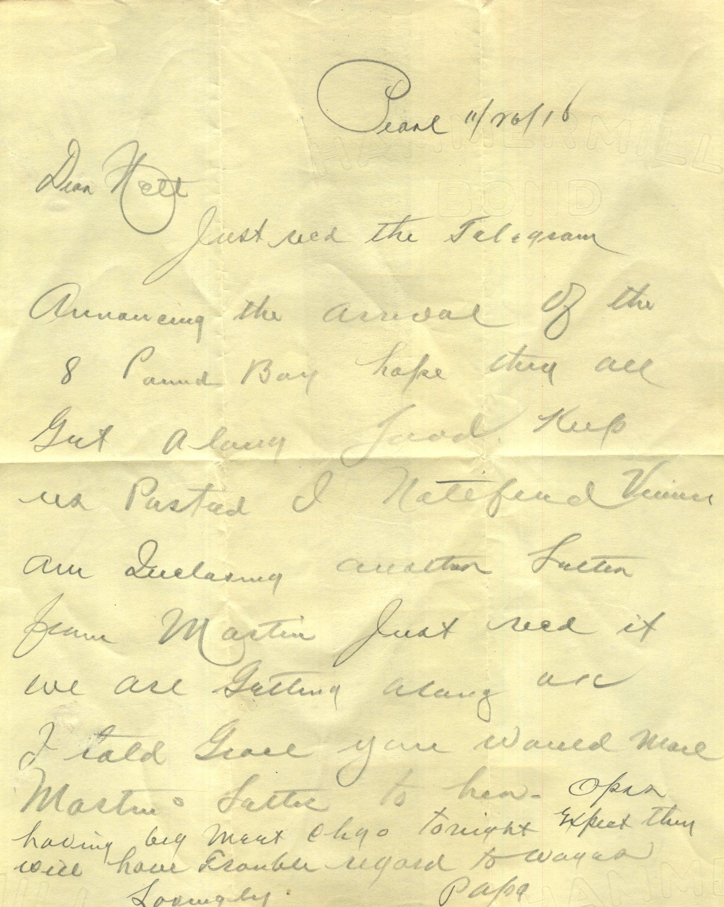

From: Elijah H. Chandler, To: Jeanette Knox Chandler  
Mailed From: Pearl, Illinois on November 20, 1918

Pearl 11/20/18  
Dear Nett,  
Just received the telegram announcing the arrival of the 8 Panned Bay. Hope they all got along good. Keep us posted. I notified Vecinee am expecting letter later from Martin, just need it We are getting along and I told Grace you would mail Martin’s letter to her. Opal’s having big meet tonight. Expect they will have ample. Regard to Wayne  
Lovingly,  
Papa