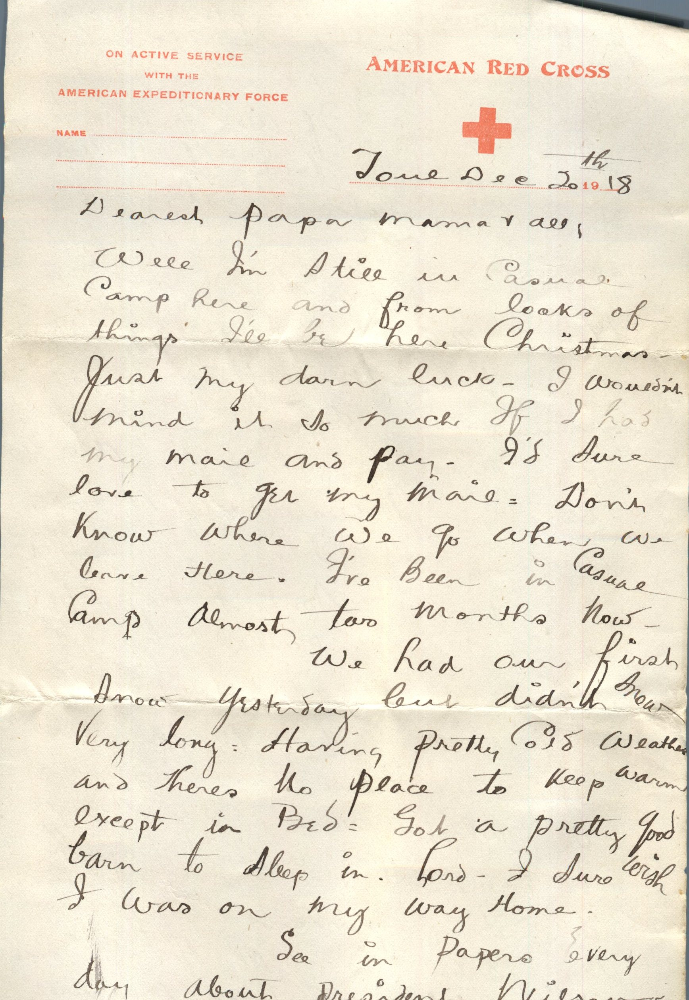
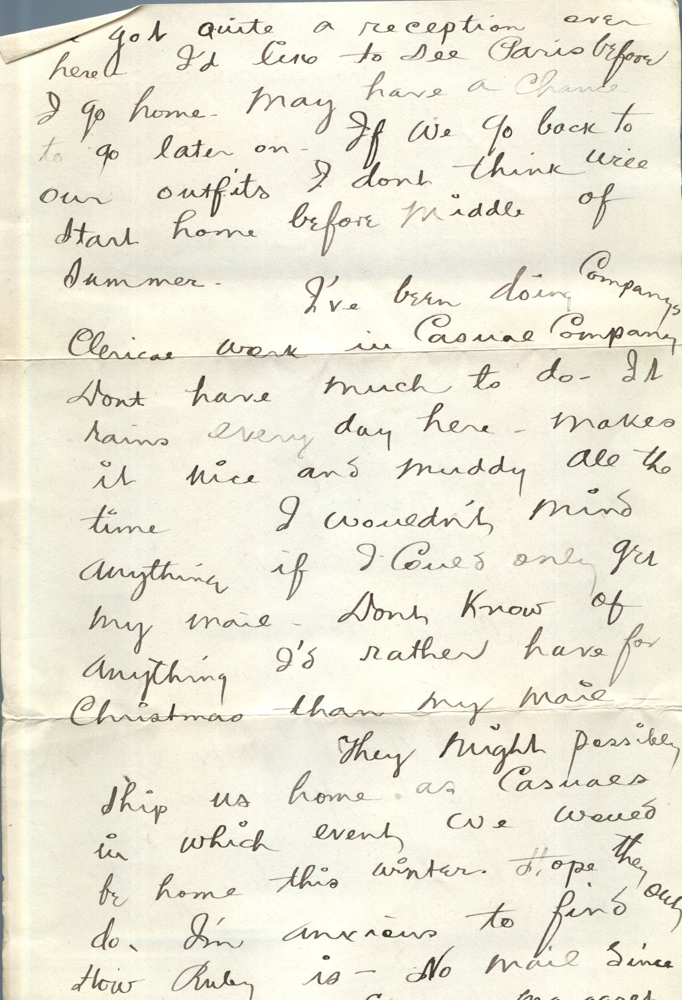
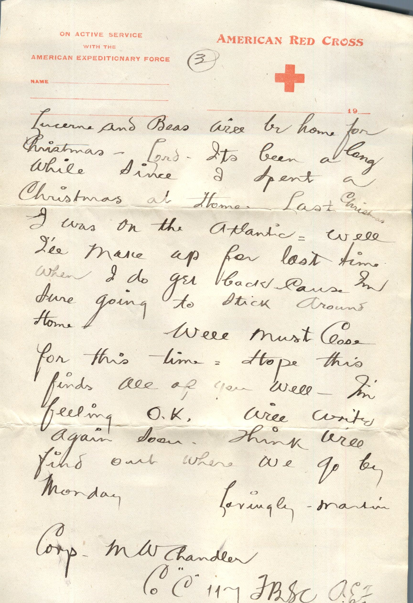
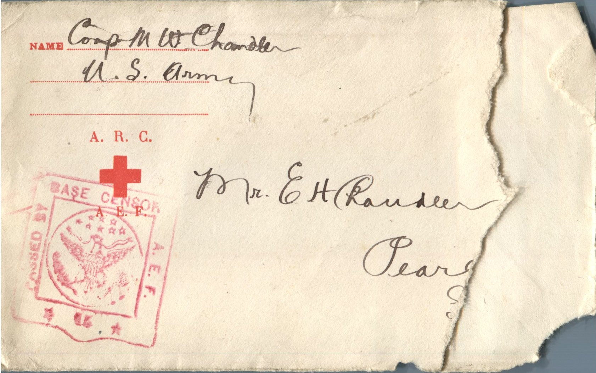

   From: Martin Chandler, To: Elijah H. Chandler  
Mailed From: France on December 20, 1918

Corp. M.W. Chandler  
US Army

Mr. E.H. Chandler  
Pearl, Ill.

Town, Dec 20, 1918  
Dearest Papa, Mama, and all,  
Well I’m still in Casual Camp here and from looks of things I’ll be here Christmas. Just my darn luck. I wouldn’t mind so much if I had my mail and pay. I’d sure love to get my mail. Don’t know where we go when we leave here. I’ve been in Casual Camp almost two months now.  
We had our first snow yesterday but didn’t snow very long. Having pretty cold weather and theres no place to keep warm except in bed. Got a pretty good barn to sleep in. Lord I sure wish i was on my way.  
See in the papers every day about President Wilson. He got quite a reception over here. I’d like to see Paris before I go home. May have a chance to go later on. If we go back to our outfits I don’t think will start home before middle of summer.  
I’ve been doing Company’s clerical work in Casual Company. Don’t have much to do. It rains everyday here. Makes it nice and muddy all the time. I wouldn’t mind anything if I could only get my mail. Don’t know of anything I’d rather have for Christmas than my mail.  
They might possibly ship us home as Casuals in which event we would be home this winter. Hope they do. I’m anxious to find out how Ruby is – no mail since 10th of October. Suppose Margaret Lucerne and Bess will be home for Christmas. Lord It’s been a long while since I spent a Christmas at home. Last Christmas I was on the Atlantic. Well I’ll make up for last time when I do get back cause I’m sure going to stick around home.  
Well must close for this time. Hope this finds all of you well. I’m feeling ok. Will write again soon. Think will find out when we go by Monday.  
Lovingly,  
Martin  
Corp M.W. Chandler.  
Co “C” 117 FBSC AEF