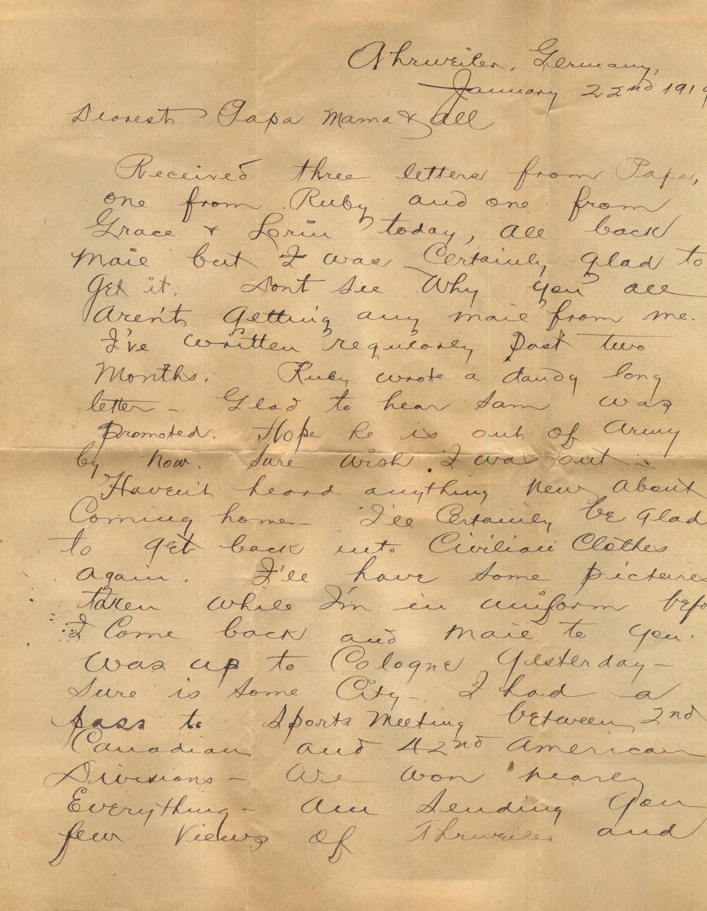
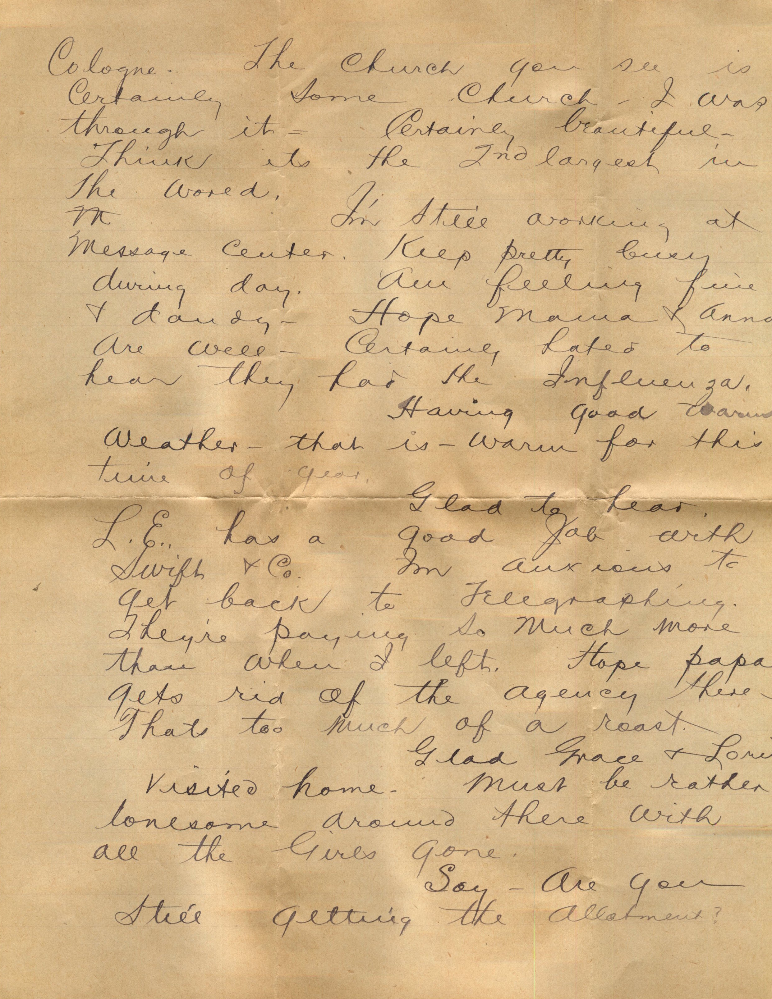
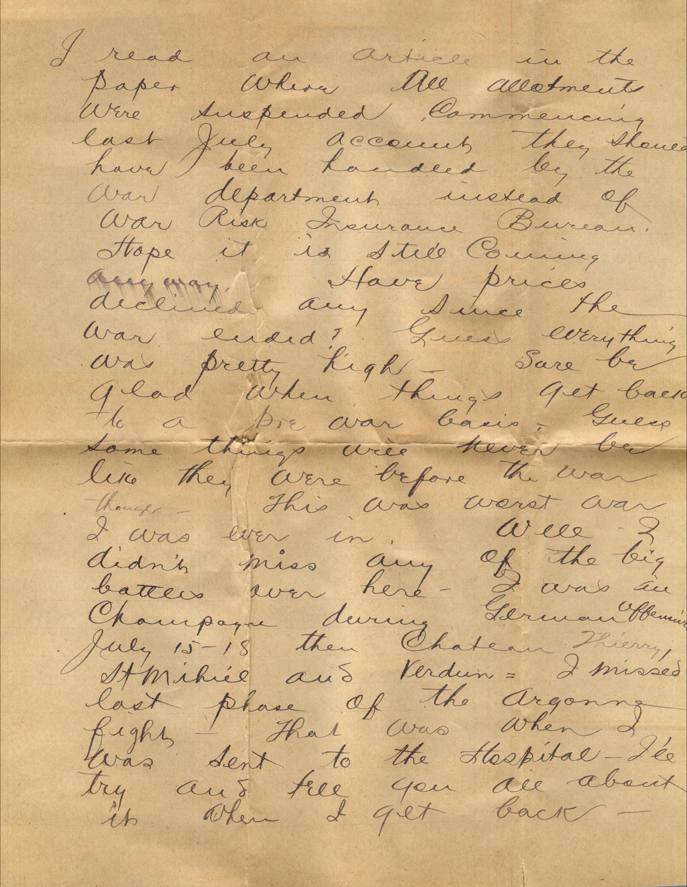
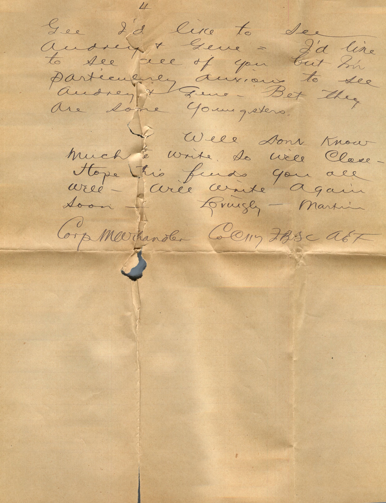

   

From: Martin Chandler, To: Elijah H. Chandler  
Mailed From: Ahrweiler, Germany on January 22, 1919

Mr. E.H. Chandler  
Pearl, Ill  
USA

Ahrweiler, Germany,  
January 22nd 1919  
Dearest Papa, Mama, and all  
Received three letters from Papa, one from Ruby and one from Grace and Lorin today, all back mail but I was certainly glad to get it. Don’t see why you all aren’t getting any mail from me. I’ve written regularly past two months. Ruby wrote a dandy long letter. Glad to hear Sam was promoted. Hope he is out of Army by now. Sure wish I was out. haven’t heard anything new about coming home. I’ll certainly be glad to get back into civilian clothes again. I’ll have some pictures taken while I’m in uniform before I come back and mail them to you. Was up to Cologne yesterday. Sure is some city. I had a pass to sports meting between 2nd Canadian and 42nd American divisions. We won nearly everything. Am sending you few views of Ahrweiler and Cologne. The church you see is certainly some church, I was through it. Certainly beautiful. Think its the 2nd largest in the world.  
I’m still working at message center. Keep pretty bus during day. Am feeling fine and dandy. Hope mama and Anna are well. Certainly hated to hear they had the influenza.  
Having good warm weather – that is – warm for this time of year.  
Glad to hear, L.E. has a good job with Swift and Co. I’m anxious to get back to telegraphing. They’re paying so much more than when I left. Hope papa gets ride of the agency there. That’s too much of a roast.  
Glad Grace and Lorin visited home. Must be rather lonesome around there with all the girls gone.  
Say – are you still getting the allotment?