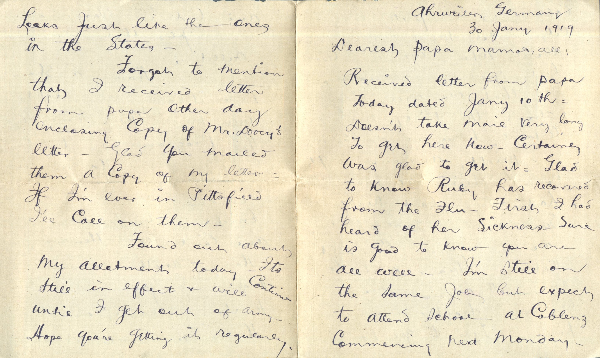
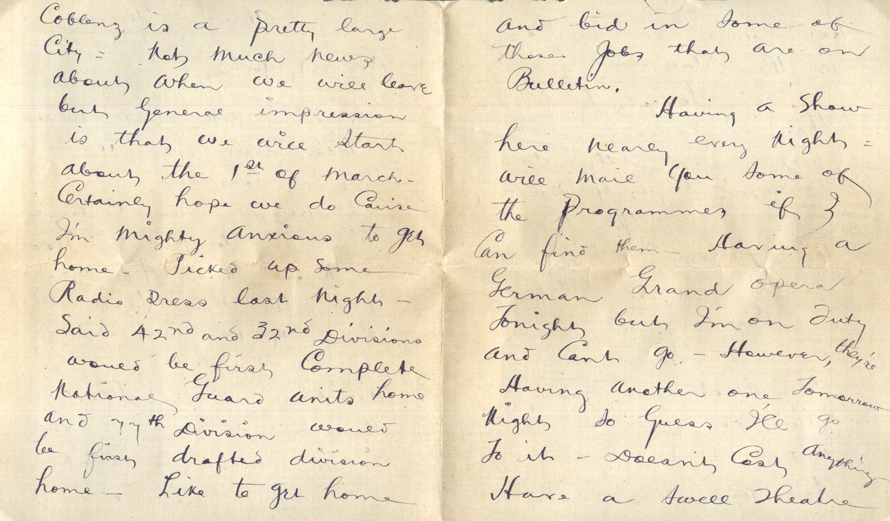
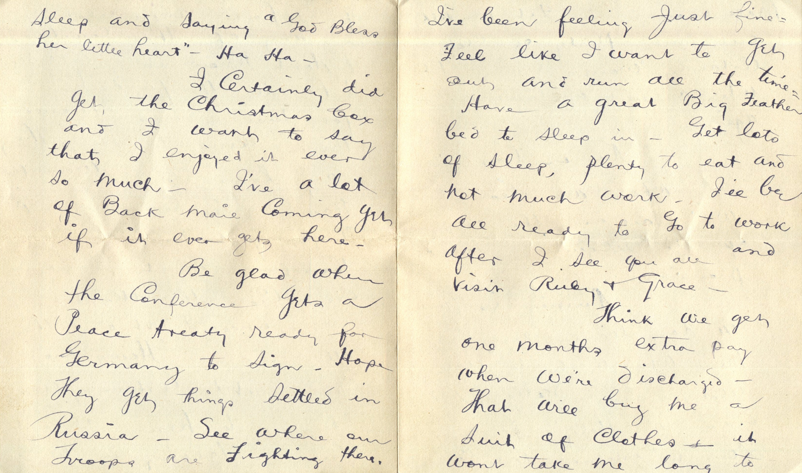
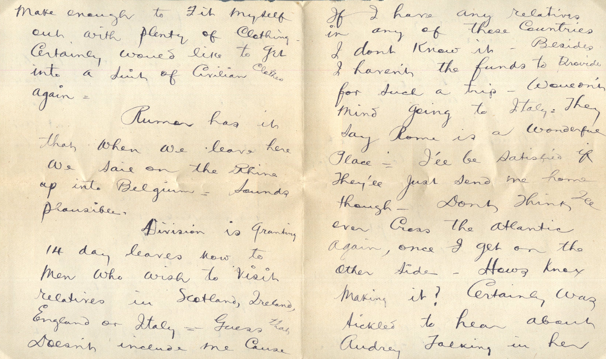

   

From: Martin Chandler, To: Elijah H. Chandler  
Mailed From: Ahrweiler, Germany on January 30, 1919

Mr. E.H. Chandler  
Pearl, Illinois  
USA

Ahrweiler, Germany  
30 Jan 1919  
Dearest Papa, Mama, and all  
Received letter from Papa today dated Jan 10th. Doesn’t take mail very long to get here now. Certainly was glad to get it. Glad to know Ruby has recovered from the flu. First I had heard of her sickness. Sure is good to know you are all well. I’m still on the same job but expect to attend school at Coblens commencing next Monday. Cobblers is a pretty large city. Not much news about when we will leave but general impression is that we will start about the 1st of March. Certainly hope we do cause I’m mighty anxious to get home. Picked up some Radio press last night. Said 42nd and 32nd divisions would be first complete national guard units home and 77th Division would be first drafted division home. Like to get home and bid in some of there jobs that are on bulletin.  
Having a show here nearly every night. Will mail you some of the programs if I can find them. Having a German grand opera tonight but I’m on duty and can’t go. However they’re having another one tomorrow night so guess I’ll go to it. Doesn’t cost anything. Have a swell theatre, looks just like the ones in the states.  
Forgot to mention that I received letter from Papa other day enclosing copy of Mr. Doocy’s letter. Glad you mailed them a copy of my letter. If I’m ever in Pittsfield I’ll call on them.  
Found out about my allotment today. it’s still infect and will continue until I get out of the army.  
Hope you’re getting it regularly. I’ve been feeling just fine. Feel like I want to get out and run all the time. Have a great big feather bed to sleep in. Get lots of sleep, plenty to eat and not much work. I’ll be all ready to go to work after I see you all and visit Ruby and Grace.  
Think we get one months extra pay when we’re discharged. That will by me a suit of clothes. It wont take me long to make enough to fit myself out with plenty of clothing. Certainly would like to get into a suit of civilian clothes again.  
Rumor has it that when we leave here we sail on the Rhine up to Belgium. Sounds plausible.  
Division is ranting 14 day leaves now to men who wish to visit relatives in Scotland, Ireland, England, or Italy. Guess that doesn’t include me case if I have any relatives in any of those countries I don’t know it. Besides I haven’t the funds to provide for such a trip. Wouldn’t mind going to Italy. They say Rome is a wonderful place. I’ll be satisfied if they’ll just send me home though. Don’t think I’ll ever cross the Atlantic again, once I get on the other side. Hows Knox making it? Certainly was tickled to hear about Audrey talking in her sleep and saying “God Bless her little heart.” Ha ha.  
I certainly did get the Christmas box and I want to say that I enjoyed it ever so much. I’ve a lot of back mail coming yet if it ever gets here.  
Be glad when the Conference gets a peace treaty ready for Germany to sing. Hope they get things settled in Russia. See where our troops are fighting there.