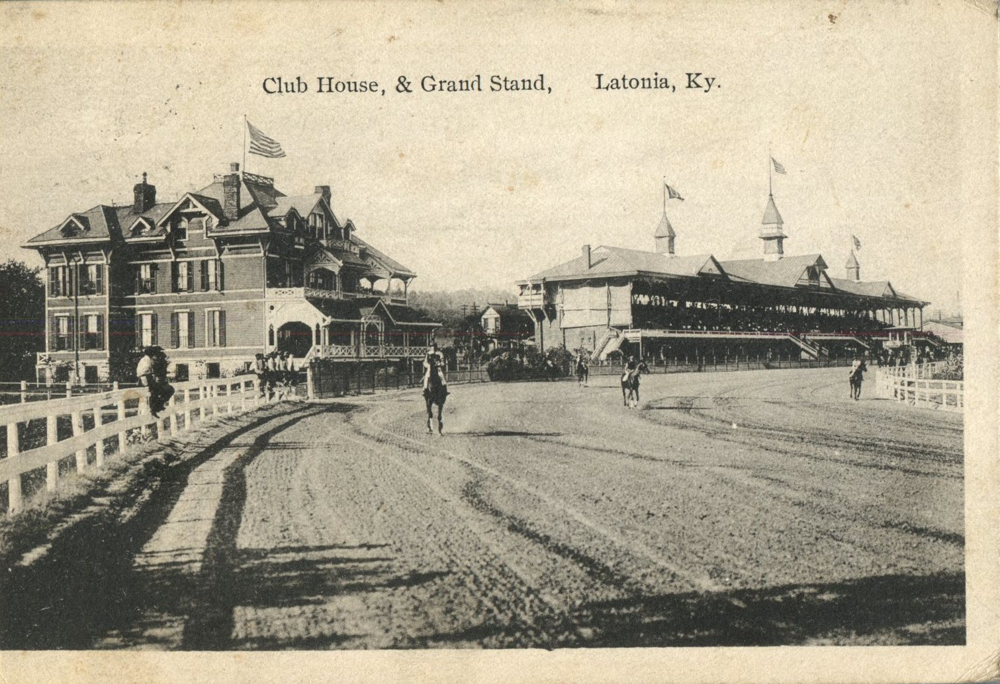
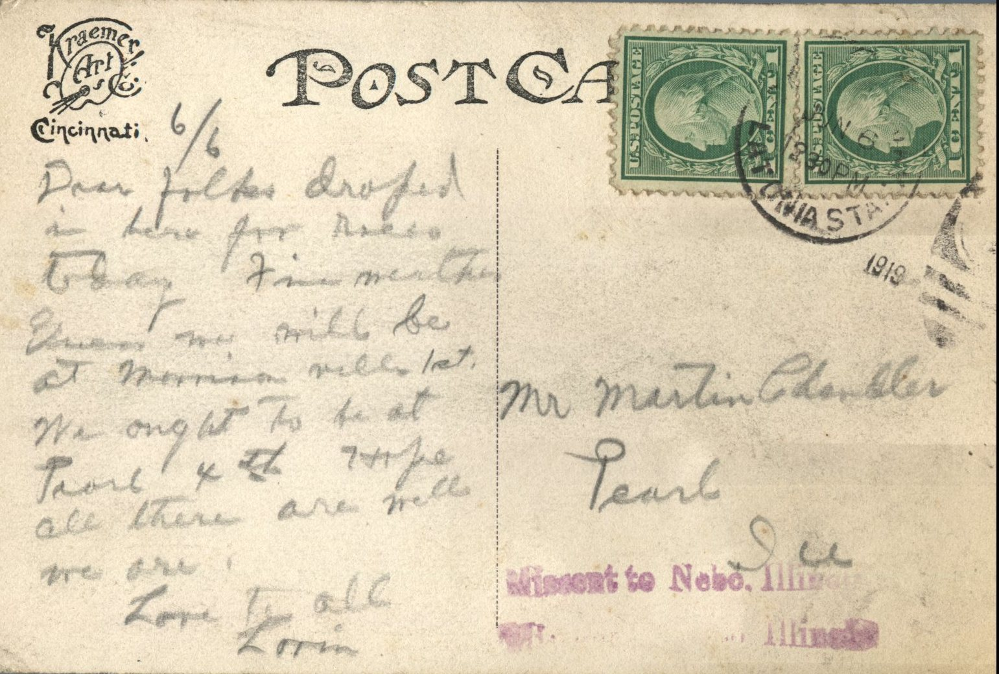

 

From: Lorin, To: Martin Chandler  
Mailed From: Latonia State College on June 6, 1919

Mr. Martin Chandler  
Pearl, Illinois

6/6  
Dear folks,  
Dropped in here for rest today. Fine weather. We will be at Morrisonville 1st. We ought to be at Pearl 4th. Hope all there are well. We are.  
Love to all,  
Lorin