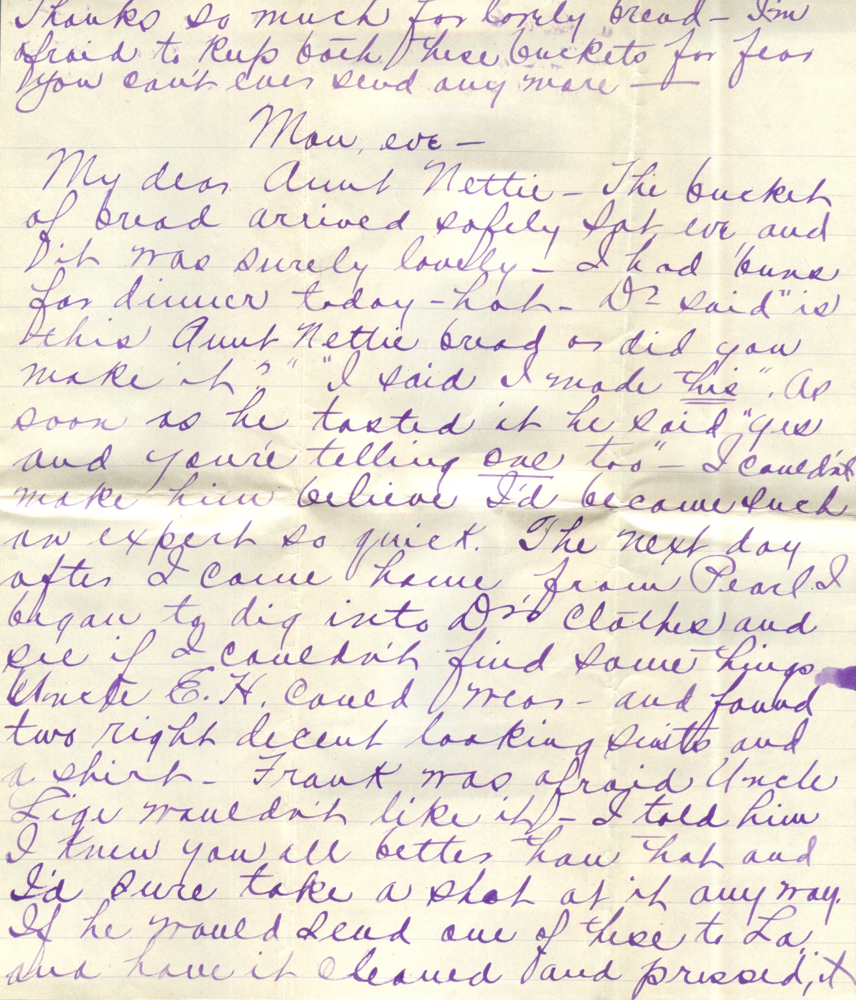
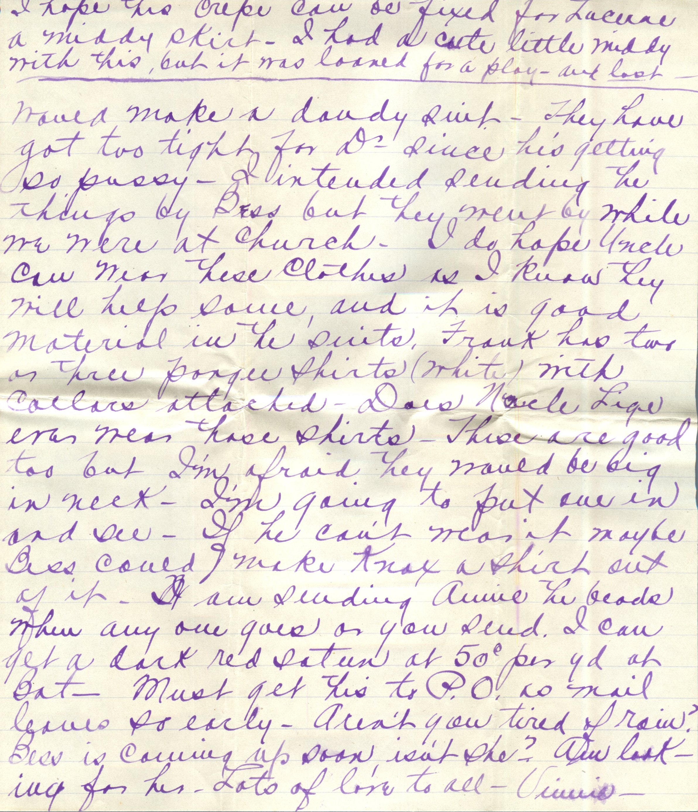
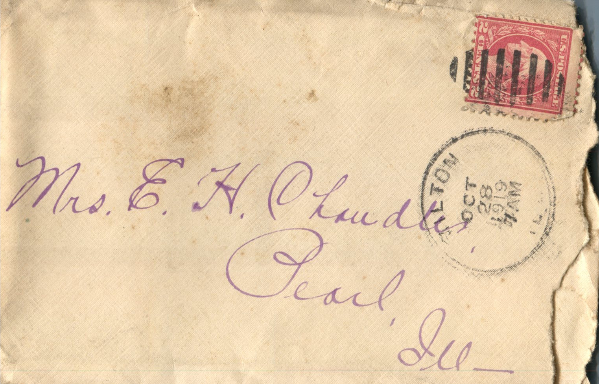

  

From: Vinnie, To: Jeanette Knox Chandler  
Mailed From: October 28, 1919

Mrs. E.H. Chandler  
Pearl, Ill.

Thanks so much for lovely bread. I’m afraid to keep both these buckets for fear you can’t send any more.  
Mon, eve.  
My dear Aunt Nettie,  
The bucket of bread arrived safely Sat eve and it was surely lovely. I had buns for dinner today-hot-Dr, said, “is this Aunt Nettie bread or did you make it?” “I said I made this,” as soon as he tasted it he said “yes and you’re telling one too” – I couldn’t make him believe I’d became such an expert so quick. The next day after I came home from Pearl I began to dig into Dr.’s clothes and see if I couldn’t find some things Uncle E.H. could wear – and found two right decent looking suits and a shirt. Frank was afraid Uncle Lige wouldn’t like it. I told him I knew you all better than that and I’d sure take a shot at it anyway if he would send one of these to LA and have it cleaned and pressed, it would make a dandy suit. They have got two tight for Dr. since he’s getting so plump. I intended sending the things by Bess but they went by while we were at church. I do hope Uncle can wear these clothes as I know they will help some, and it is good material in the suits. Frank has two or three polo shirts (white) with collars attached. Does Uncle Lige want near these shirts- These are good too but I’m afraid they would be big in neck. I’m going to put on in and see. If he can’t use it maybe Bess could make Knox a shirt out of it. I am sending Annie the beads when any one goes or you send. I can get a dark red satin at 50 cents per yard at bat. Must get this to P.O as mail leaves so early. Aren’t you tired of now? Bess is coming up soon isn’t she? Am looking for her. Lots of love to all.  
-Vinnie-