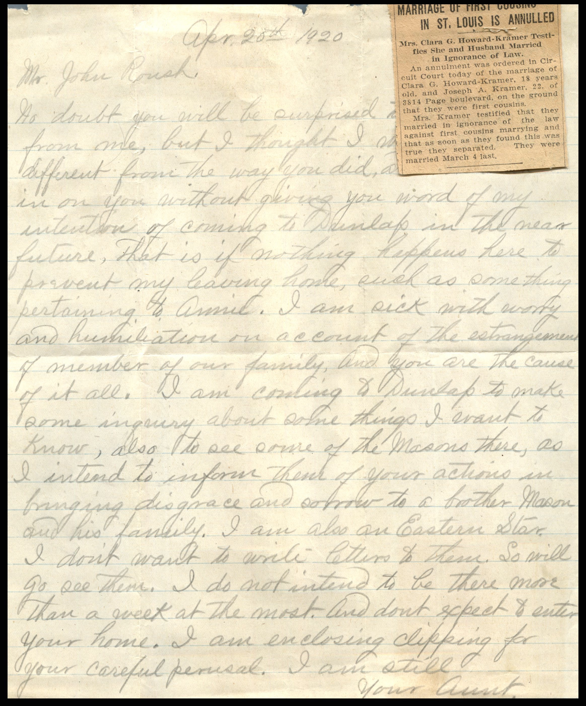

From: Unknown, To: John W. Roush  
Mailed From: Pearl, Illinois on April 20, 1920

Return Address:  
P.O. Box 101  
Pearl, Illinois

Mailing Address:  
Mr. J.W. Roush  
Dunlap, Iowa

Newspaper Clipping Attached:  
“Marriage of First Cousins in St. Louis is Annulled  
Mrs. Clara G. Howard-Kramer Testifies She and Husband Married in Ignorance of Law.  
An annulment was order in Circuit City today of the marriage of Clara G. Howard-Kramer, 18 years old, and Joseph A. Kramer, 22, of 3814 Page Boulevard, on the ground that they were first cousins.  
Mrs. Kramer testified that they married in ignorance of the law against first cousins marrying and that as soon as they found this was true they separated. They were married March 4 last.”

April 20, 1920  
Mr. John Roush,  
No doubt you will be surprised to get this letter from me, but I thought I would do different from the way you did, and not walk in on you without giving you word of my intention on coming to Dunlap in the near future. That is if nothing happens here to prevent my leaving home, such as something pertaining to Annie. I am sick with worry and humiliation on account of the estrangement of members of our family, and you are the cause of it all. I am coming to Dunlap to make some inquiries about some things I want to know, also to see some of the Masons there, as I intend to inform them of your actions in bringing disgrace and sorrow to a brother Mason and his family, I am also an Eastern Star. I don’t want to write letters to them. So will go see them. I do not intend to be there more than a week at the most. And don’t expect to enter your home. I am enclosing clipping for your careful perusal. I am still,  
Your Aunt