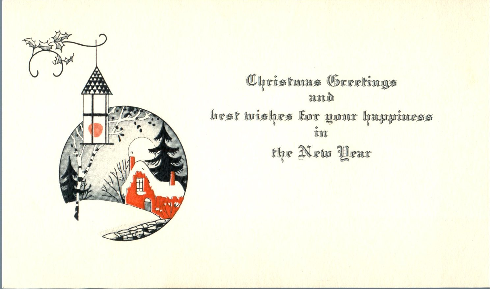
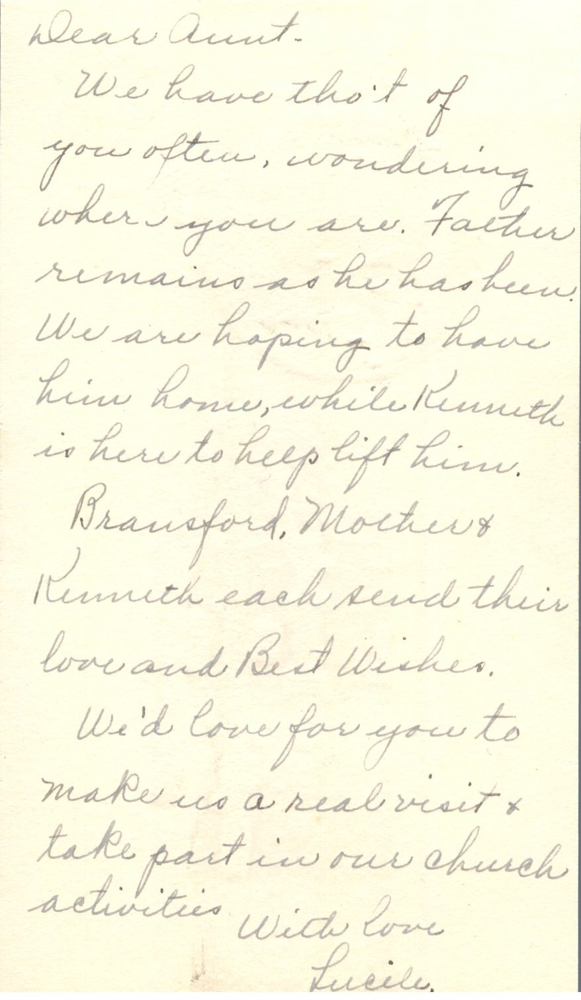
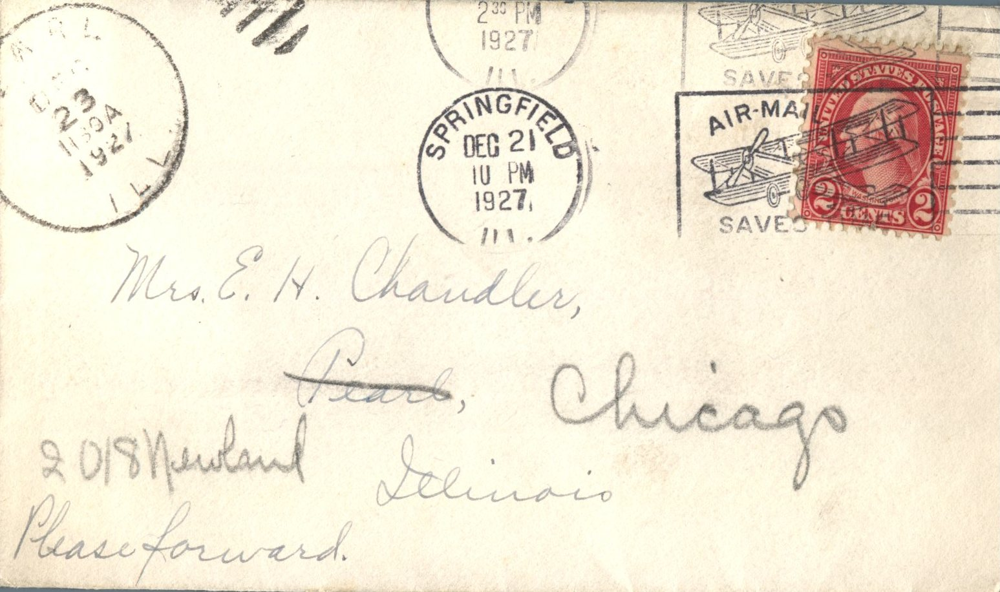
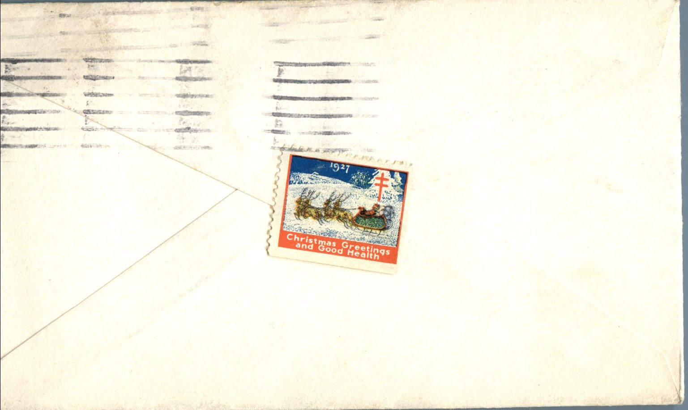

 

From: Lucile, To: Jeanette Knox Chandler  
Mailed From Springfield, Illinois on December 21, 1927

On Envelope:  
Mrs. E.H. Chandler  
(crossed out:) Pearl, Illinois  
(Rewritten:) Chicago, Illinois 2018 Newland  
Please forward

Dear Aunt,  
We have thought of you often, wondering where you are. Father remains as he has been. We are hoping to have him home, while Kenneth is here to help lift him.  
Brausford, Mother, and Kenneth each send their love and best wishes.  
We’d love for you to make us a real visit and take part in our church activities.  
With love,  
Lucile