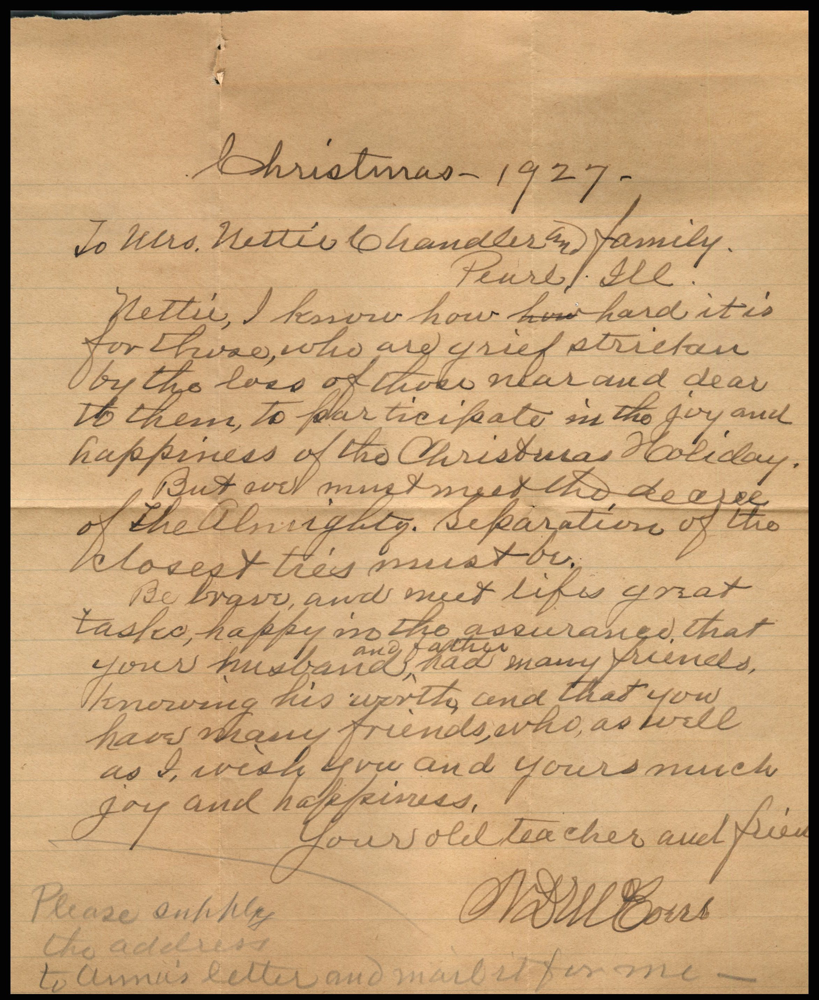
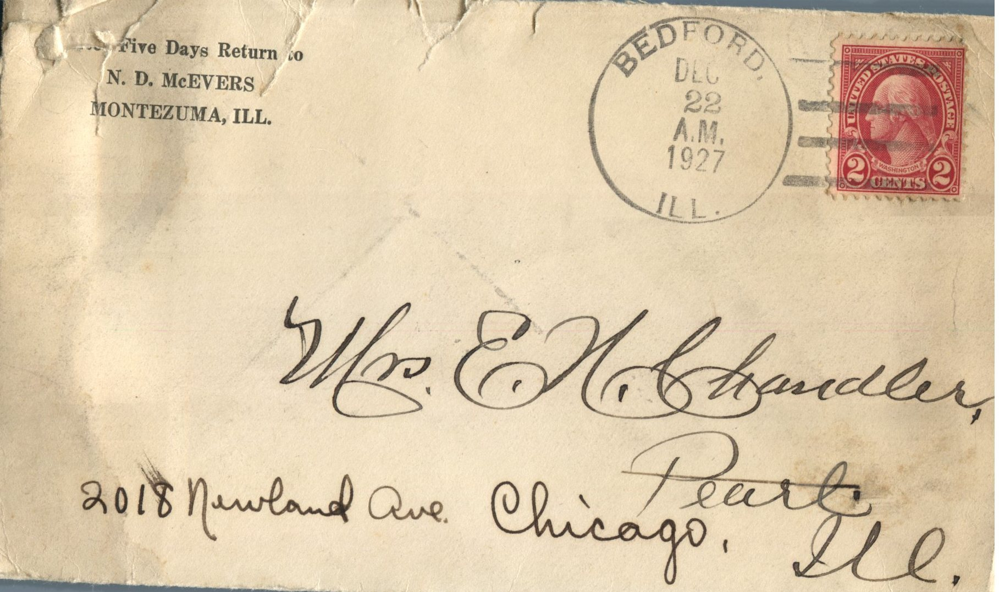

From: N.D. McEvers, To: Jeanette Knox Chandler  
Mailed From: Bedford, Illinois on December 22, 1927

Mailing Address:  
Mrs. E.H. Chandler  
Chicago, Illinois  
2018 Newland Ave.

Return Address:  
After 5 days return to  
N.D McEvers  
Montezuma, Ill.

Christmas 1927  
To Mrs. Nettie Chandler and Family  
Pearl, Illinois  
Nettie I know how hard it is for those who are grief stricken by the loss of those near and dear to them, to participate in the joy and happiness of the Christmas Holiday.  
But we must meet the decree of the Almighty. Separation of the closest must be.  
Be brave, and meet life’s great tasks, happy in the assurance that your husband and father had many friends, knowing his worth, and that you have many friends who as well as I, wish you and yours much joy and happiness.  
Your old teacher and friend,  
N.C. McEvers  
Please supply the address to Annie’s letter and mail it for me.