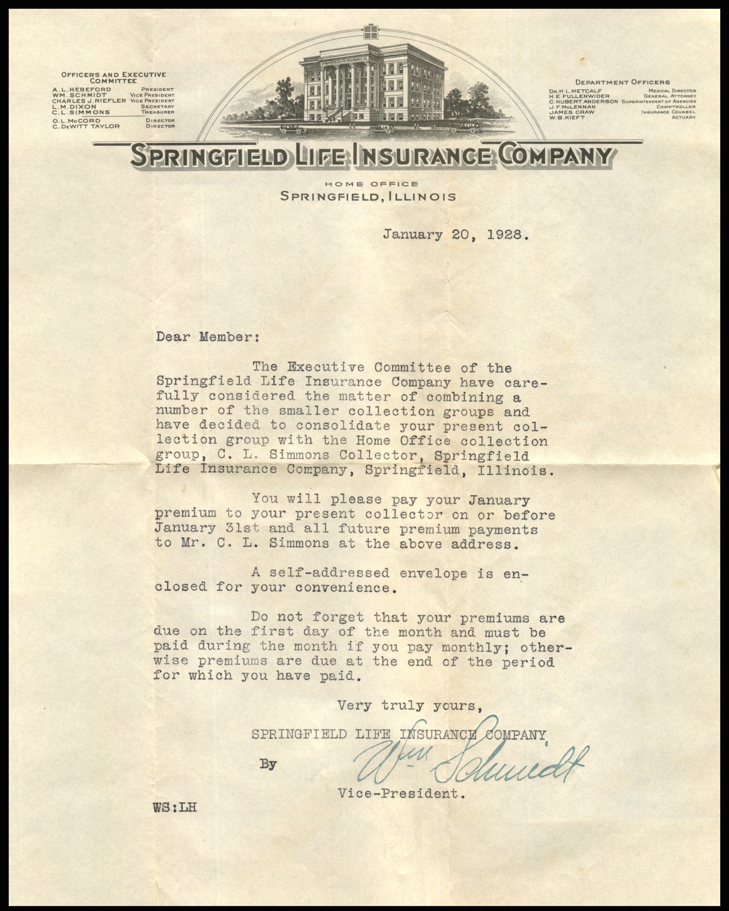
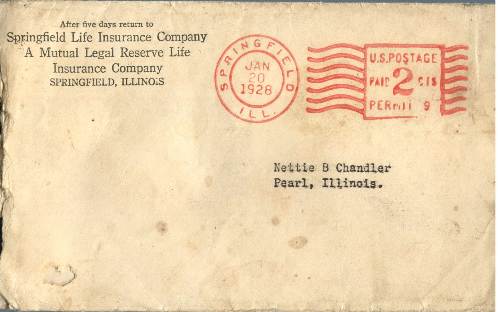

From: Springfield Life Insurance Company, To: Jeanette Knox Chandler  
Mailed From: Springfield, Illinois on January 20, 1928

Mailing Address:  
Nettie B. Chandler  
Pearl, Illinois.

Return Address:  
After 5 days return to Springfield Life Insurance Company  
A Mutual Legal Reserve Life Insurance Company  
Springfield, Illinois

Janaury 20, 1928  
Dear Member:  
The executive Committee of the Springfield Life Insurance Company have carefully considered the matter of combing a number of the smaller collection groups and have decided to consolidate your present collection group with the Home Office collection group, C. L. Simmons Collector, Springfield Life Insurance Company, Springfield, Illinois.  
You will please pay your January premium to your present collector on or before January 31st and all future payments to Mr. C. L. Simmons at the above address.  
A self-addressed envelope is enclosed for your convenience.  
Do not forget that your premiums are due on the first day of the month and much be paid during the month if you pay monthly; otherwise premiums are due at the end of the period for which you have paid.  
Very truly yours,  
Springfield Life Insurance Company  
By W.M. Schmidt  
Vice – President