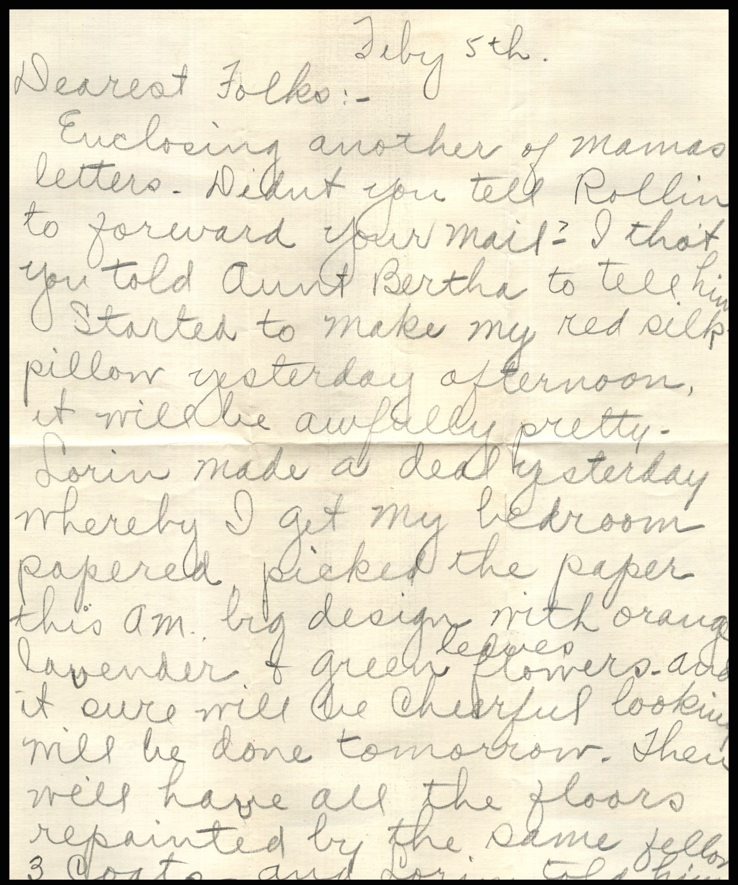
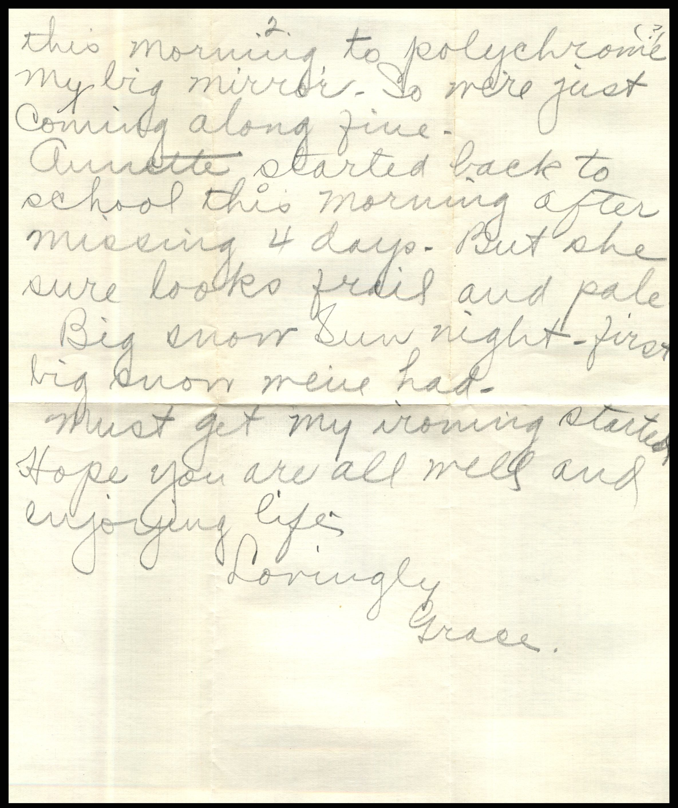
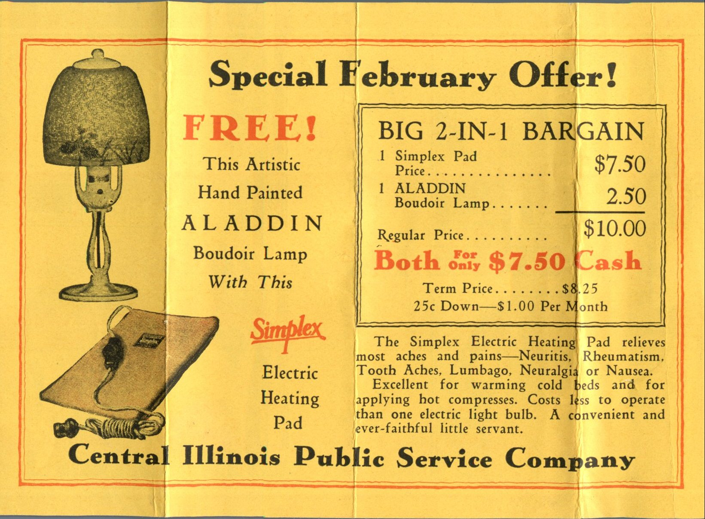
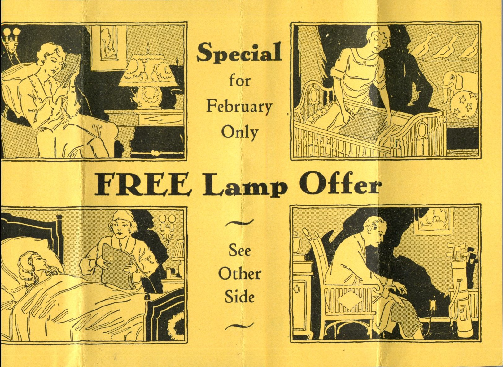
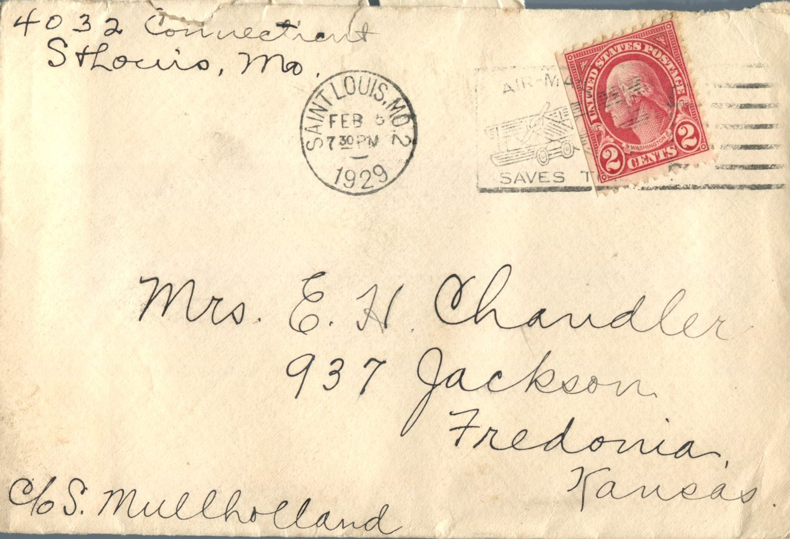

  From: Grace Chandler, To: Jeanette Knox Chandler  
Mailed From: Saint Louis, MO. on February 5, 1929

Mailing Address:  
Mrs. E.H. Chandler 937 Jackson Fredonia, Kansas

Return Address:  
4032 Connecticut St. Louis, MO. c/o Sam Mullholland

July 5th  
Dearest Folks,  
Enclosing another of Mama’s letters. Didn’t you tell Rollin to forward your mail? I thought you told Aunt Bertha to tell him. Started to make my red silk pillow yesterday. It will be awfully pretty. Lorin made a deal yesterday whereby I get my bedroom papers. Picked the paper this a.m. Bid design with orange, lavender, and green leaves and flowers. And it sure will be cheerful looking. Will be not tomorrow. Then will have all the floors repainted by the same fellow. 3 coats and Lorin told him this morning to polychrome my big mirror. So were just coming along fine. Annette started back to school this morning after missing 4 days. But she sure looks frail and pale. Big snow Sunday night. First big snow we’ve had. Must get my ironing started. How you are all well and enjoying life.  
Lovingly,  
Grace

Includes an add for a “Special February Offer” of an Electric Heating Pad and Aladdin Boudoir Lamp “Both for only $7.50 Cash”