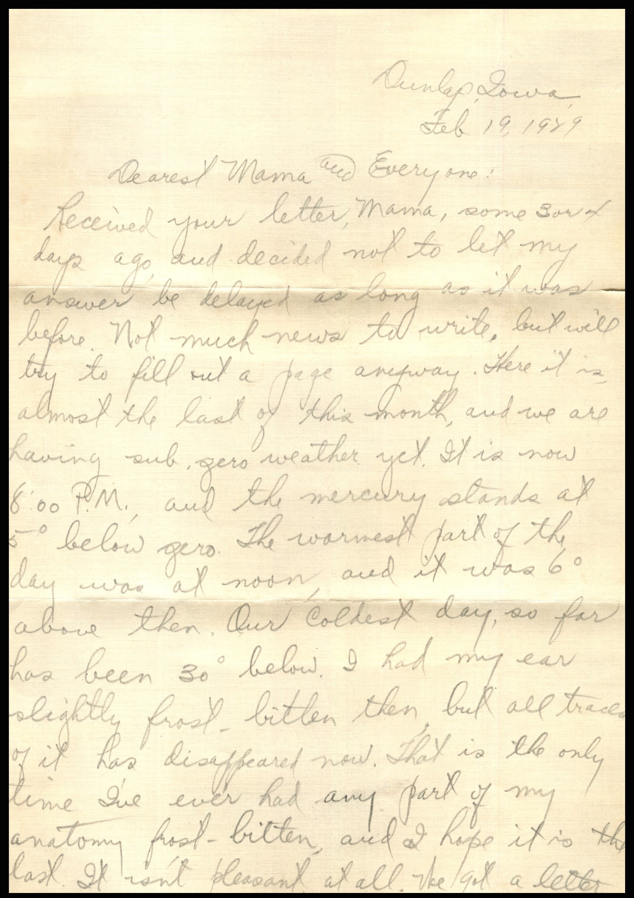
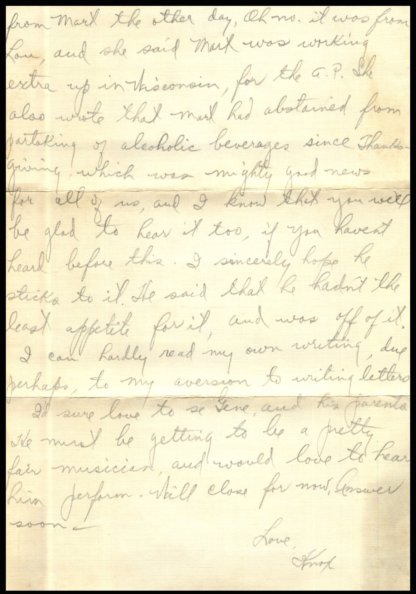
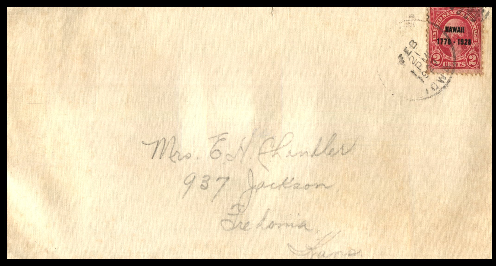

 From: Knox, To: Jeanette Knox Chandler  
Mailed From: Dunlap, Iowa on February 19, 1929

Mrs. E.H. Chandler  
937 Jackson  
Fredonia, Kansas

Dunlap, Iowa  
Feb. 19, 1929  
Dearest Mama and Everyone,  
Received your letter, Mama, some 3 or 4 days ago, and decided not to let my answer be delayed as long as it was before. Not much news to write, but will try to fill out a page anyway. Here it is, almost the last of this month, and we are having sub zero weather yet. It is now 8:00 PM and the mercury stands at 5 degrees below zero. The warmest part of the day was noon, and it was 6 degrees above then. Our coldest day, so far, has been 30 degrees below. I had my ears slightly frostbitten then but all traces of it has disappeared now. That is the only time I’ve ever had any part of my anatomy frost-bitten, and I hope it is the last. It isn’t pleasant at all. We got a letter from Mart the other day, Oh no, it was from Lou and she said Mart is working extra up in Wisconsin, for the A.P. She also wrote that Mart had abstained from partaking of alcoholic beverages since Thanksgiving which was mighty good news for all of us, and I know that yo will be glad to hear it too, if you haven’t hear before this. I sincerely hope he sticks to it. He said that he hadn’t the least appetite for it, and was off of it. I can hardly read my own writing, due perhaps, to my aversion to writing letters.  
I’d sure love to see Gene, and his parents. He must be getting to be a pretty fair musician, and would love to hear him perform. Will close for now, answer soon.  
Love,  
Knox