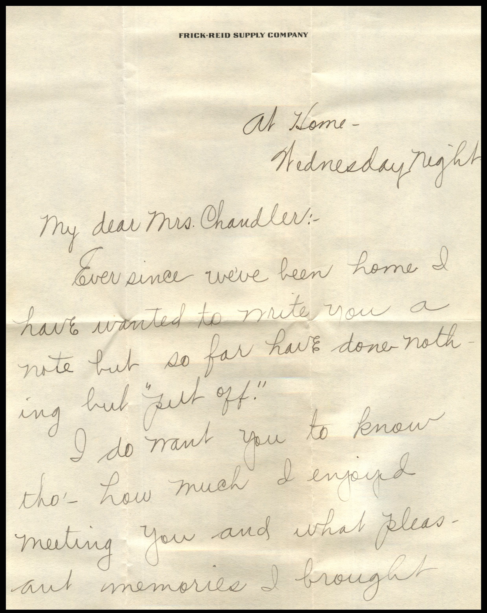
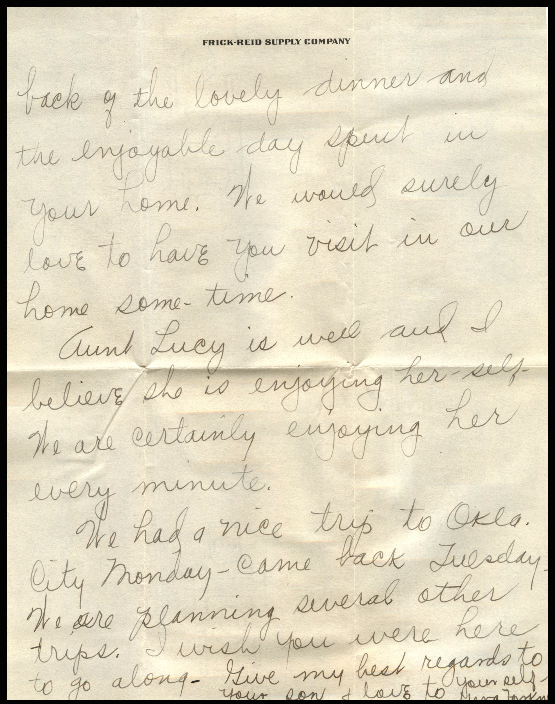
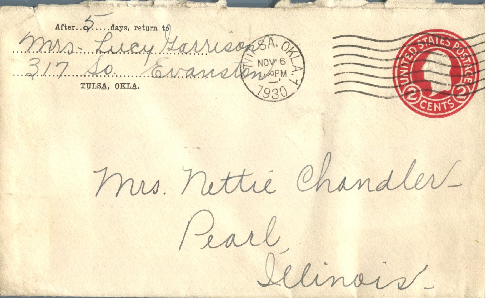

 

From: Verg Forkman , To: Jeanette Knox Chandler  
Mailed From: Tulsa, Oklahoma on November 6, 1930

Mailing Address:  
Mrs. Nettie Chandler  
Pearl, Illinois

Return Address:  
Mrs. Lucy Garrison  
317 So. Evanston

At Home-  
Wednesday Night  
My Dear Mrs. Chandler  
Ever since we’ve been home I have wanted to write you a note but so far have done nothing but “put off.”  
I do want you to know thought – how much I enjoyed meeting you and what pleasant memories I brought back of the lovely dinner and the enjoyable day spent in your home. We would surely love to have you visit in our home some time.  
Aunt Lucy is well and I believe she is enjoying herself. We are certainly enjoying her every minute.  
We had a nice trip to Okla. City on Monday. Cam beck Tuesday. We are planning several other trips. I wish you were here to go along. Give my best regards to your son and love to yourself.  
Verg Forkmen