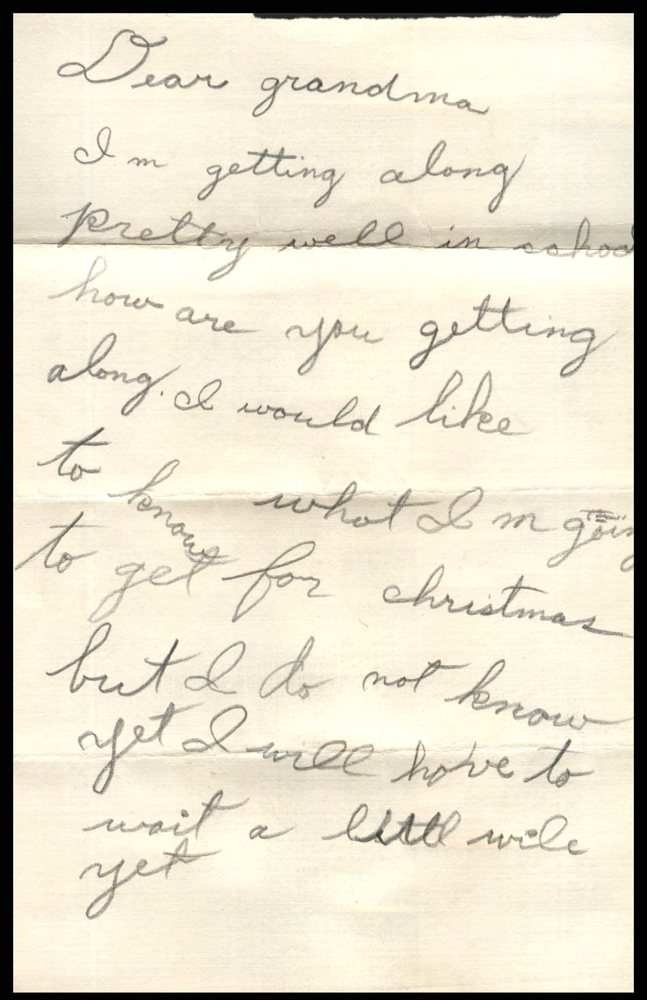
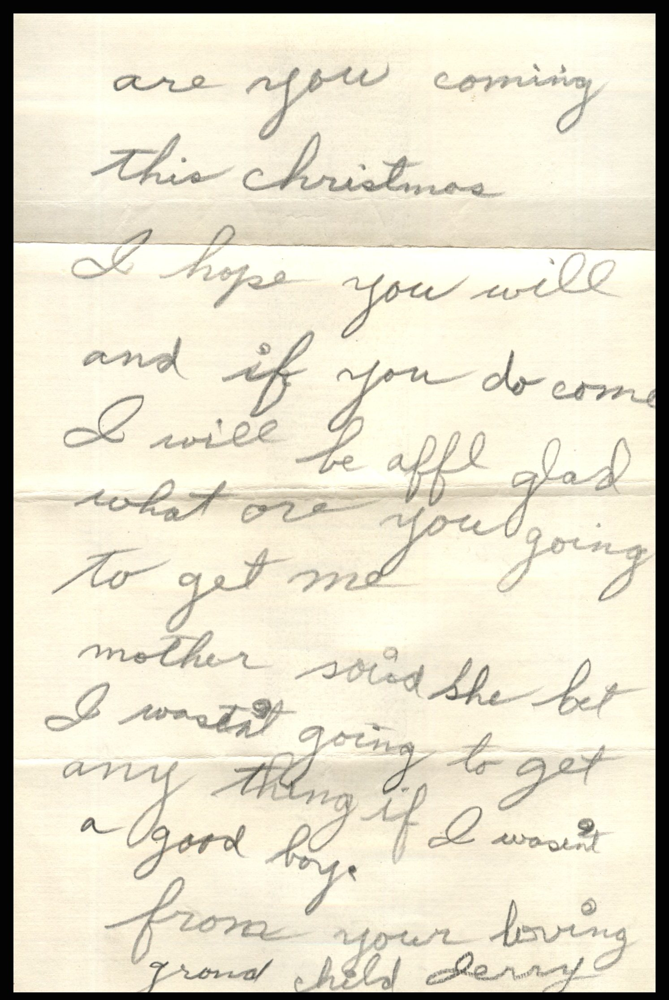

From: Jerry, To: Jeanette Knox Chandler  
Mailed From: Chicago, Illinois on December 4, 1930

Mailing Address:  
Mrs. E.H. Chandler  
Pearl, Illinois

Dear Grandma,  
I’m getting along pretty well in school. How are you getting along. I would like to know what I am going to get for Christmas but I do not know yet. I will have to wait a little while. Are you coming this Christmas. I hope you will and if you do come I will be awful glad. What are you going to get me. Mother said she bet I wasn’t going to get anything if I wasn’t a good boy.  
From your loving grandchild,  
Jerry