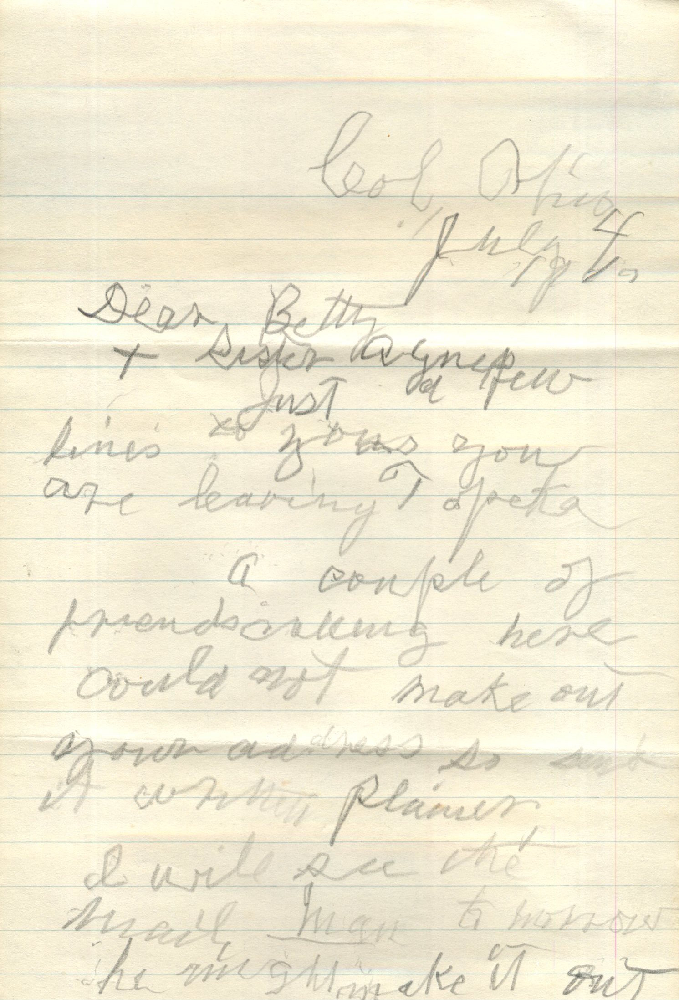
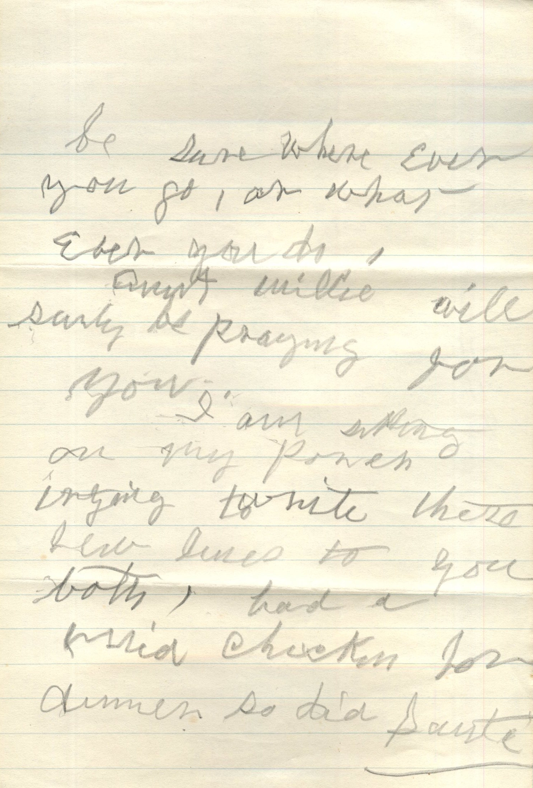
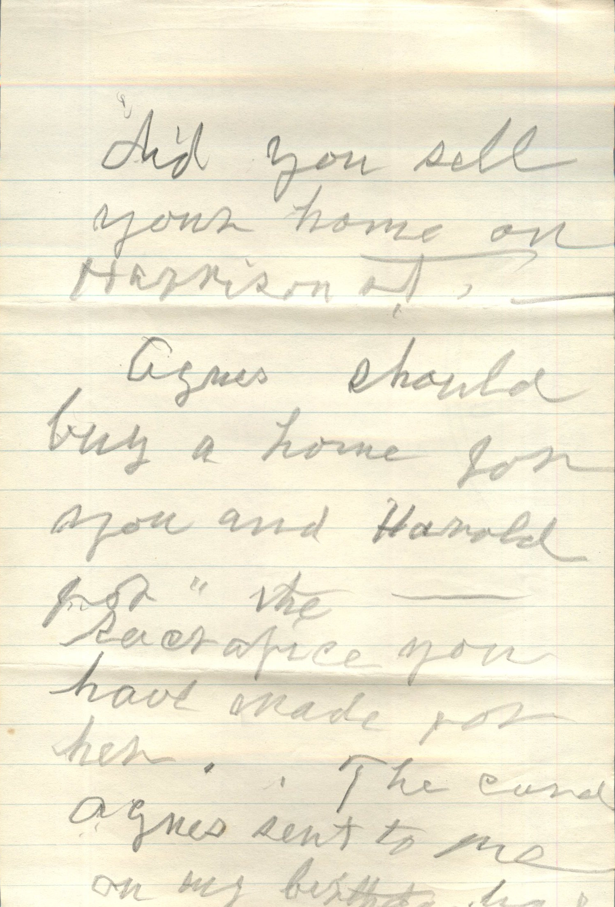
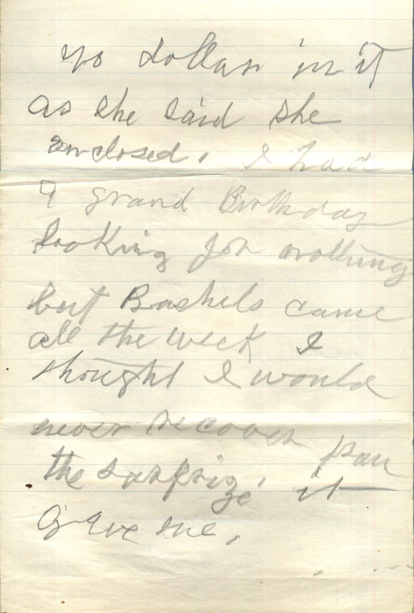
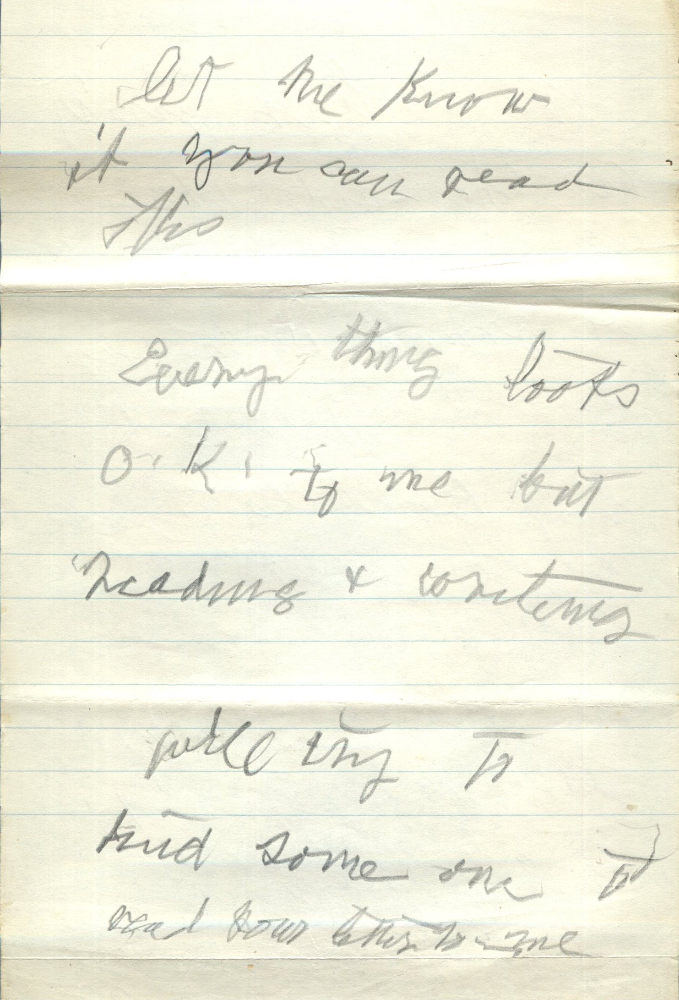
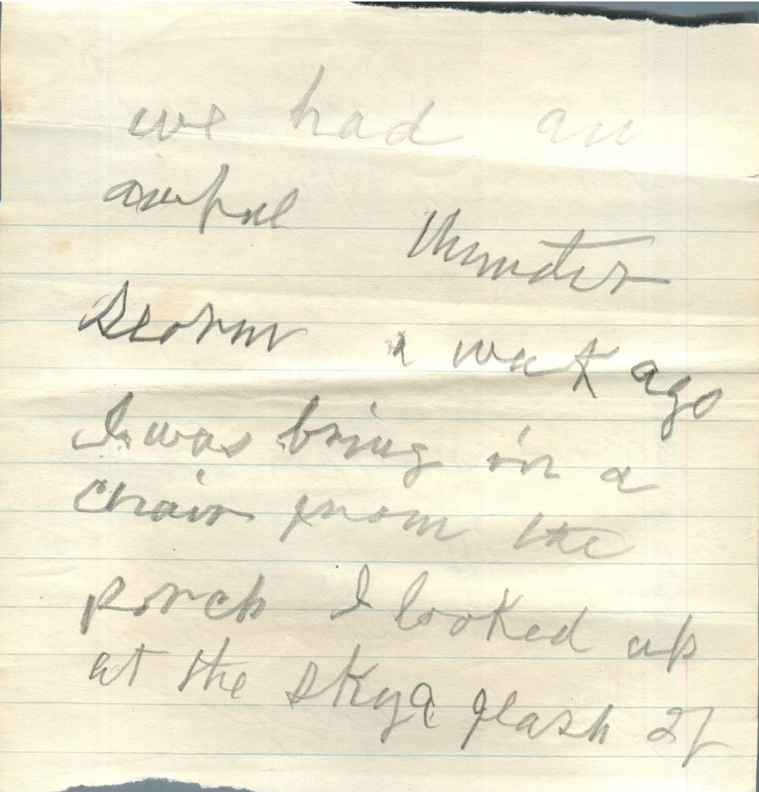
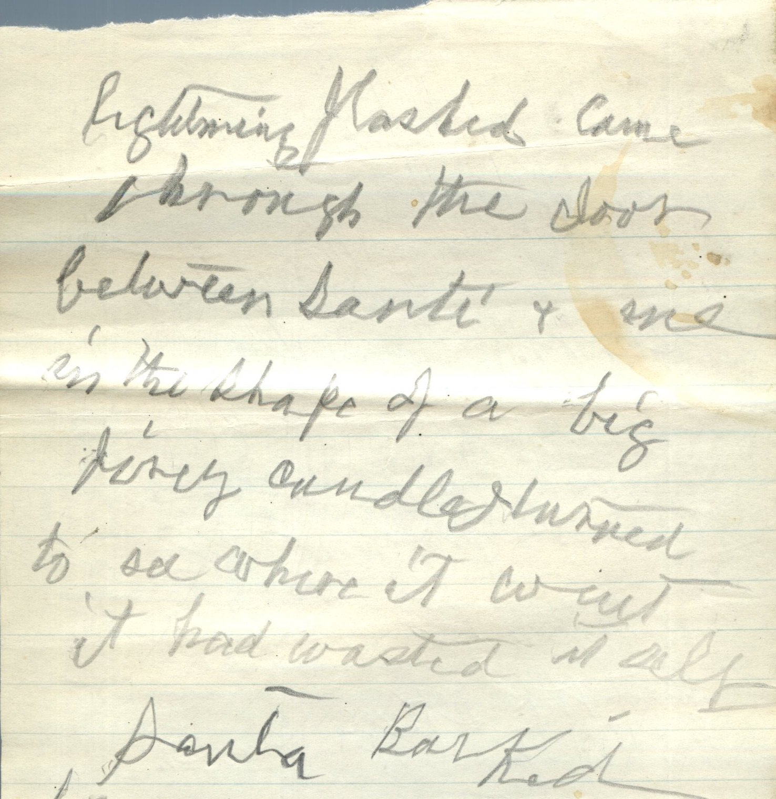
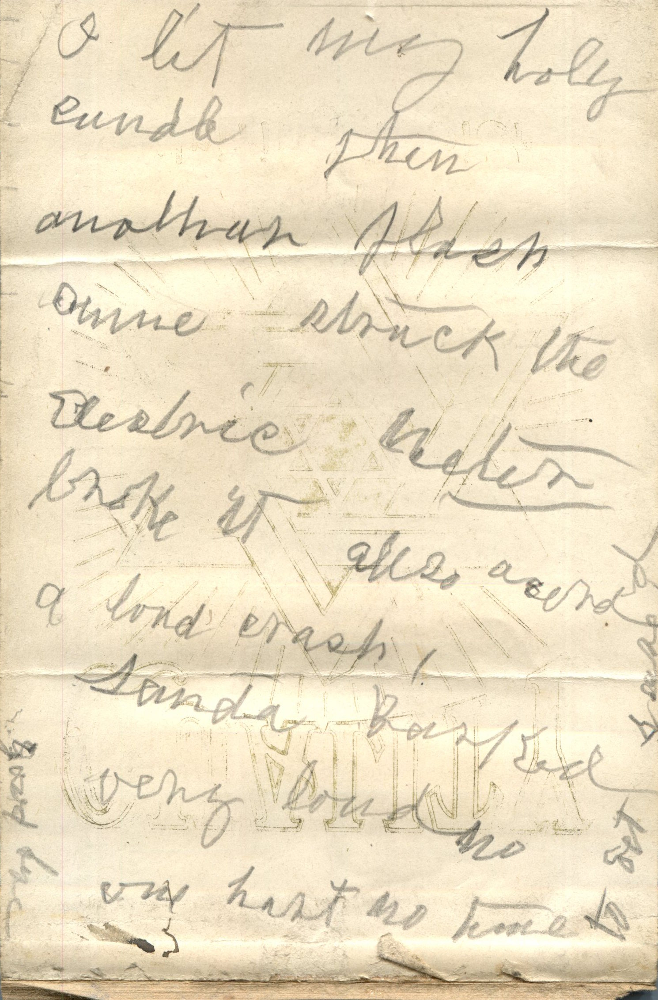

        

From: Amelia J. Wiggins, To: Betty  
Mailed From: Columbus, Ohio on July 4, 1941

Col, Ohio  
July 4, 1941  
Dear Betty and Sister Agnes,  
Just a line to you since you are leaving Topeka.  
A couple of friends calling here. Could not make out gown and dress so sent it written plainer. I will see the mail man tomorrow. He might make it out. Be sure where ever you go, or whatever you do, Aunt Millie will surely be praying for you.  
I am sitting on my porch trying to write these few lines to you both. Had a mild chicken for dinner so did sauté.  
Did you sell your home on Harrison St.  
Agnes should buy a home from you and Harold for the reasonable price you have made for her.  
The card Agnes sent to me on my birthday had no dollar in it as she said she enclosed. I had a grand birthday, looking for nothing but bushels came all the week, I thought I would never recover from the surprise it gave me.  
Let me know if you can read this.  
Everything looks OK to me but reading and writing. Will try to find someone to read your letters to me. We had an awful winter storm a week ago. I was bringing in a chair from the porch. I looked up at the sky and it was black. Water came through the door between Sandy and one in the shape of a big livey candle. I turned to see where it went. It had wasted it away.  
Sandy barked and I let her cuddle. Then another flash came and struck the electric heater. Broke it also heard a long crash.  
Sandy barked very loud. No one was home to set light.  
Write soon