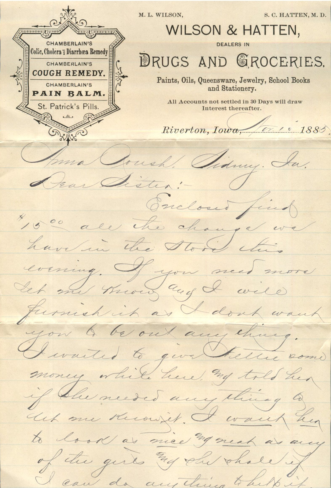
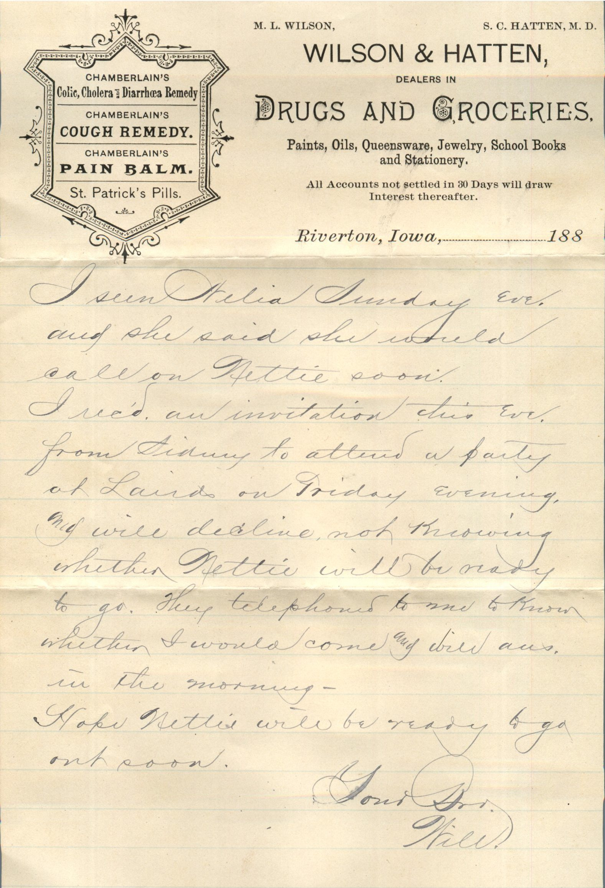
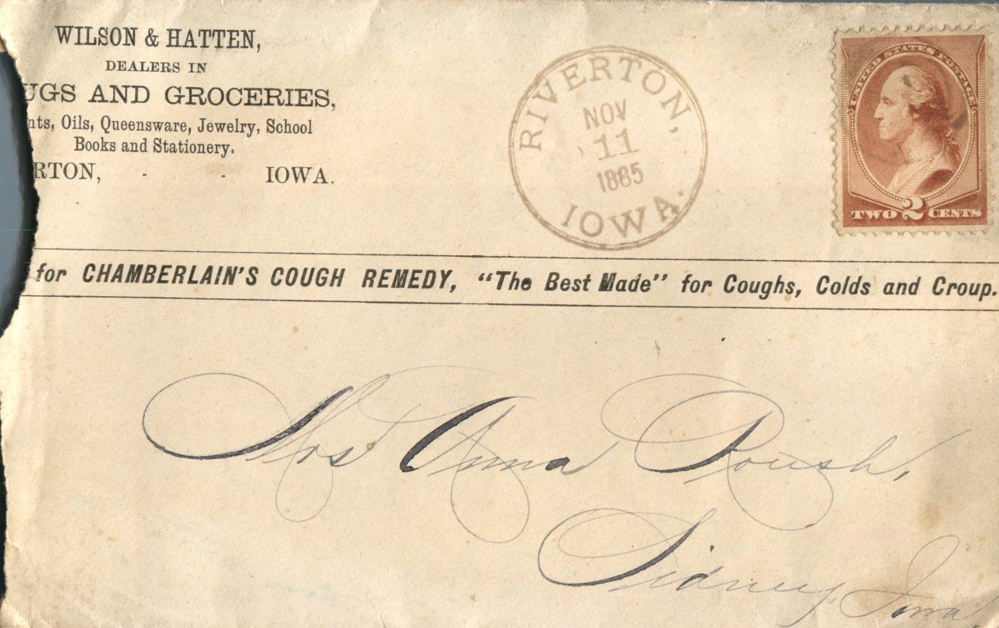

  

From: William Thomas Knox, To: Anna Roush  
Mailed From: Riverton, Iowa on April 10, 1885

Mrs. Anna Roush  
Sidney, Iowa

Riverton, Iowa, Apr. 10, 1885  
Anna Roush, Sidney, Ia.  
Dear Sister,  
Enclosed find $15.00 all the change we have in the store this evening. IF you need more let me know and I will furnish it as I don’t want you to be out anything. I wanted to give Nettie some money while here and told her if she needed anything to let me know it. I want her to look as nice and neat as any of the girls and she shall if I can do anything to help it. I seen Delia Sunday eve. and she said she would call on Nettie soon. I received an invitation this eve. from Sidney to attend a party of Laird’s on Friday evening and will decline not knowing whether Nettie will be ready to go. They telephoned to me to know whether I would come and will answer in the morning.  
Hope Nettie will be ready to go out soon.  
Your Bro,  
Will