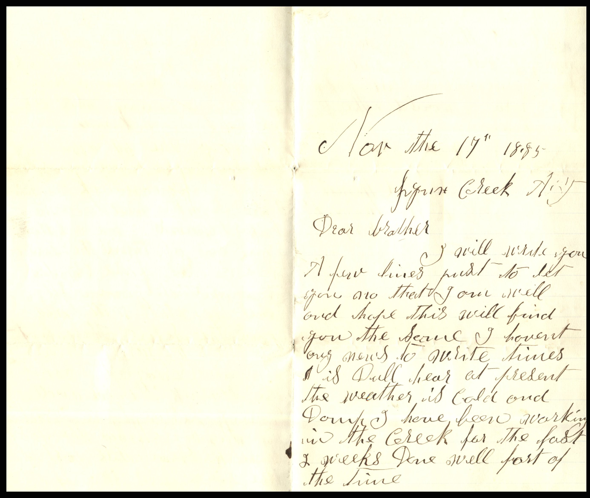
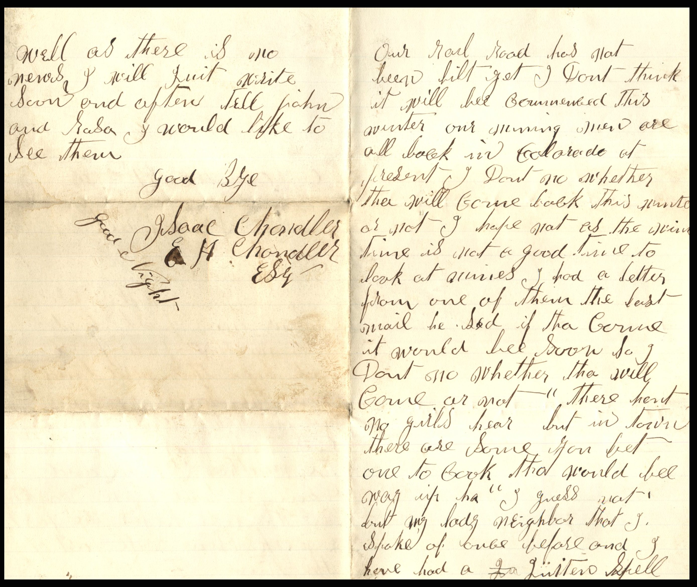

From: J. Saul and Elijah H. Chandler, To: Unknown Chandler  
Mailed On: November 17, 1885

Nov. the 17th 1885  
Dear Brother,  
I will write you a few lines past to let you no that I am well and hope this will fin you the same. I haven’t any news to write. Times is dull hear at present. The weather is cold and damp. I have been working in the Creek for the last 2 weeks. Done well part of the time. Our rail road has not been built yet. Don’t think it will be completed this winter. Our working men are all back in Colorado at present. I don’t know whether they will com back this winter or not. I hope not as the winter time is not a good time to look at armies. I had a letter from one of them the last mail. He said if they come it would be soon so I don’t no whether they will come or not. There haven’t been no girls hear but in town there are some. You bet one to cook that would be way up here. I guess not but my lady neighbor that J. spoke of once before and I have had a spell.  
Well as there is no news I will quit. Write soon and after tell john and Sasha I would like to see them.  
Goodbye  
J. Saul Chandler  
E. H. Chandler