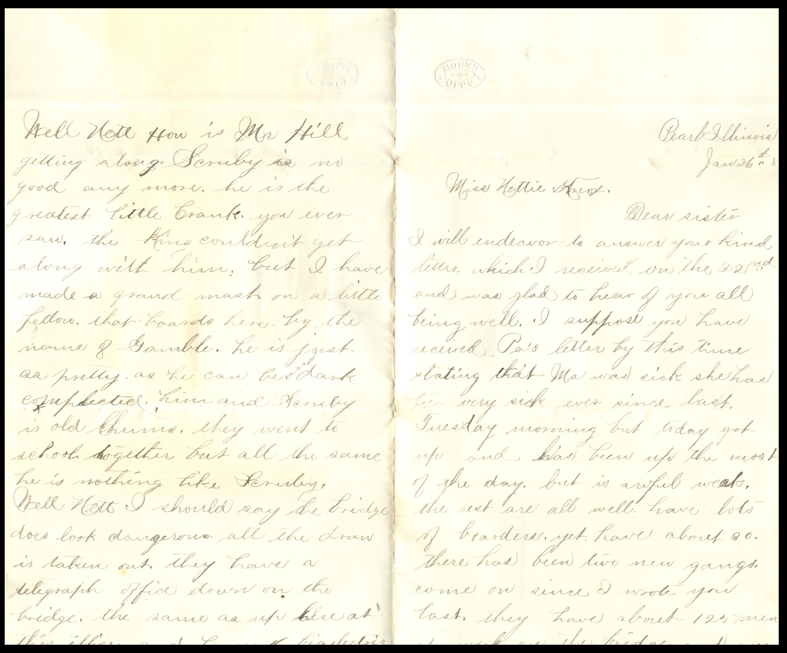
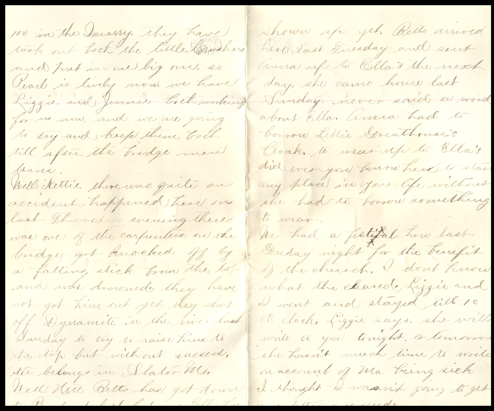
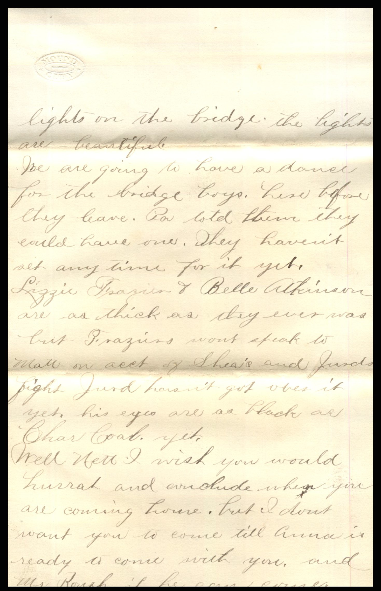
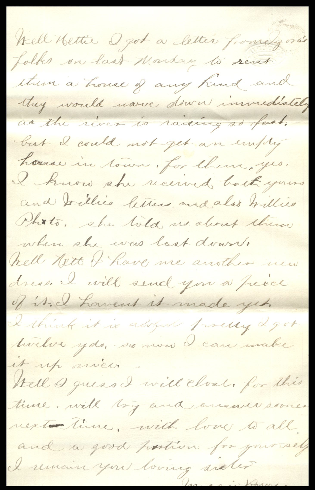
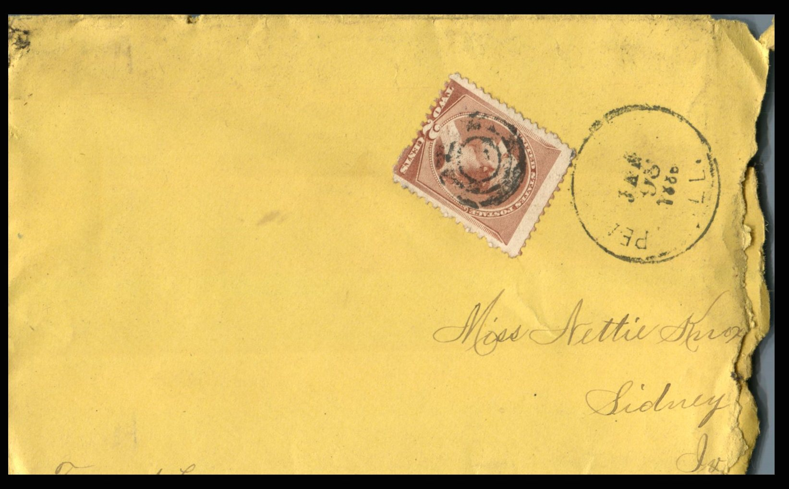
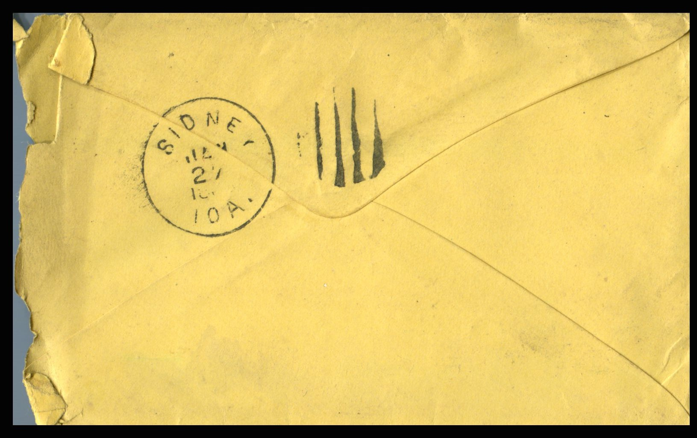

    From: Ruth, To: Jeanette Knox Chandler  
Mailed From: Pearl, Illinois on January 26, 1886

Miss Nettie Knox  
Sidney, Ia.  
Freemont Co

Pearl, Illinois  
Jan 26th ’86  
Miss Nettie Knox,  
Dear Sister, I will endeavor to answer your kind letter which I received on the 22nd and was glad to hear of you all being well. I suppose you have received Pa’s letter by this time stating that Ma was sick. She has been very sick ever since last Tuesday morning but today got up and has been up the most of the day but is awful weak. The rest are all well. Have lots of boarders yet. Have about 30. There has been five new gangs come on since I wrote you last. They have about 125 men at work on the bridge and over 100 in the Quarry. They have took out both the little washers and put in one big one. So Pearl is lively now. We have Lizzie and Jennie both wiring for us now and we are going to try and keep them both till after the bridge men leaves.  
Well Nettie there was quite an accident happened here on last Thursday evening. There was one of the carpenters on the drive for knocked off by a falling stick from the top and was drowned. They have not got him yet . They shot off Dynamite in the river last Sunday to try to raise him to the top but without success. He belongs in Slator Mo.  
Well Nett, Betts has got down to Pearl at last but no Ella has shown up yet. Betts arrived here last Tuesday and sent Anna up to Ella’s the next day. She came here last Sunday. Never said a word about Ella. Anna had to borrow Lettie Greathouse’s cloak to wear up to Ella’s. Did ever you know her to start any place in your life which she had to borrow something to wear?  
We had a festival here last Friday night for the benefit of the church. I don’t know what they cleared. Lizzie and I went down and stayed till 10 o’clock. Lizzie says she will write to you tonight or tomorrow. She hasn’t much time to write on account of Ma being sick. I thought I wasn’t going to get your letter answered.  
Well Nett, how is Mr. Hill getting along. Scruby is good any more. He is the greatest little crank you ever saw. The King couldn’t get along with him but I have made a grand match on a little fellow that boards here but the name of Gamble. He is just as pretty as he can be and dark completed. Him and Scruby is old chums. They went to school together but all the same he is nothing like Scruby.  
Well Nett, I should say the bridge does look dangerous. All the draw is taken out. They have a telegraph office down on the bridge same as up her at this office and have 4 big electric lights on the bridge. The lights are beautiful.  
We are going to have a dance for the bridge boys here before they leave. Pa told them they could have one. They haven’t set any time for it yet. Lizzie Tisazuin and Belle Atkins are as thick as they ever was but Tisazuin’s won’t speak to Matt on account of Shea’s and Jurd’s fight. Jurd hasn’t got over it yet, his eyes are was black as Char Coal yet.  
Well Nett, I wish you would hurry and include when you are coming home. But i don’t want you to come till Anna is ready to come with you and Mr. Roush if he can come.  
Well Nettie I got a letter from Izora’s folks on last Monday to rent them a house of any kind and they would move down immediately as the river is rising so fast. But I could not et an empty house in town for them. Yes, I know she received both yours and Wille’s letters and also Willie’s photo. She told us about them when she was last down.  
Well Nett I have me another new dress. I will send you a piece of it. I haven’t had it made yet. I think it is awful pretty. I got twelve yards so now I can make it up nice.  
Well I guess I will close for this time. Will try and answer some next time. With love to all and a good portion for yourself.  
I remain your loving sister,  
Ruth