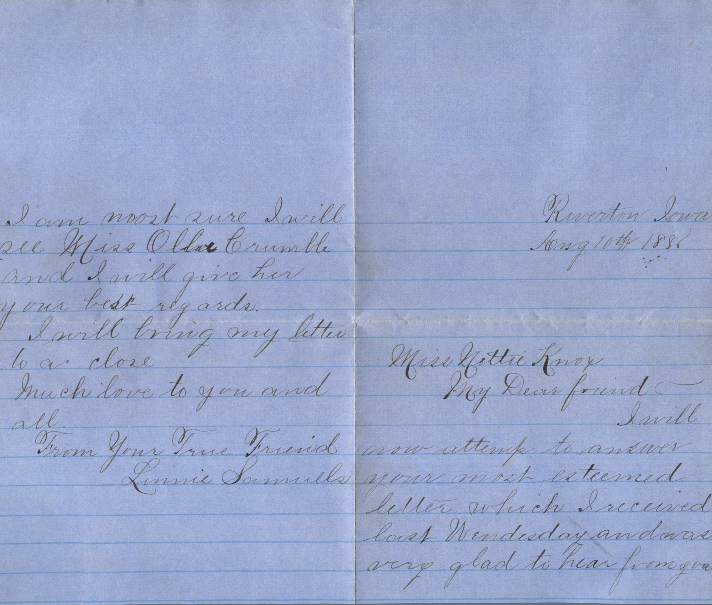
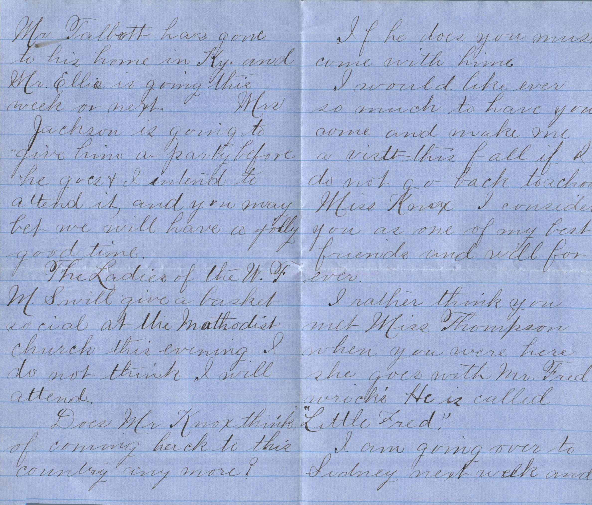
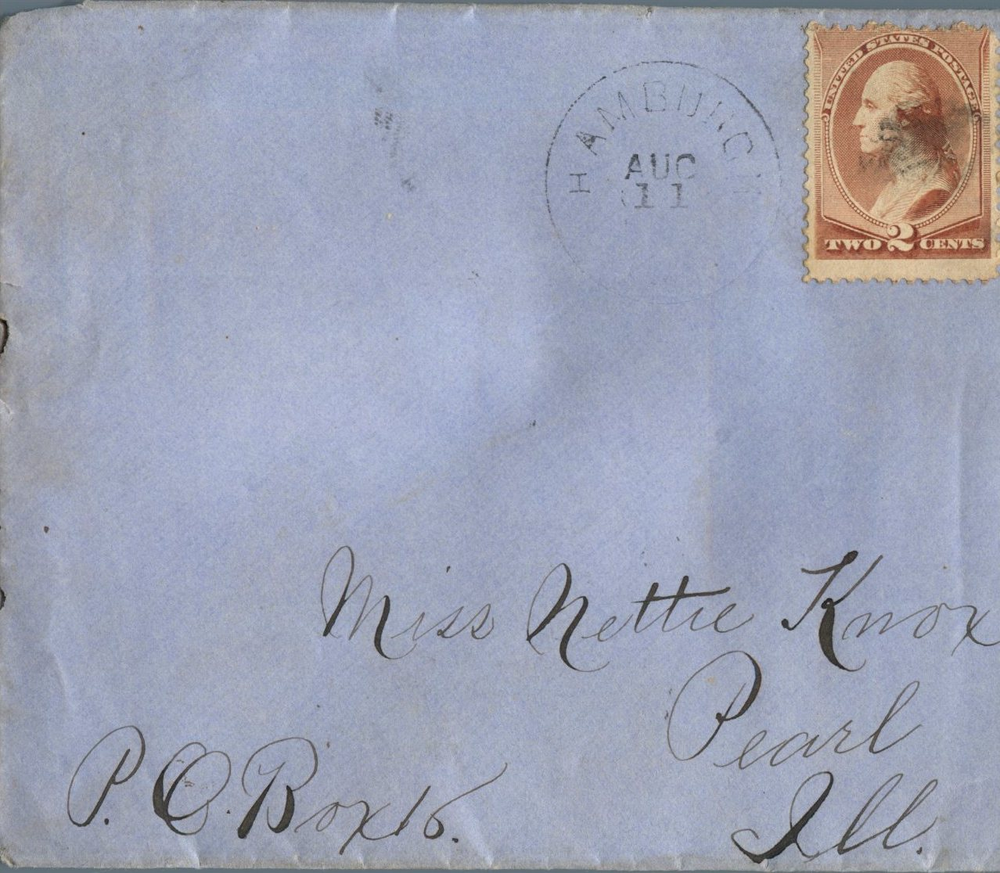
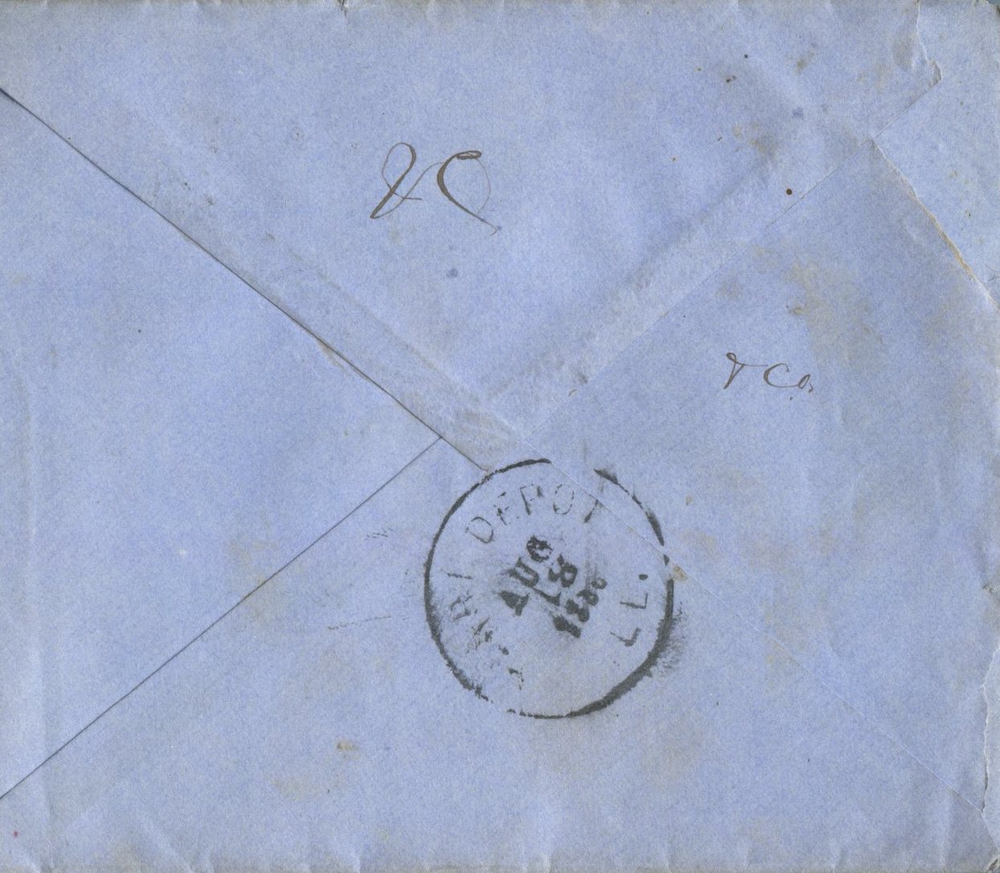

   

From: Linnie Samuels, To: Jeanette Knox Chandler  
Mailed From: Riverton, Iowa on August 10, 1886

Miss Nettie Knox  
Pearl, Ill.  
PO Box 10

Riverton, Iowa  
August 10th, 1886  
Miss Nettie Knox  
My Dear Friend –  
I will now attempt to answer your most esteemed letter which I received last Wednesday and was very glad to year form you. Mr. Talbot has gone to his home in Ky. and Mr. Ellis is going this week or next.  
Mrs. Jackson is going yo give him a party before he goes and I intend to attend it, and you may bet we will have a jolly good time.  
The Ladies of the W. F. M. S will give a basket social at the Methodist church this evening. I do not think I will attend.  
Does Mr. Knox think of coming back to this country any more?  
If he does you must come with him.  
I would like ever so much to have you come and make me a visit this fall if I do not go back to school. Miss Knox I consider you as one of my best friends and will for ever.  
I rather think you met Miss Thompson when you were here. She goes with mr. Fred Wricks. He is called “Little Fred.”  
I am going over to Sidney next week and I am most sure I will see Miss Olive Crumble and I will give her your best regards.  
I will bring my letter to a close.  
Much love to you and all  
From your true friend,  
Linnie Samuels