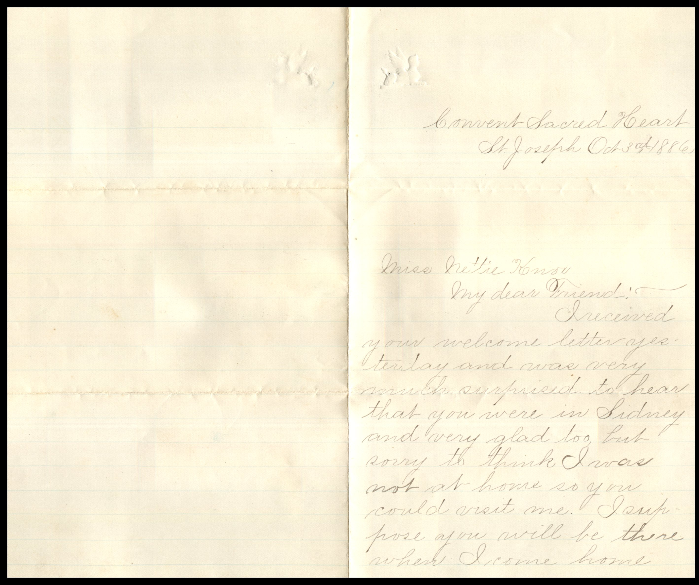
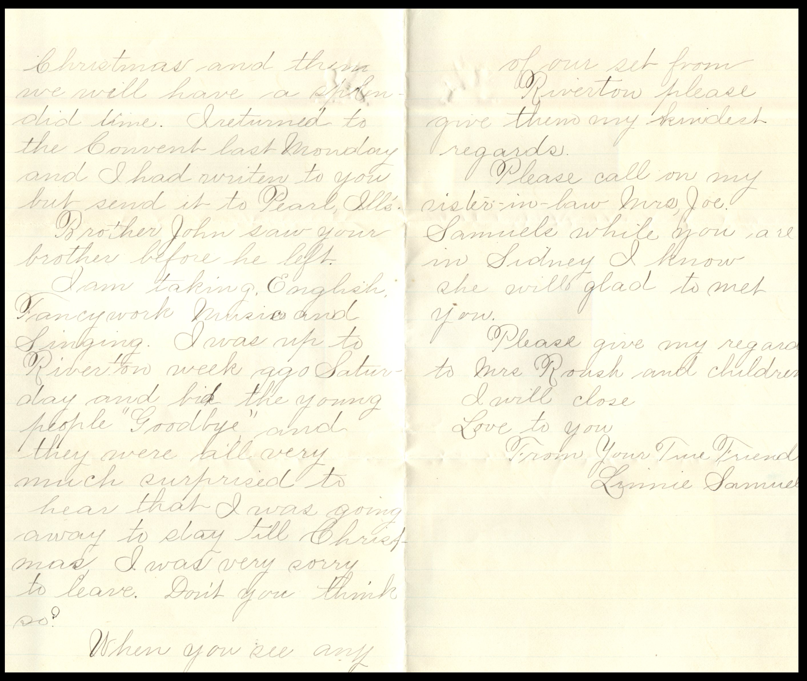
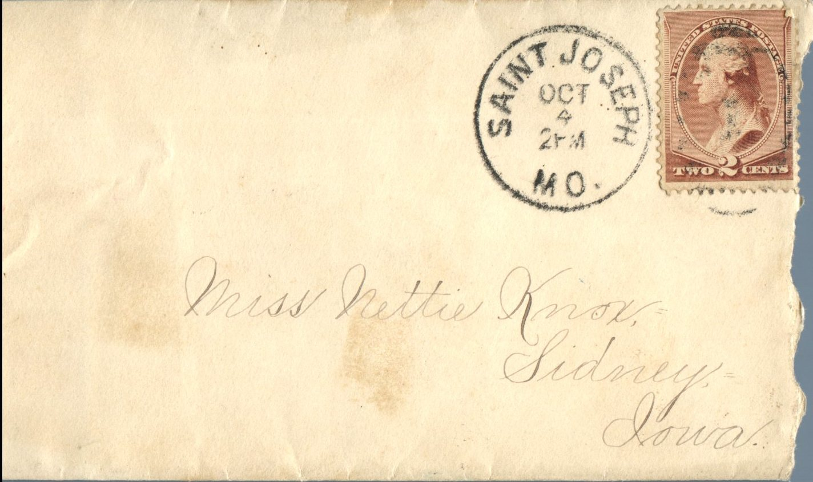
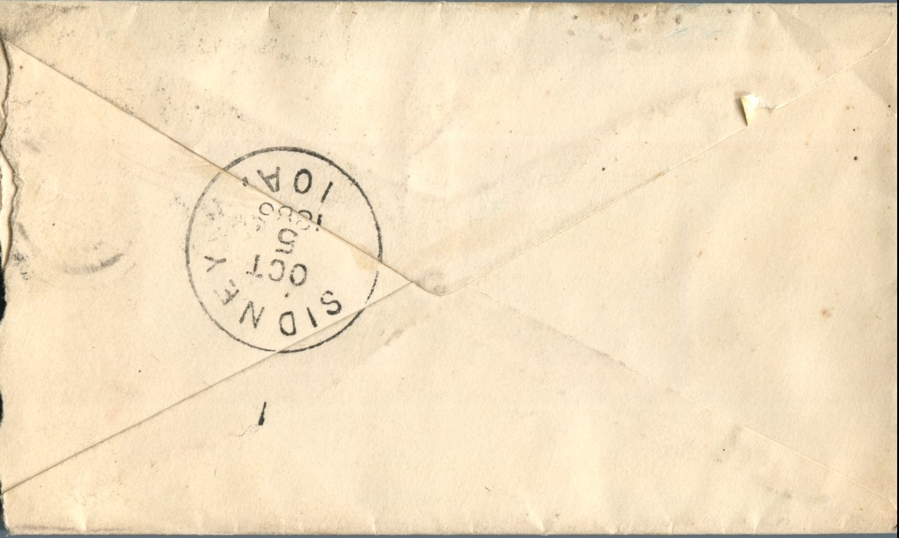

 

From: Linnie Samuels, To: Jeanette Knox Chandler  
Mailed From: Saint Joseph, MO. on October 4, 1886

Miss Nettie Knox  
Sidney, Iowa

Convent Sacred Heart  
St. Joseph October 3rd, 1886  
Miss Nettie Knox  
My dear Friend,  
I received your welcome letter yesterday and was very much surprised to hear that you were in Sidney and very glad too, but sorry to think I was not at home so you could visit me. I supposed you will be there when I come home Christmas and then we will have a splendid time. I returned to the Convent last Monday and I had written to you but sent it to Pearl, Illinois.  
Brother John saw your brother before he left.  
I am taking English, Fancy work, Music, and Singing. I was up to River on a week ago Saturday and bid the young people “Goodbye” and they were all very much surprised to hear that I was going away to stay till Christmas. I was very sorry to leave. Don’t you think so?  
When you see any of our set from Riverton please give them my kindest regards.  
Please call on my sister-in-law Mrs. Joe Samuels while you are in Sidney. I know she will be glad to meet you.  
Please give my regards to Mrs. Roush and children. I will close.  
Love to you.  
From Your True Friend,  
Linnie Samuels