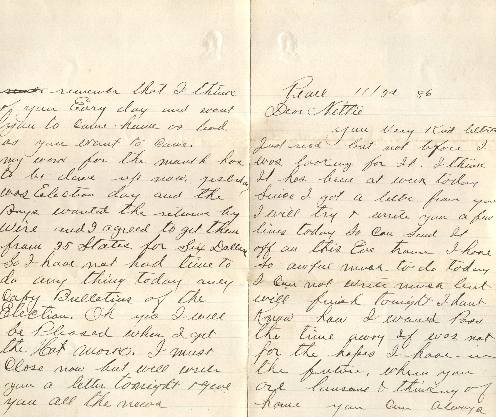
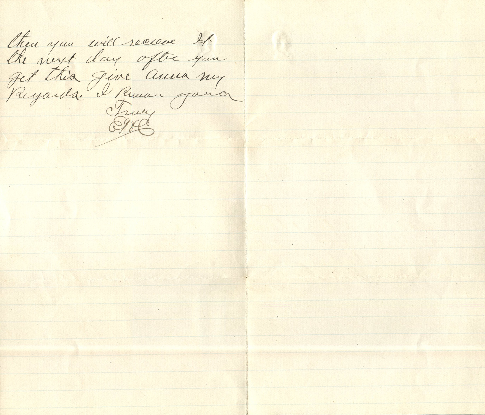
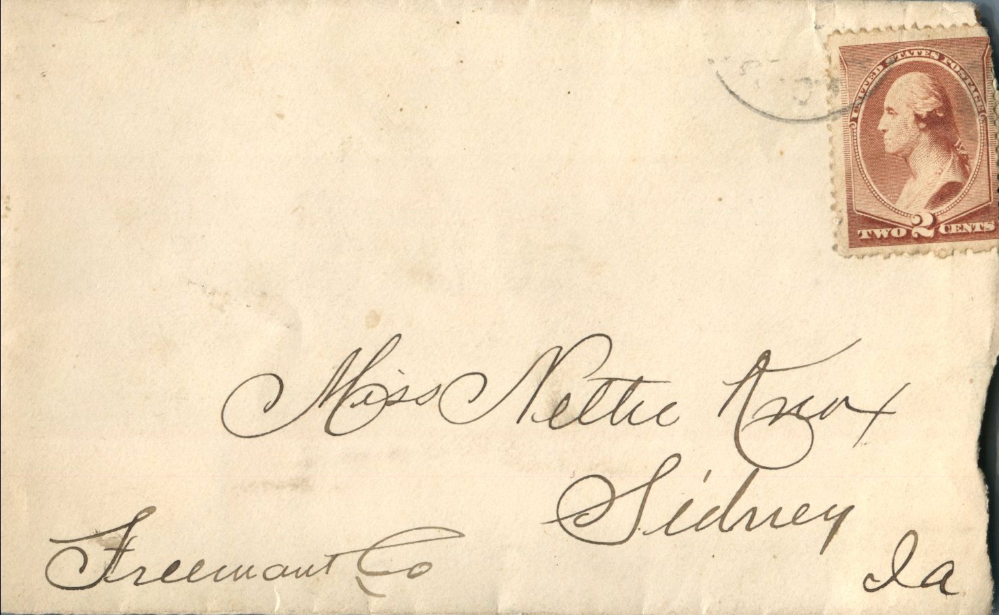

  

From: Elijah H. Chandler, To: Jeanette Knox Chandler  
Mailed From: Pearl, Illinois on November 3, 1886

Miss Nettie Knox  
Sidney, Ia  
Freemont Co

Pearl Ill 3rd ’86  
Dear Nettie,  
Your very kind letter just received but not before I was looking for it. I think it has been a week today since I got a letter from you. I will try to write you a few lines today so can send it off on this eve train. I have so awful much to do today I can not write much but will finish tonight. I don’t know how I would pass the time away if was not for the hopes I have in the future. When you are lonesome and thinking of home you can always remember that I think of you every day and want you to come home as bad as you want to come.  
My work for the month has to be done up now. Yesterday was Election day and the boys wanted the return by wire and I agreed to get them from 35 states for six dollars. So I have not had time to do anything today only copy bulletins of the election. Oh yes I will be pleased when I get the hat works. I must close now but will write you a letter tonight and give you all the news. Then you will receive it the next day after you get this. Give Anna my regards. I remain yours.  
Truly,  
EHC