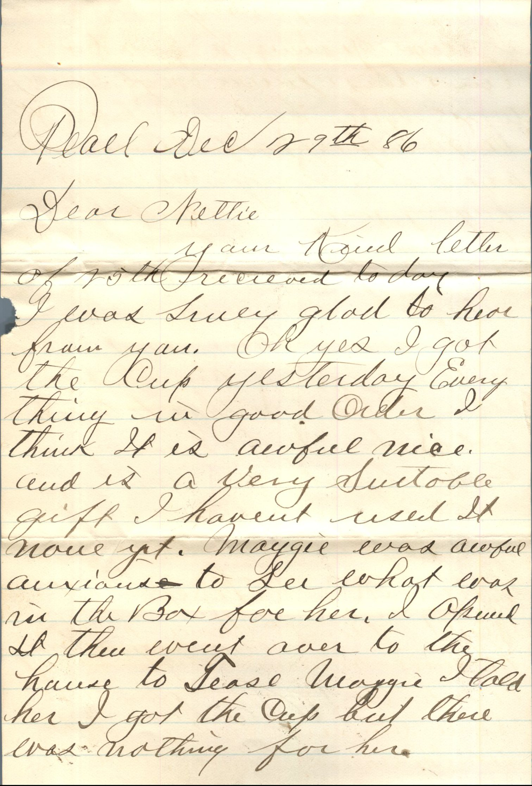
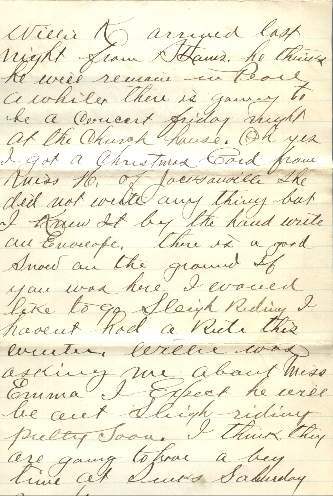
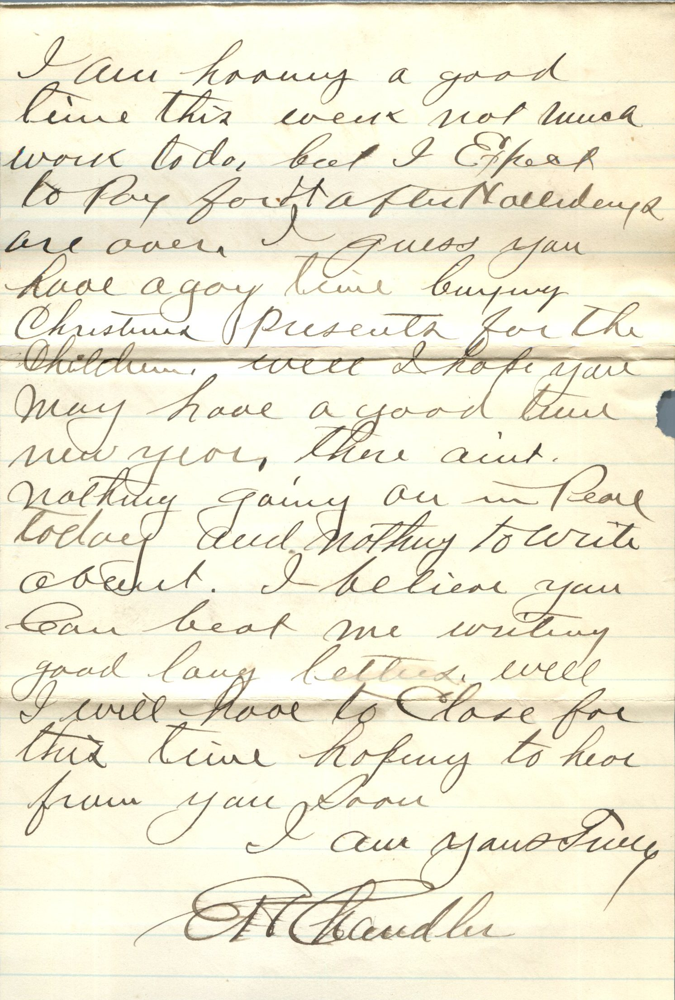
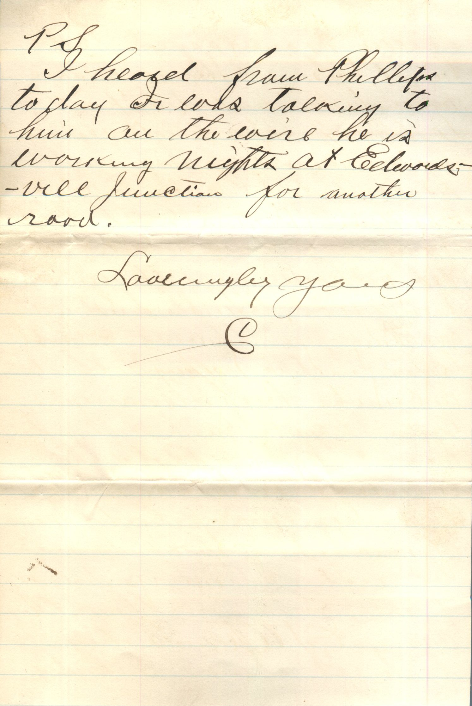
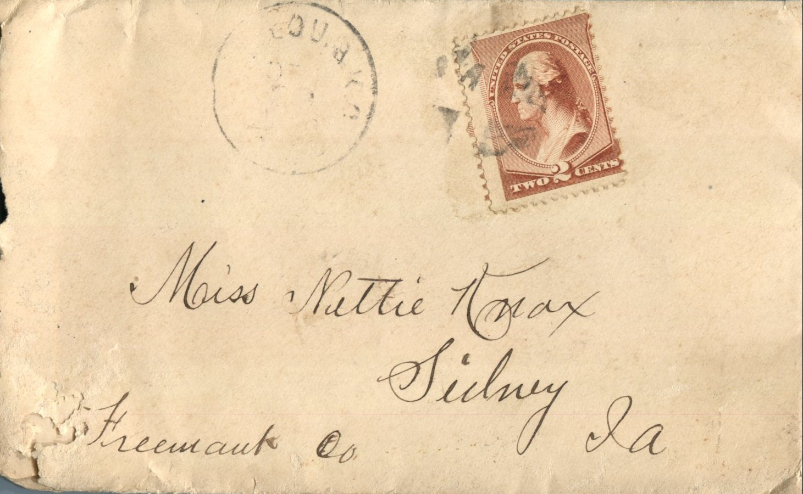
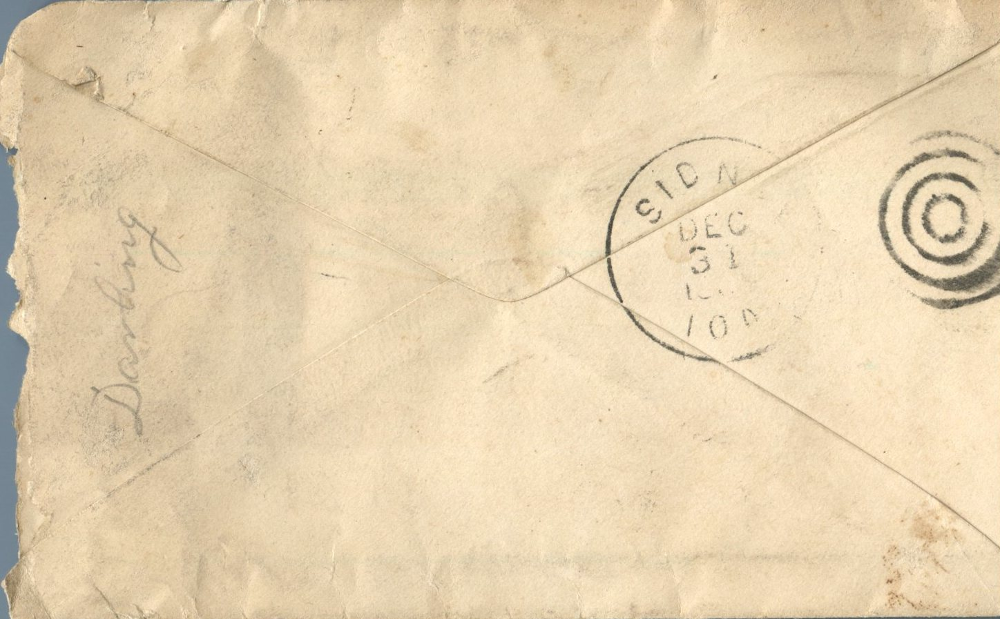

    From: Elijah H. Chandler, To: Jeanette Knox Chandler  
Mailed From: Pearl, Illinois on December 29, 1886

Miss Nettie Knox  
Sidney, Ia.  
Freemaut Co.

Pearl, Dec 29th ’86  
Dear Nettie,  
Your kind letter of 25th received today. I was surely glad to hear from you. Oh yes I got the cup yesterday. Everything in good order I think it is awfully nice and is a very suitable gift. I haven’t used it now yet. Maggie was awful anxious to see what was in the box for her. I opened it then went over to the house to tease Maggie. I told her I got the cup but there was nothing for her.  
Willie K arrived last night from St. Louis. He thinks he will remain in Pearl awhile. There is king to be a concert Friday night at the church house. Oh yes I got a Christmas card from Miss N. of Jacksonville but I knew it by the handwrite on envelope. There is a good snow on the ground. If you were here I would like to go sleigh riding. I haven’t had a ride this winter. Willie was asking me about Miss Emma. I expect he will be out sleigh riding pretty soon. I think they are going to have a big time at Duke’s Saturday night.  
I am having a good time this week not much work to do, but I expect to pay for it after the holidays are over. I guess you have a good time buying Christmas presents for the children. We’ll I hope you may have a good time new year, there aint nothing going on in Pearl today and nothing to write about. I believe you can beat me writing good long letters. Well I will have to close for this time. Hoping to hear from you soon.  
I am your truly,  
E.H. Chandler  
P.S. I heard from Phillips today. Jr was talking to him on the well. He is working nights at Edwardsville junction for another road.  
Lovingly Yours,  
E.