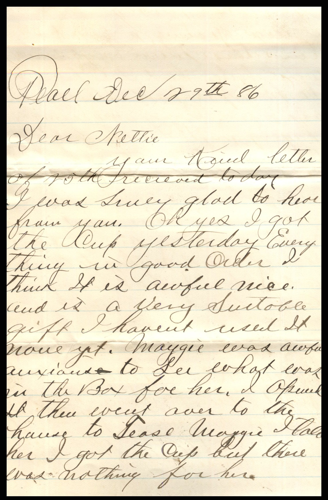
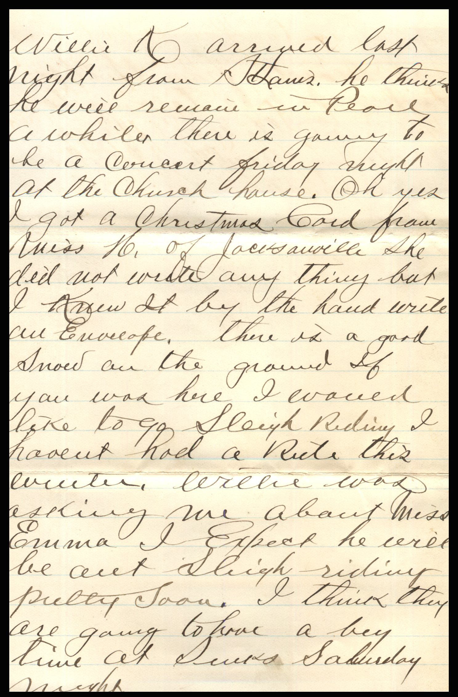
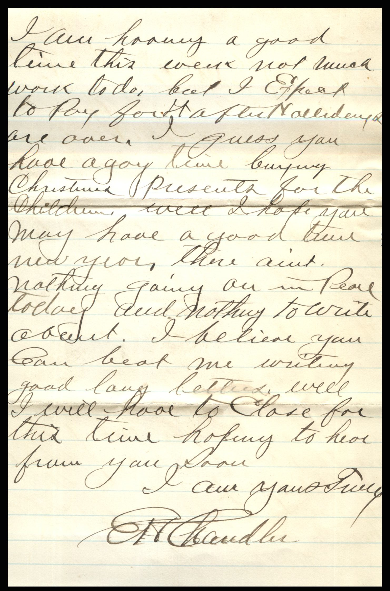
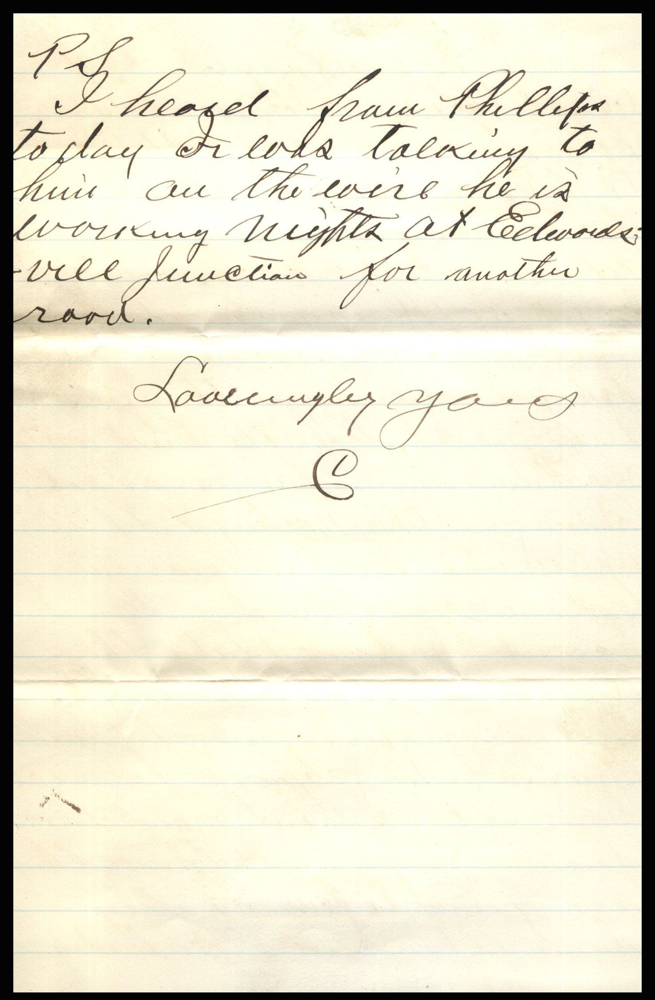

From: Elijah H. Chandler, To: Jeanette Knox Chandler

Miss Nettie Knox  
Sidney, Ia  
Freenaut Co.

Pearl, December 29th, ’86  
Dear Nettie,  
Your ind letter of 20th received today. I was sure glad to hear from you. Oh yes I got the cup yesterday. Everything in good order. I think it is awful nice and is a very suitable gift. I haven’t used it now yet. Maggie was awful anxious to see what was in the box for her. I opened it there, went over to the house to tease Maggie. I told her I got the cup but there was nothing for her. Willie K. arrived last night from St. Louis. He thinks he will remain in Pearl a while. there is going to be a concert Friday night at the church house. Oh yes, I got a Christmas card from Miss N. of Jacksonville. She did not write anything but I knew it by the hand writing on envelop.e There is a good snow on the ground. If you was here I would like to go sleigh riding. I haven’t had a ride this winter. Willie was asking me about Miss Emma. I expect he will be out sleigh riding pretty soon. I think they are going to have a good time on Saturday night. I am having a good time this week. Not much work to do, but I expect to pay for it after the holidays are over. I guess you have a good time buying Christmas presents for the children. Well, I hope you may have a good time this new year. There aint nothing going on in Pearl today and nothing to write about. I believe you can beat me writing good, long letters. Well I will have to close for this time hoping to hear from you soon.  
I am yours truly,  
E.H. Chandler

P.S. I heard from Phillipson today while talking to him in the evening he is working nights at Elevoidsville Junction for another road.  
Lovingly yours  
E.