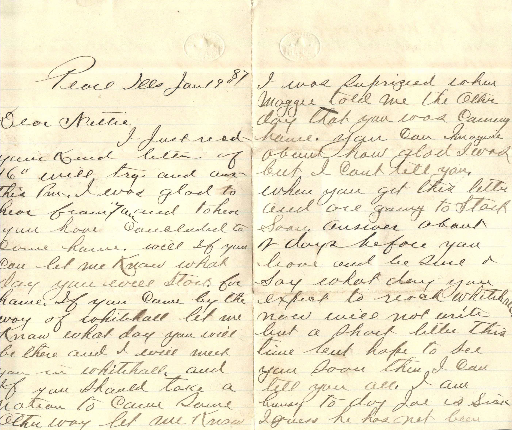
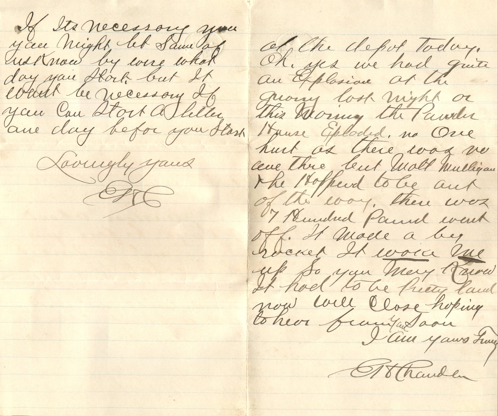
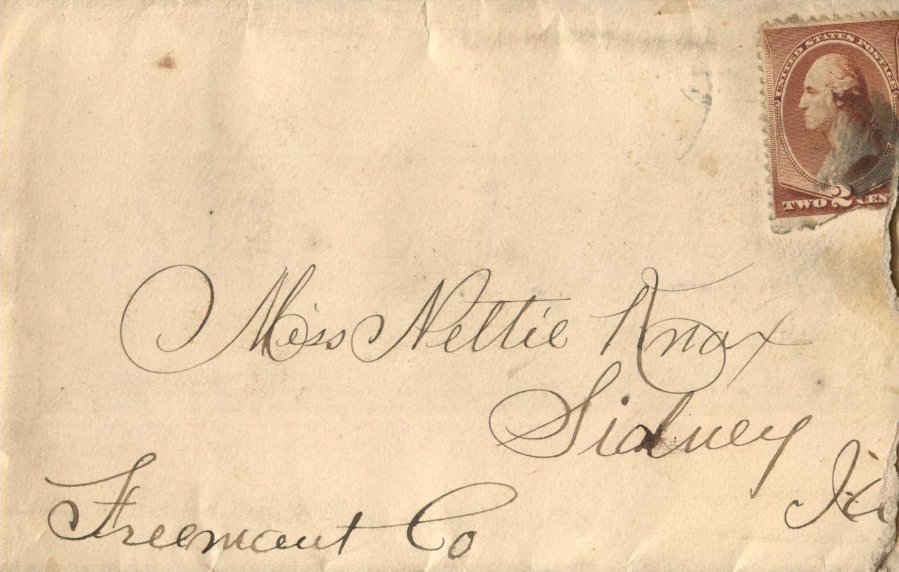

  

From: Elijah H. Chandler, To: Jeanette Knox Chandler  
Mailed From: Pearl, Illinois on January 19, 1887

Miss Nettie Knox  
Sidney, Ia  
Freemont Co

Pearl, Ill Jan 19, 1887  
Dear Nettie,  
I just received your kind letter of 16th will try and answer this pm. I was glad to hear from you and to hear you have concluded to come home. Well if you can let me know what day you will start for home. If you come by the way of White Hall let me know what day you will be there and I will meet you in Whitehall and if you should take a notion to come soon other way let me know. I was surprised when Maggie told me the other day that you was coming home. You can imagine about how glad I was but I can’t tell you. When you get this letter and are going to start soon. Answer about 2 days before you leave and be sure and say what day you expect to reach Whitehall. Now will not write but a short letter this time but hope to see you soon then I can tell you all. I am busy today. Mae is sick. I guess he has not been at the depot today. Oh, yes we had quite an explosion at the quarry last night or this morning, the powder house exploded. No one hurt as there was no one there but Matt Mulligan and he happened to be out of the way. There was 7 hundred pound went off. It made a big rocket. It woke me up. So you may know it had to be pretty loud. Now will close hoping to hear from you soon.  
I am yours truly,  
E.H. Chandler

If it’s necessary you might let some of us know by where what day you start. But it wont be necessary if you can start a letter one day before you start.  
Lovingly yours,  
E.H.C.