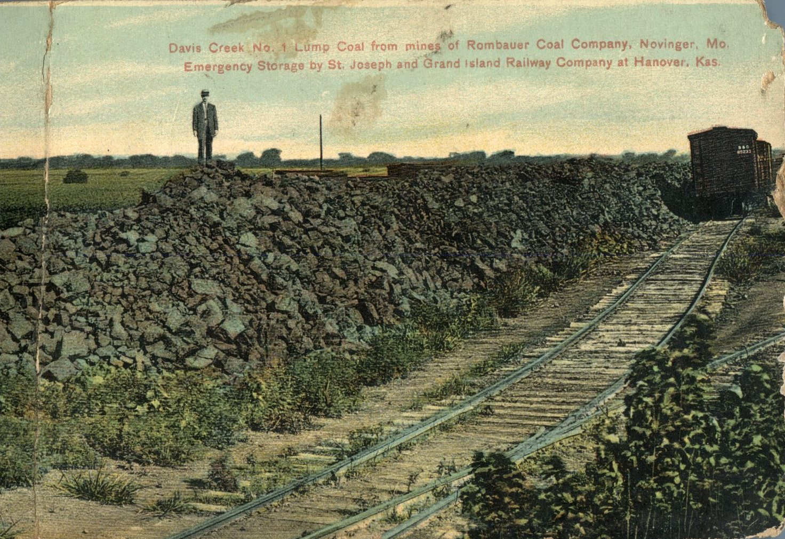
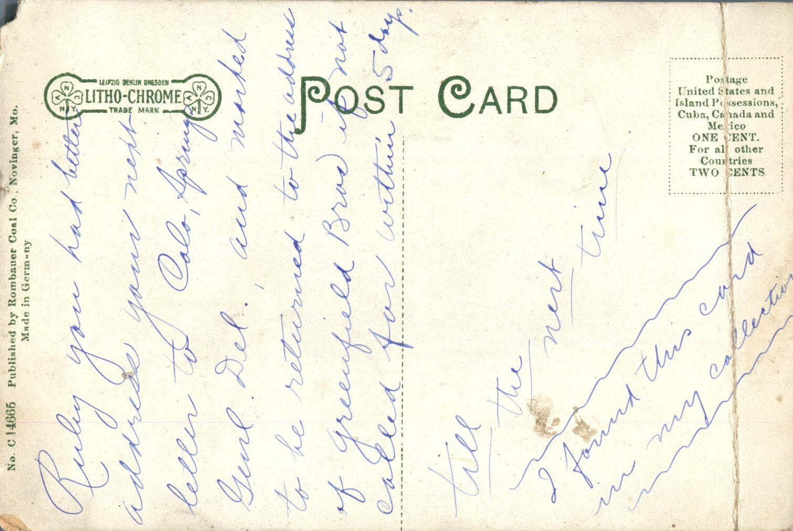

 From: Unknown, To: Ruby Chandler  
Postcard Info: No. C 14665 Published by Rombauer Coal Co., Novinger, Mo. Made in Germany  
Picture Info: Davis Creek., No. 1 Lump Coal from mines of Rombauer Coal Company, Novinger, Mo. Emergency Storage at St. Joseph and Grand Island Railways Company at Hanover, Kas.

Ruby you had better address your next letter to Colo Springs Genl. Del. and marked to be returned to the address of Greensfield Bros if not called for within 5 days.  
Till the next time

I found this card in my collection.