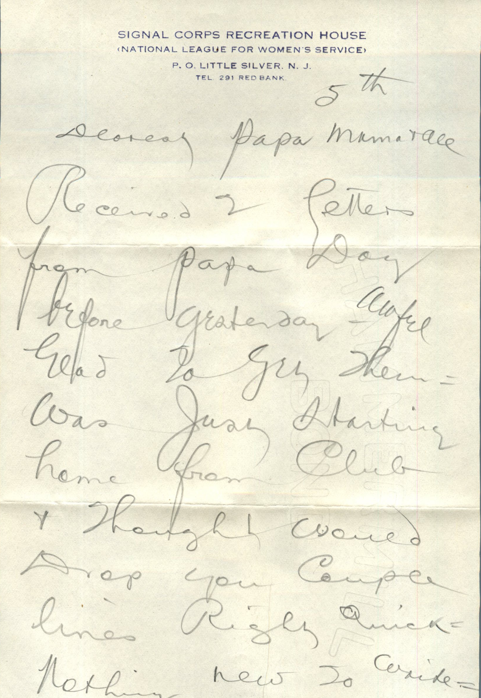
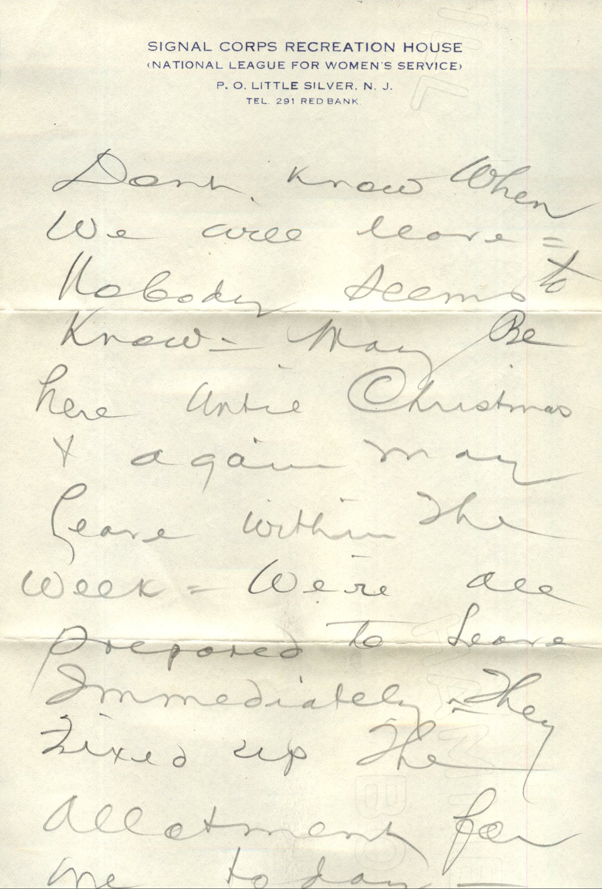
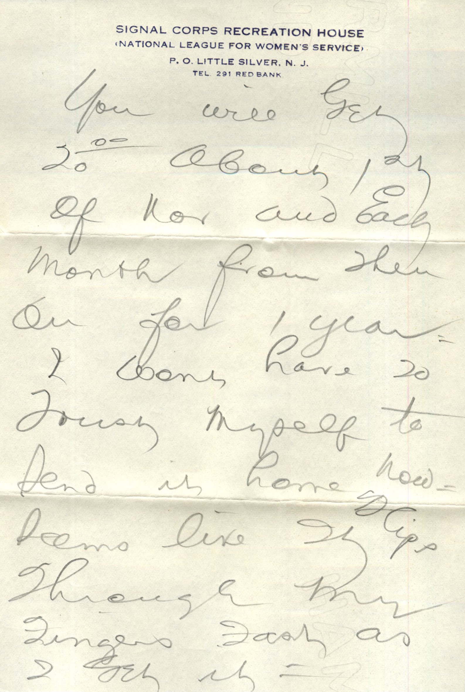
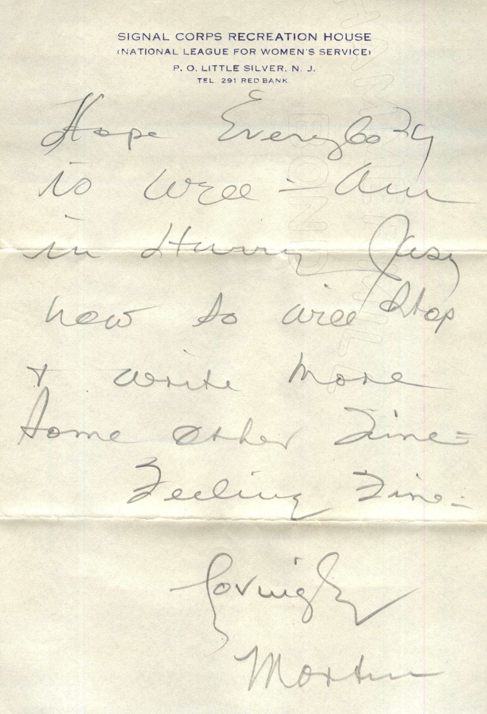
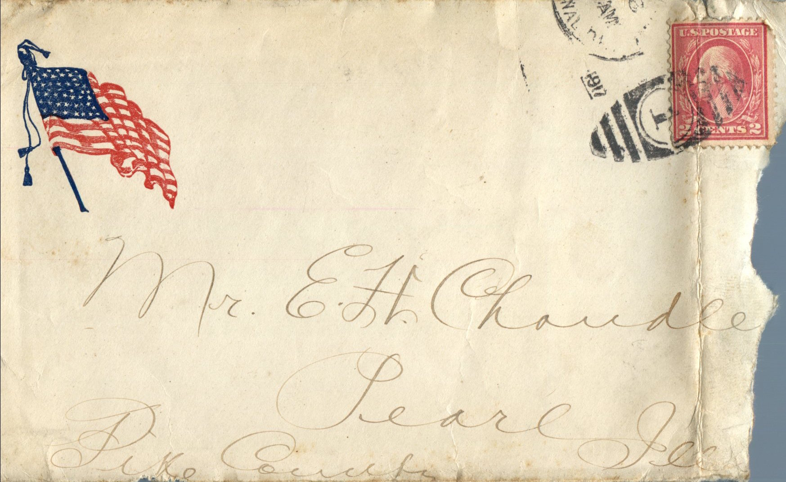
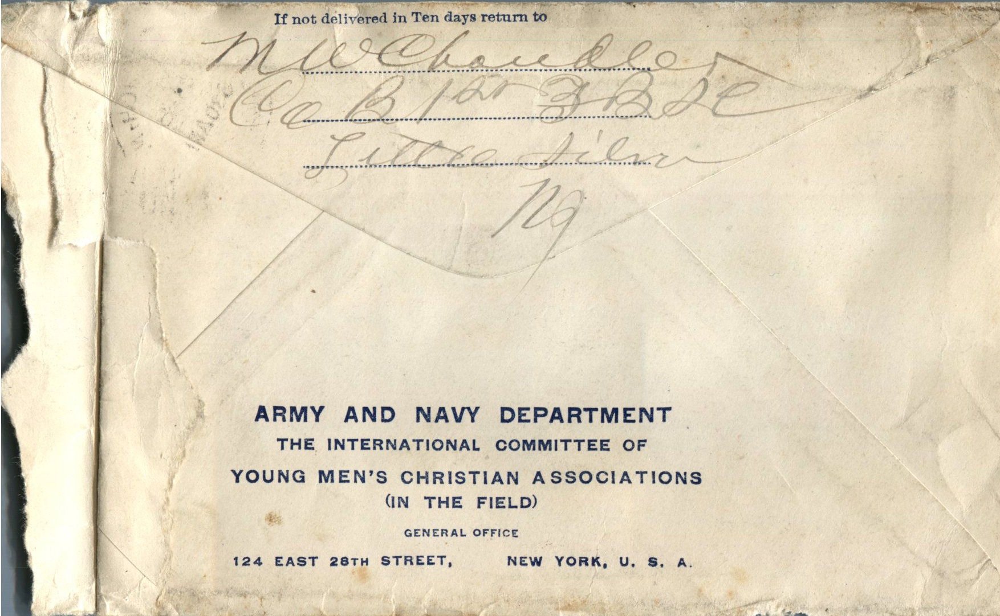

     

From: Martin Chandler, To: Elijah H. Chandler  
Mailed From: Little Silver, New Jersey

Mr. E. H. Chandler  
Pearl, Ill  
Pike Co

5th  
Dearest papa mama, and all  
Received 2 letters from papa day before yesterday. Awful glad to get them. Was just starting home from club and thought would drop you couple lines right quick. Nothing new to write. Don’t know when we will leave. Nobody seems to know. May be here until Christmas and again may leave within the week. We’re all prepared to leave immediately. They fixed up the allotment for me today.  
You will get 20.00 about 1st of Nov. and each month from then on for 1 year. I wont have 20 myself to send it home now. Seems like it slips through my fingers just as I get it. Hope everybody is well. Am in hurry just now so will stop and write more some other time.  
Feeling fine.  
Lovingly,  
Martin