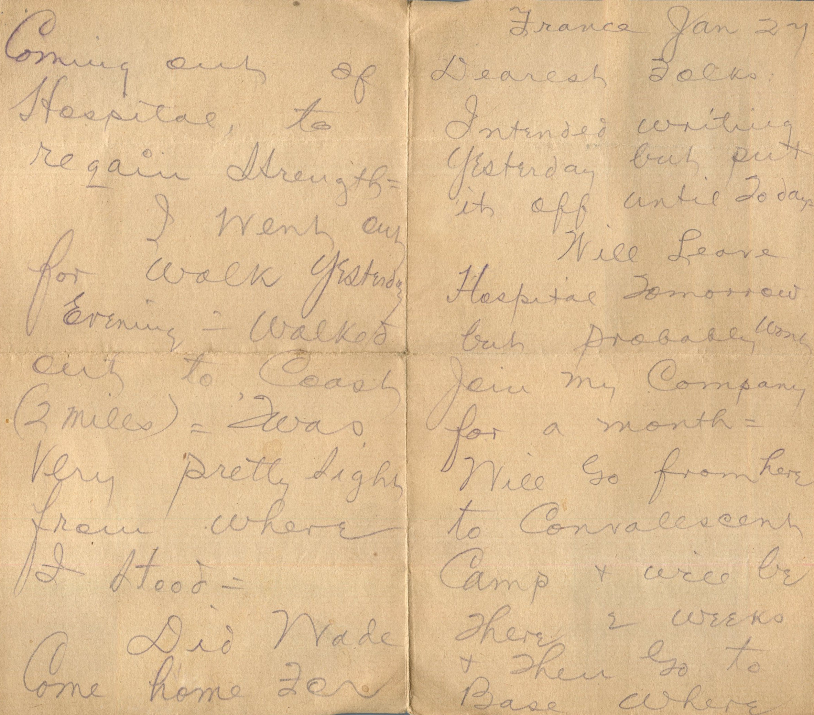
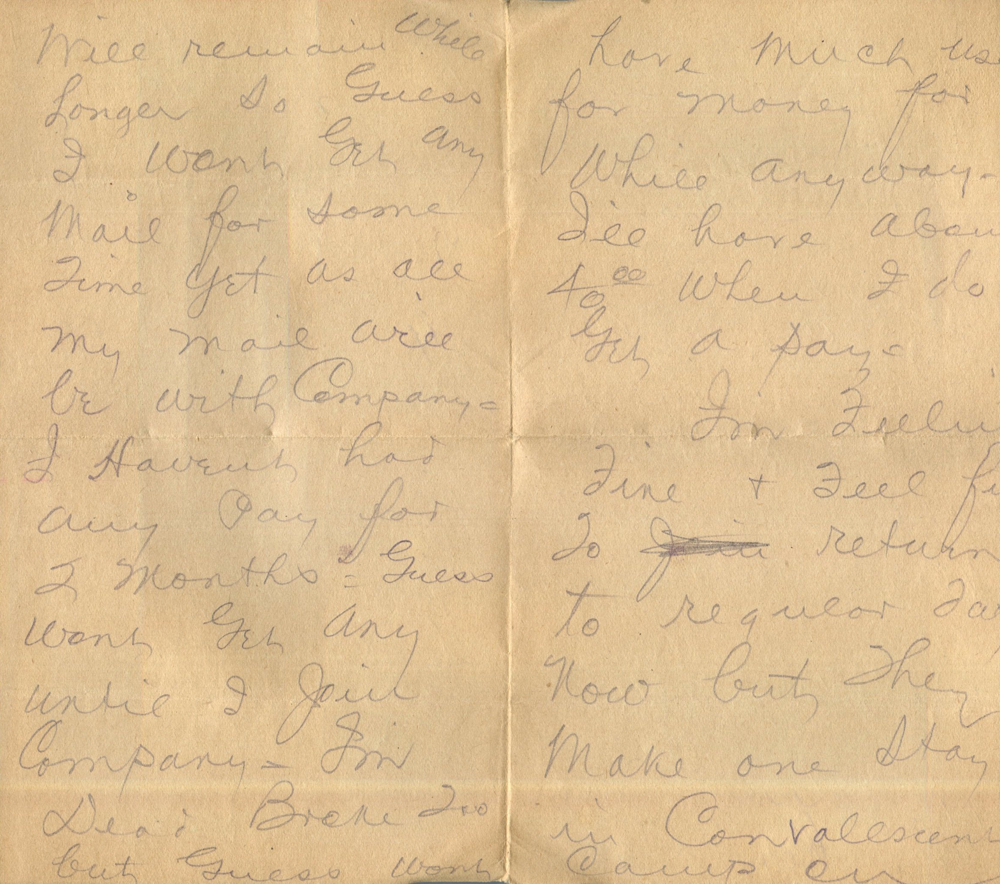
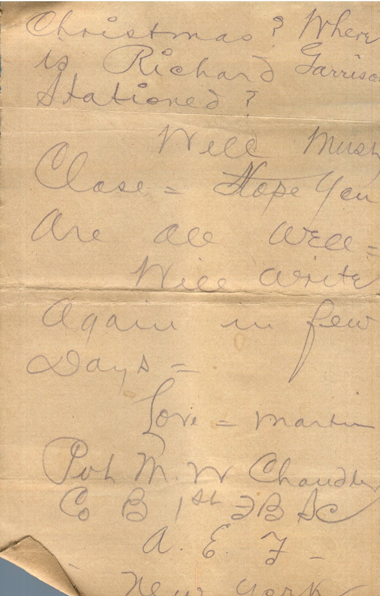

  

From: Martin Chandler, To: Elijah H. Chandler and Family  
Mailed From: France on January 27

France Jan 27  
Dearest Folks,  
Intended writing yesterday but out it off until today.  
Will leave hospital tomorrow but probably wont join my company for a month. Will go from here to convalescent camp and will be there 2 weeks and then go to base where will remain while longer so guess I wont get any mail for some time yet as all my mail will be with company. I haven’t had any pay for 2 months. Guess wont get any until I join company. I’m dead broke too but guess wont have much use for money for while anyway. I’ll have about 40.00 when