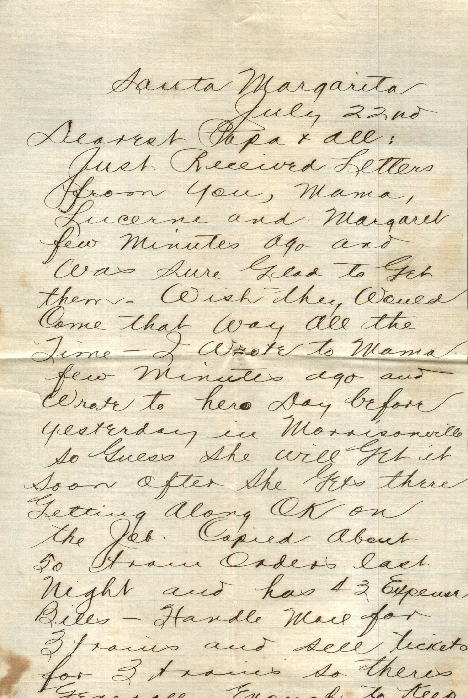
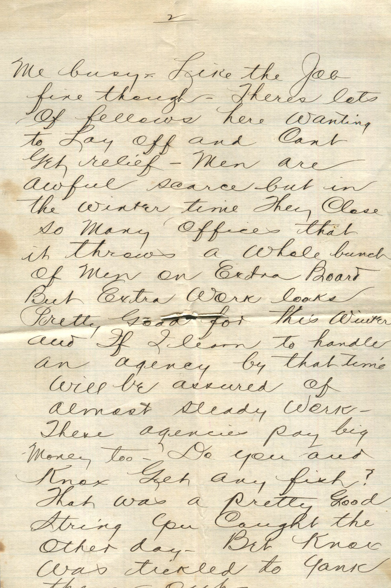
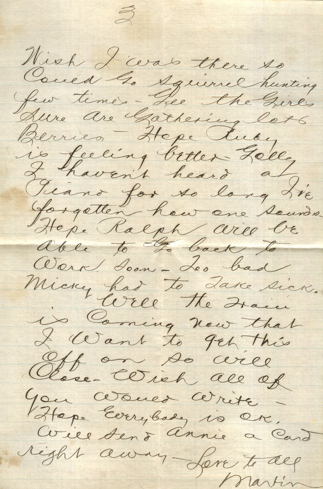

  

From: Martin Chandler, To: Elijah H. Chandler  
Mailed From: Santa Margarita, CA on July 22

Santa Margarita  
July 22nd  
Dearest Papa and All,  
Just received letters from you, mama, Lucerne and Margaret fe minutes ago and was sure glad to get the. Wish they would come that way all the time. I wrote yo Mama few minutes ago and wrote to her day before yesterday in Morrisonville so guess she will get it soon after she gets there.  
Getting along OK on the job. Coping about 50 train orders last night and had 43 Expense Bills. Handle mail or 3 trains and sell tickets for 3 trains so there’s generally enough to keep me busy. Like the job fine though. Theres lots of fellows here wanting to lay off and can’t get relief. M en are awful scarce but in the winter time they close so many offices that it throws a whole bunch of men on extra board but extra work looks pretty good for this winter and if I earn to handle an agency by that time will be assured of almost steady work. These agencies pay big money too. Do you and Knox get any fish? That was a pretty good string you caught the other day. Bet Knox was tickled to yank them out.  
Wish I was there so could go squirrel hunting few times. Gee the girls sure are bathing lots berries. Hope Ruby is feeling better. Golly I haven’t heard a piano for so long I’ve forgotten how one sounds. Hope Ralph will be able to go back to work soon. Too bad Micky had to take sick.  
Well the train is coming now that I want to get this off on so will close. Wish all of you would write. Hope everyone is OK. Will send Annie a card right away.  
Love to all,  
Martin