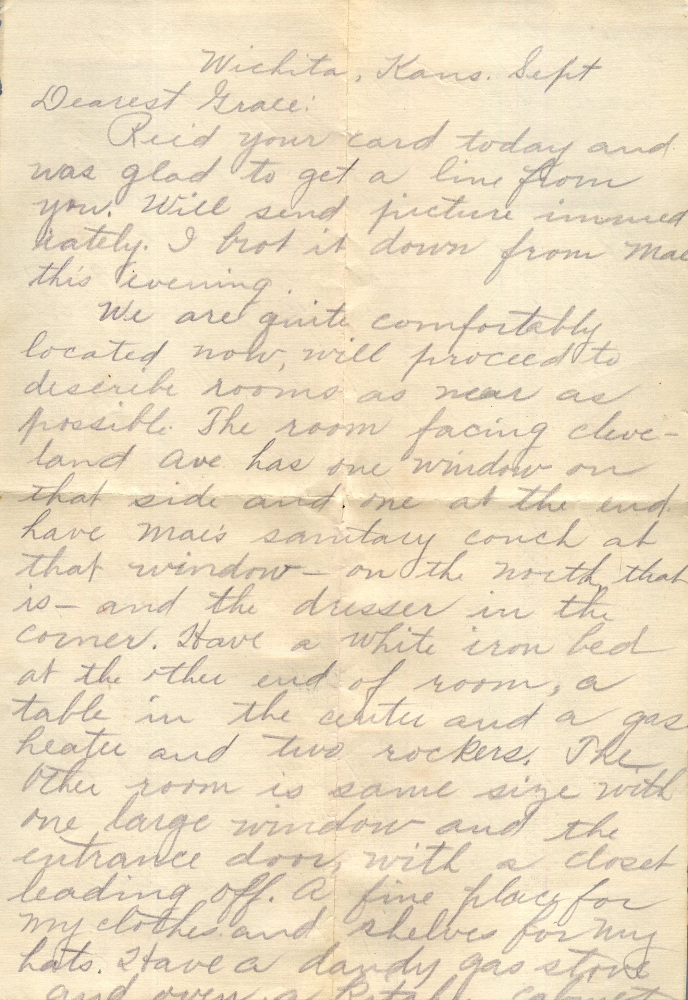
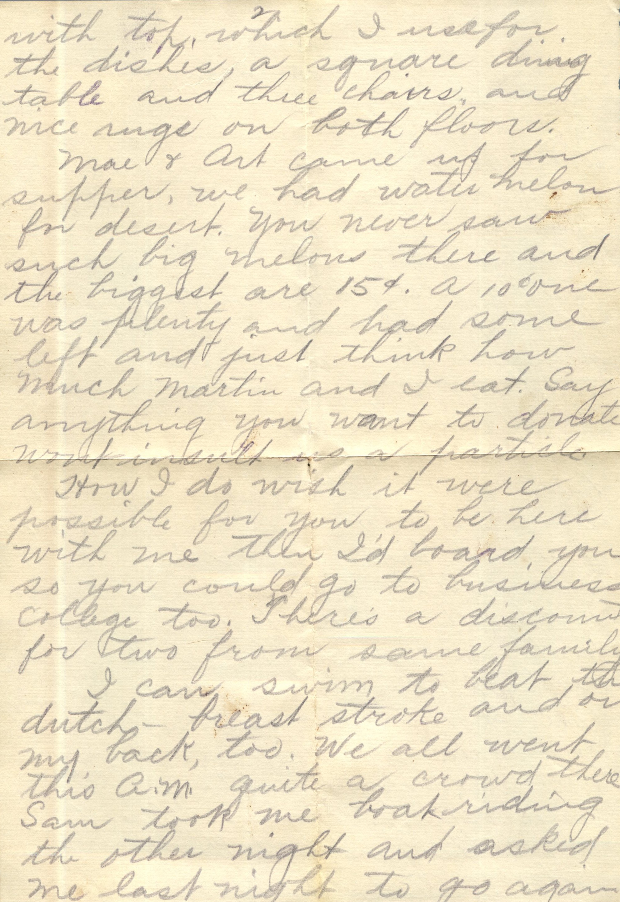
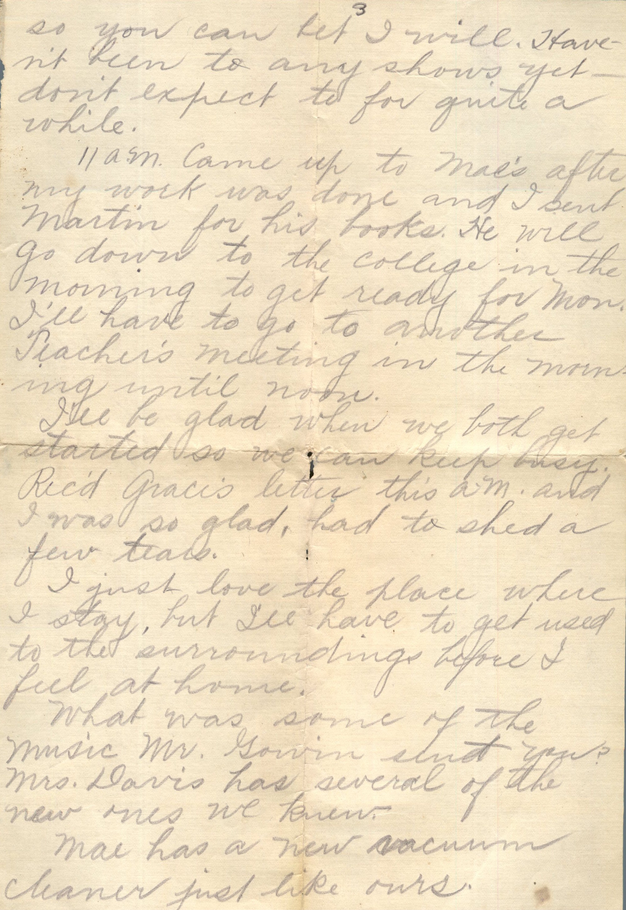
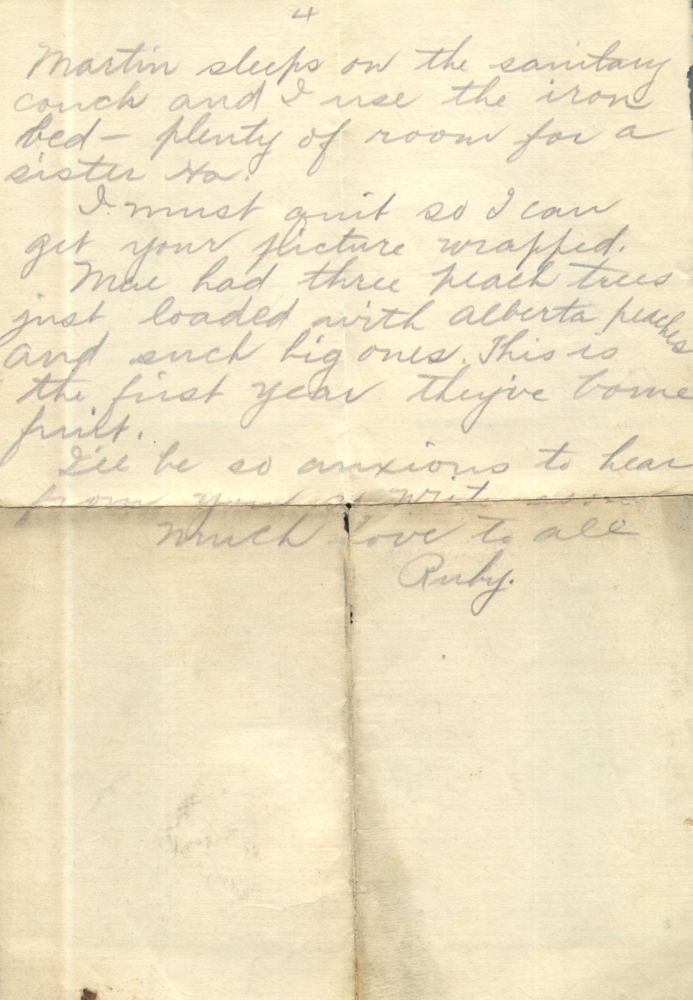
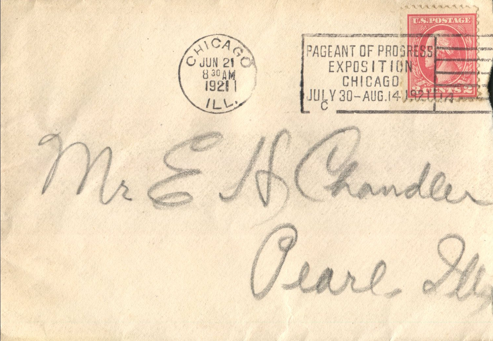
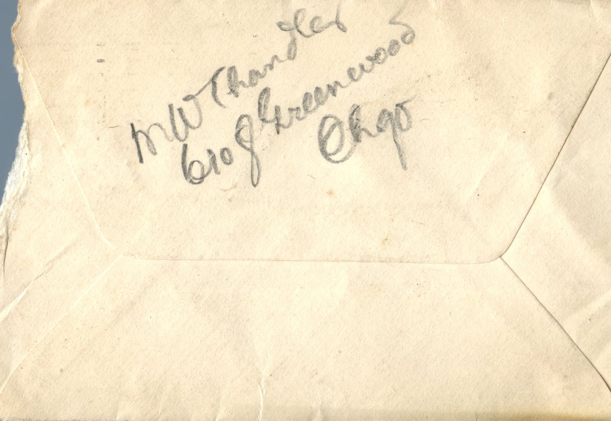

  From: Ruby Chandler, To: Grace Chandler  
Mailed From: Wichita, Kansas on September

Wichita, Kans. Sept  
Dearest Grace;  
Received your care today and was glad to get a line from you. Will send picture inclosed later. I brought it down from Mae this evening.  
We are quite comfortably located now, will proceed to desirable rooms as near as possible. The room facing Cleveland Ave has one window on that side and one at the end. Have Mae’s sanitary couch at that window – on the north that is – and the dresser in the corner. Have a white iron bed at the other end of room, a table in the center and a gas heater and two rockers, the other room is same size with one large window, and the entrance door, with a closet leading off. A fine place for my clothes and shelves for my hats. Have a dandy gas stove and over a kitchen cabinet with top, which I use for the dishes, a square dining table and the chairs, and a nice rug on both floors.  
Mae and Art came up for supper, we had watermelon for desert. You never saw such big melons there and the biggest are $0.15. A $0.10 one was plenty and had some left and just think how much Martin and I eat. Say anything you want to do. Wont insult us a particle.  
How I do wish it were possible for you to be here with me then I’d board you so you could go to business college too. There’s a discount for two from same family.  
I can swim to beat the dutch. Breast stroke and on my back, too. We all went this am quite a crowd there. Sam took me boat riding the other night and asked me last night to go again so you can bet I will. Haven’t been to any shows yet, don’t expect to for quite a while.  
11 am Came up to Mae’s after my work was done and I sent Martin for his books. He will go down to the college in the morning to get ready for Mon. I’ll have to go to another teacher’s meeting in the morning until noon.  
I’ll be glad when we both get started so we can keep busy. Received Grace’s letter this am and I was so glad, had to shed a few tears.  
I just love the place where I stay, but I’ll have to get used to the surroundings before I feel at home.  
What was some of the music Mr. Gorin sent you? Mrs. Davis has several of the new ones we knew.  
Mae has a new vacuum cleaner just like ours. Martin sleeps on the sanitary couch and I used the iron bed. Plenty of room for a sister Ha.  
I must quit so I can get your picture wrapped.  
Mae had three peach trees just loaded with Alberta peaches and such big ones. This is the first year they’ve borne fruit.  
I’ll be anxious to hear from you so write.  
Much love to all,  
Ruby