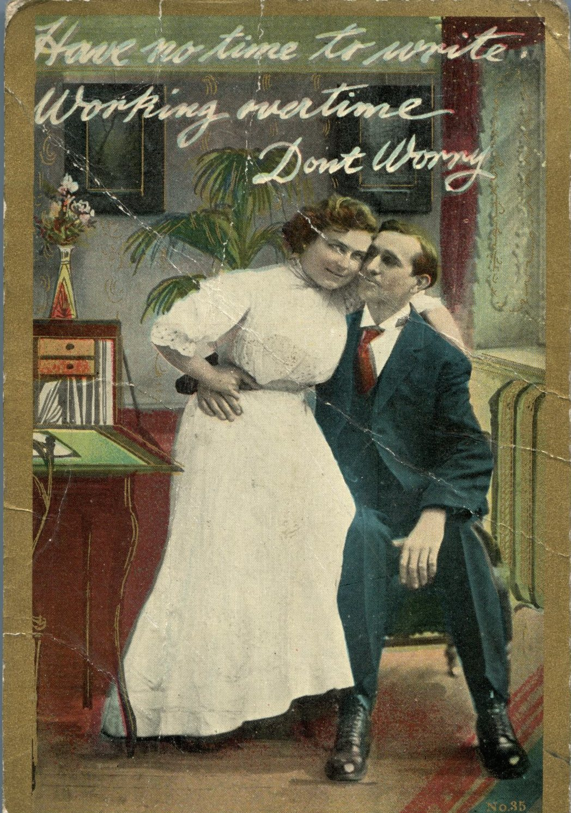
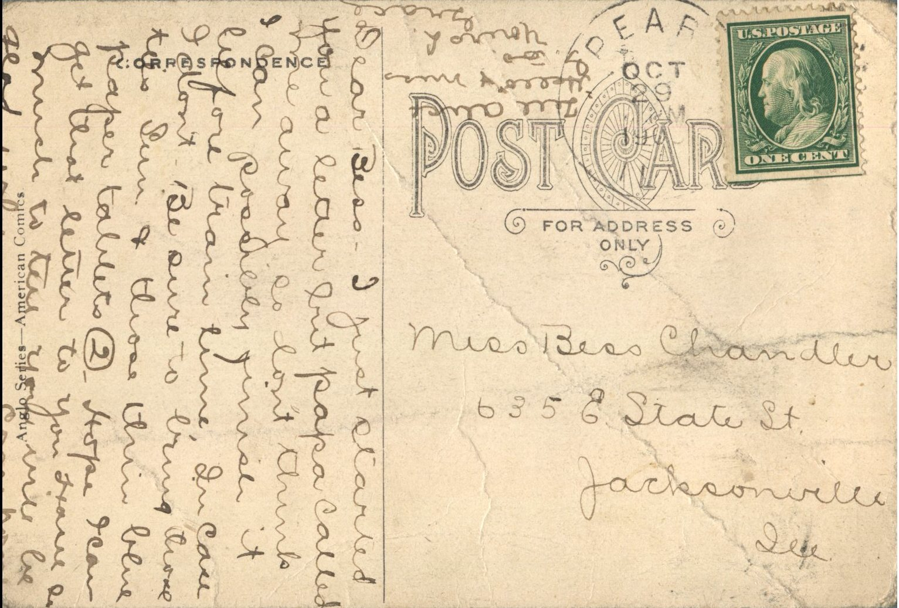

 From: Grace Chandler, To: Bess Chandler  
Mailed From: Pearl, Illinois on October 29, 1908  
Postcard Info: Anglo Series – American Comics

Miss Bess Chandler  
6356 State St.  
Jacksonville, Ill.

Dear Bess –  
I just started a letter but Papa called me away so don’t think I can possibly finish it before train time. In case I don’t be sure to bring those ties Sunday and those thin blue paper tablets too. Hope I can get that letter to you. Have so much to tell you. Will be glad when you come home. Tell all “hello” and miss G. too.  
Yours Lovingly,  
Grace