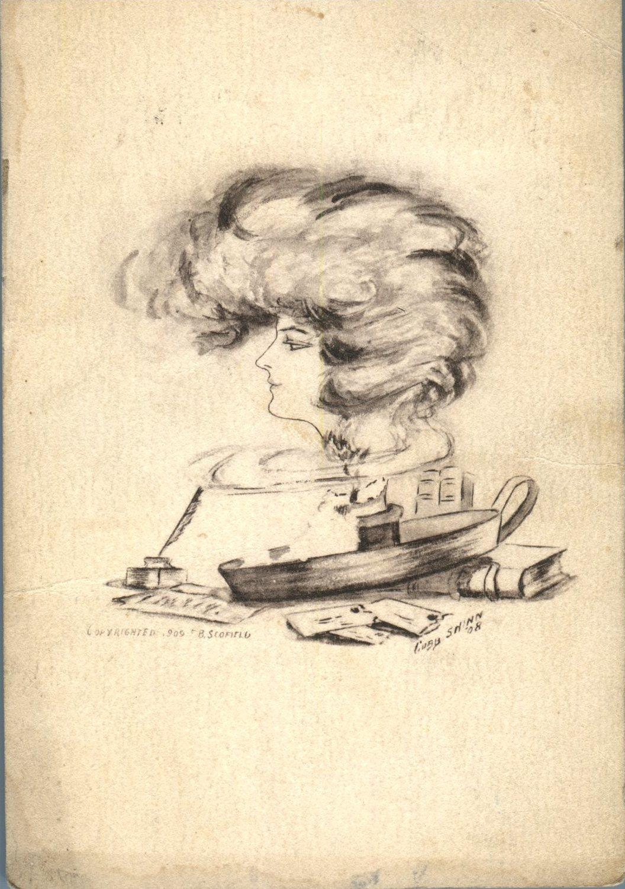
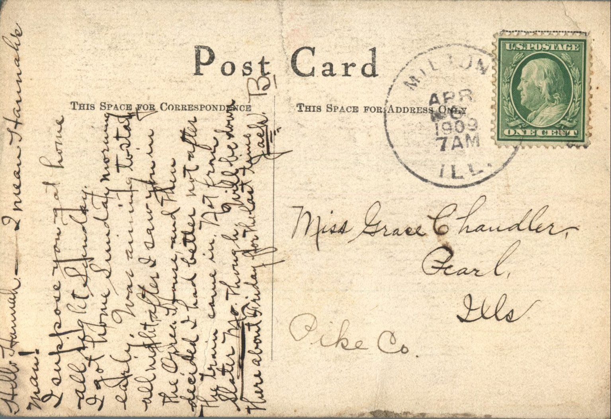

 

From: Jake, To: Grace Chandler  
Mailed From: Milton, Illinois on April 6, 1909

Miss Grace Chandler  
Pearl, Illinois  
Pike County

Hello Hannah! I mean Hannah’s ma!  
I suppose you got home all right Sunday. I got home on Sunday morning early. Was aiming to stay all night after I saw you in the Orell house and then decided I had better not after the train came in. Not from Slater, MO. Thought will be down there about Friday for the last time.  
Jack