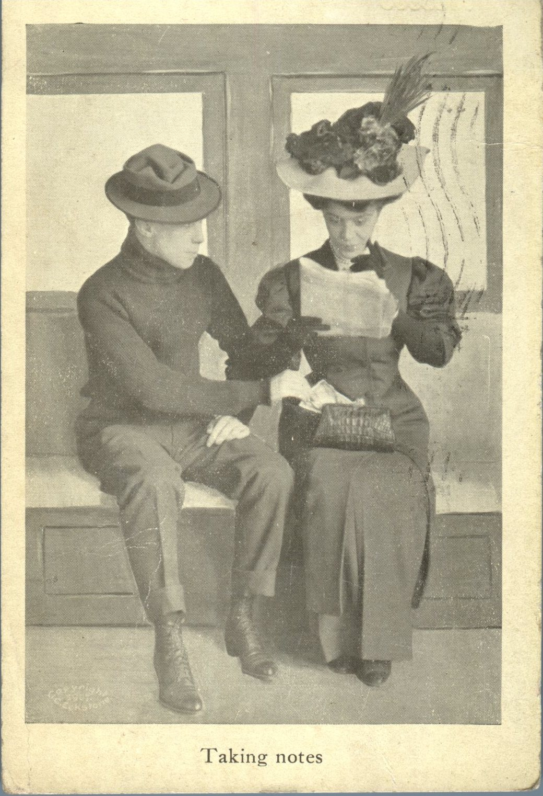
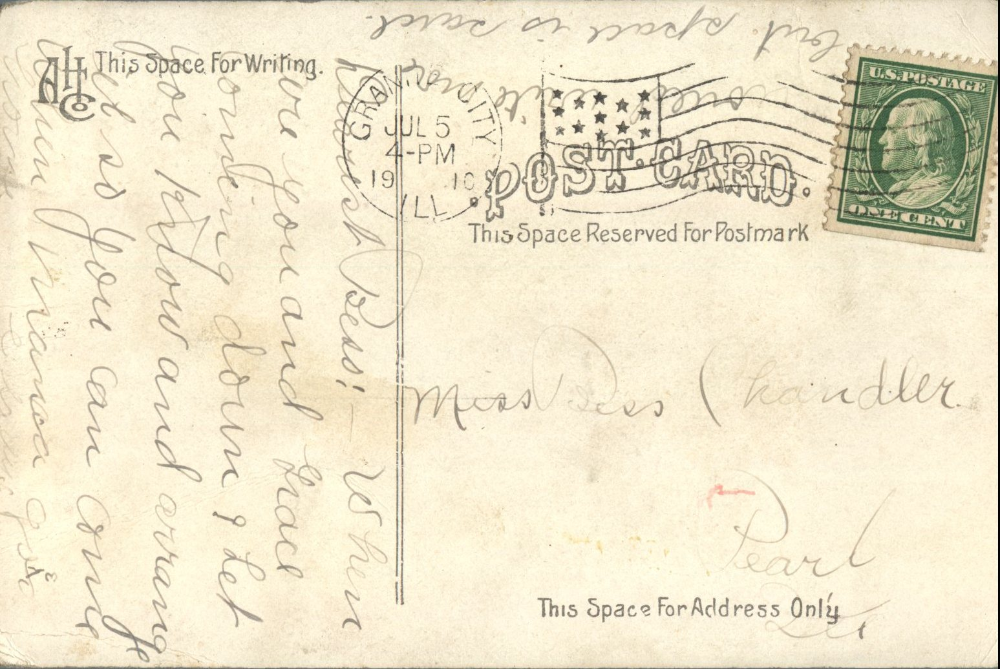

 From: Unknown, To: Bess Chandler  
Mailed From: Granite City, Illinois on July 5, 1910

Miss Bess Chandler  
Pearl, Illinois

Dearest Bess,  
When are you and Grace coming down? Let you know and arrange it so you can come when Nana goes home. Would write more but space is scarce.