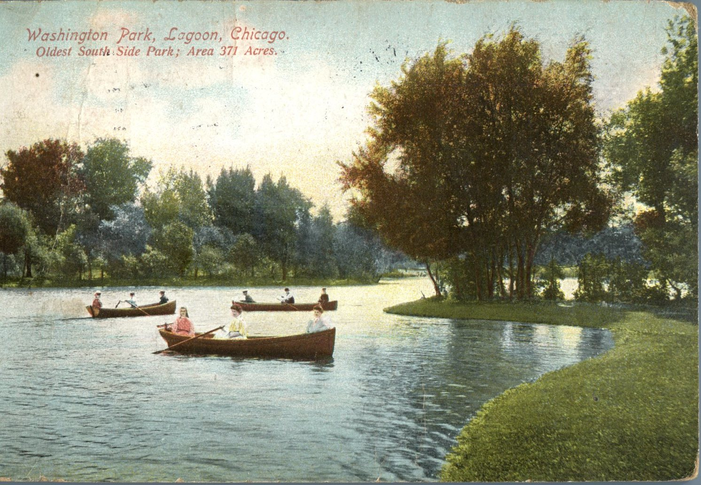
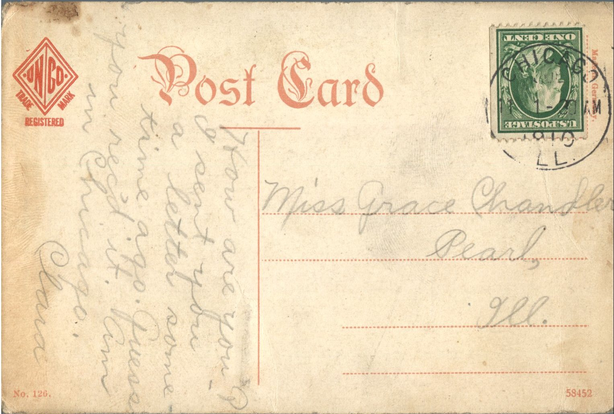

 From: Clara, To: Grace Chandler  
Mailed From: Chicago, Illinois on July 11, 1910  
Picture Info: Washington Park, Lagoon, Chicago. Oldest South Side Park; Area 371 Acres.

Miss Grace Chandler  
Pearl, Illinois

How are you? I sent you a letter some time ago. Guess you received it. Am in Chicago.  
Clara