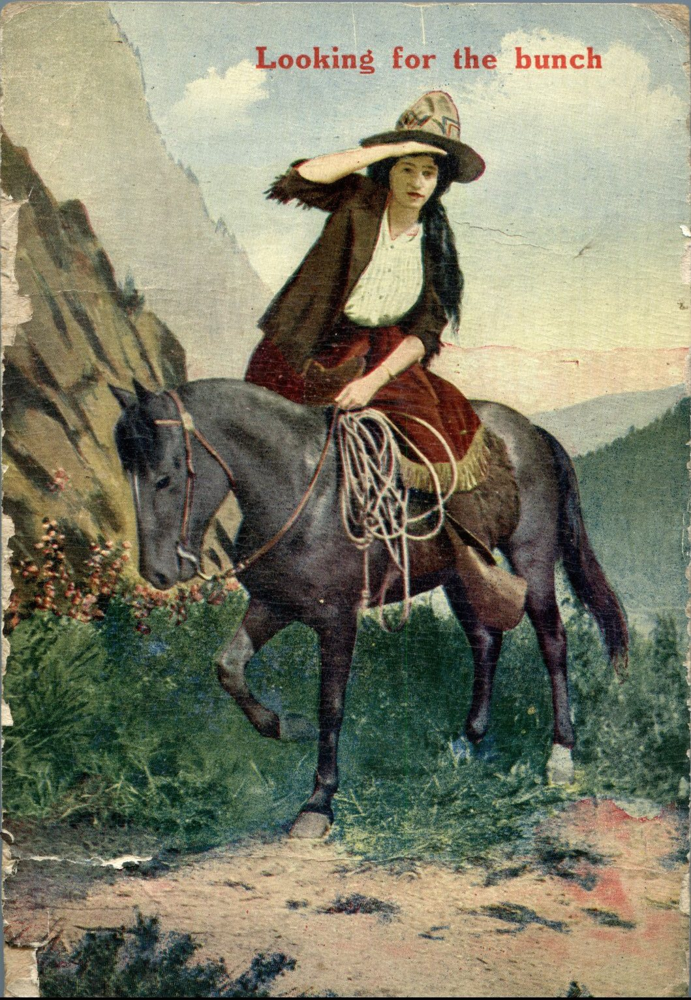
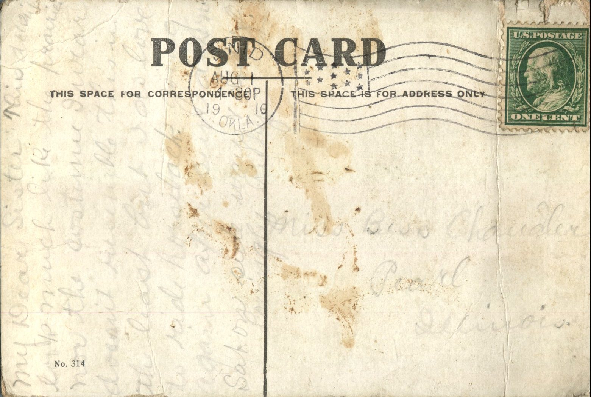

 From: Ruby Chandler, To: Bess Chandler  
Mailed From: Enid, Oklahoma on August 1, 1910

Miss Bess Chandler  
Pearl, Illinois

My Dear Sister,  
This doesn’t look much like the prairie nor the costume I wear doesn’t resemble this in the least but I do love to ride Hopsitack. Going again after sending this and on Saturday.  
Lovingly,  
Ruby