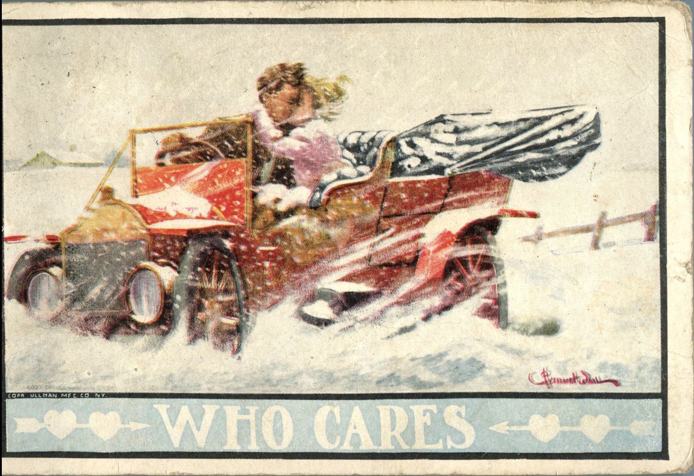
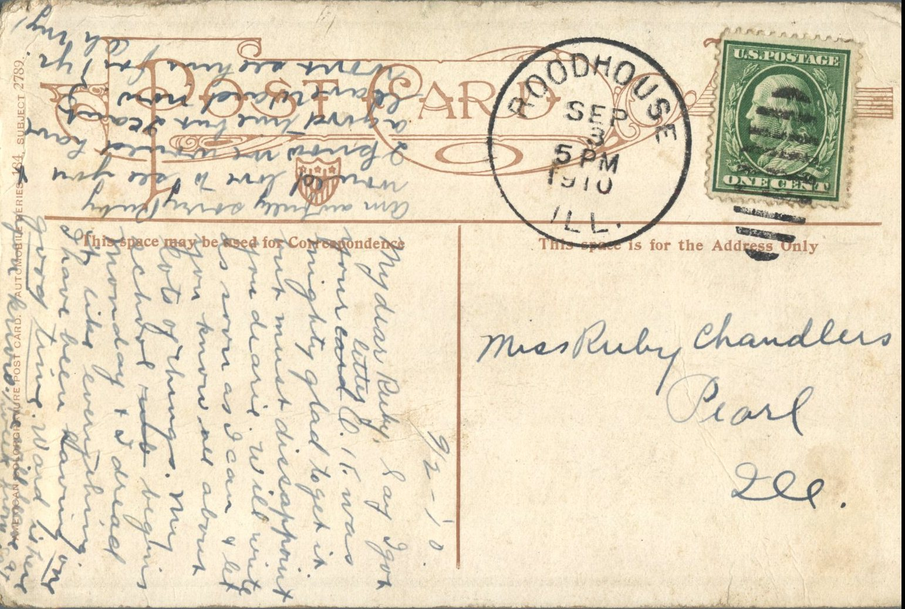

 

From: Pearl Ellis, To: Ruby Chandler  
Mailed From: Roadhouse, Illinois on September 3, 1910  
Postcard Info: American Colorgravure Post Card. Automobile Series 184, Subject 2789

Miss Ruby Chandler  
Pearl, Illinois

9/2 – ’10  
My Dear Ruby,  
Say i got your letter 6-11. Was mighty glad to get it but must disappoint you dearie. Will write as soon as I can and let you know all about lots of things. My school begins Monday and I dread it like everything. I have been having one good time. Ward is here you know. He will leave a week from Saturday. Am awfully sorry Ruby. Would love to see you and I know we would have a good time but I can’t leave Ward now. I won’t see him for one year. Oh my.  
Pearl