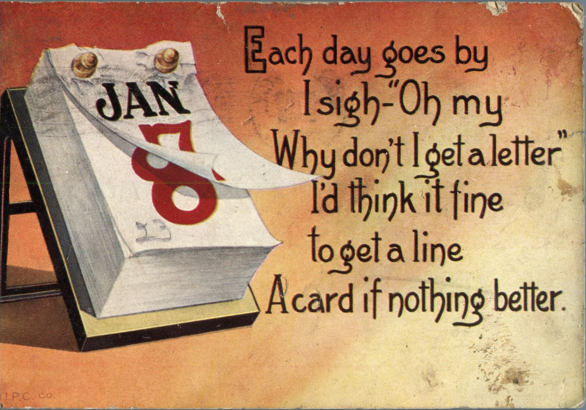
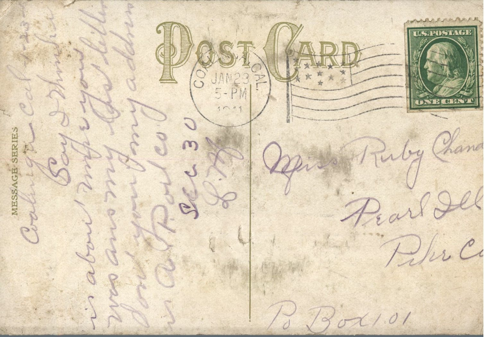

 

From: L.M., To: Ruby Chandler  
Mailed From: Coalinga, California on January 23, 1911

Miss Ruby Chandler  
Po Box 101  
Pearl, Illinois  
Pike Co

Coalinga, Cal 1-23-11  
Say I wonder, it is about time you was answering my last letter. Don’t you know my address in A. Port Co. Sec 30  
L.M.