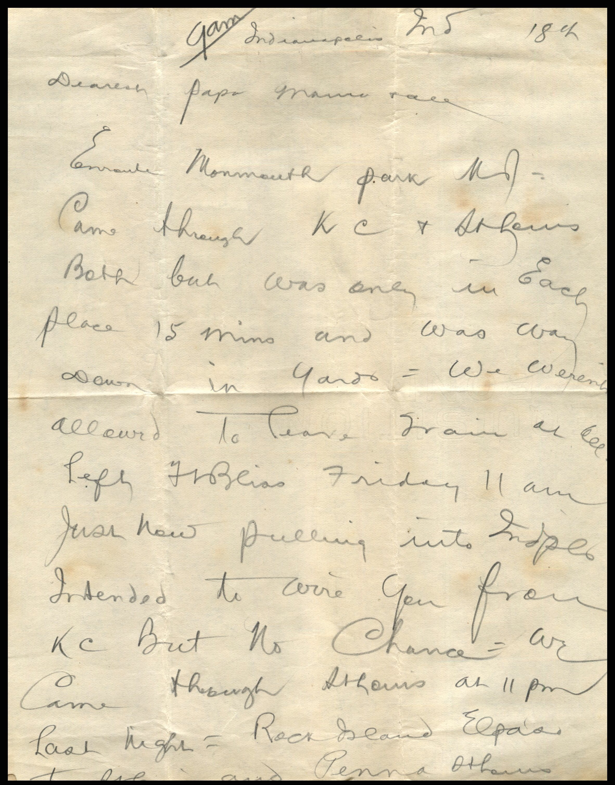
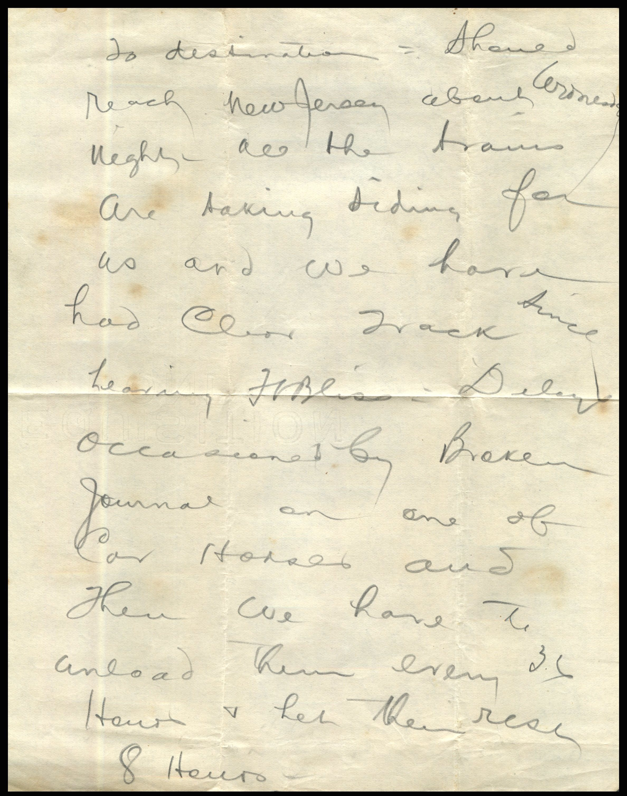
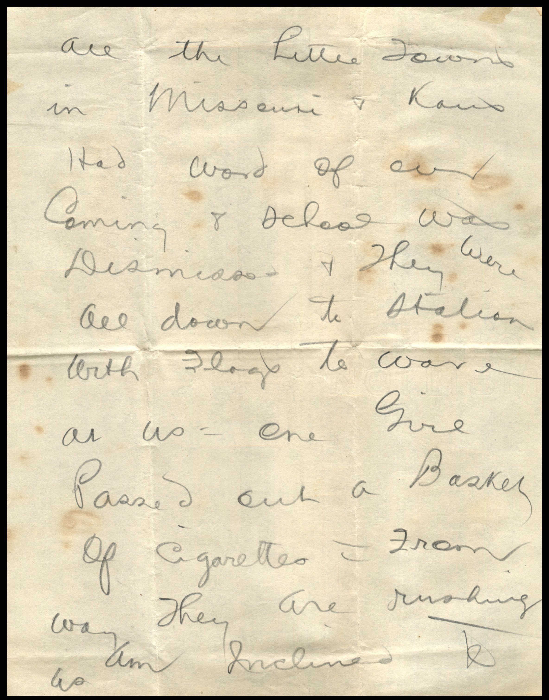
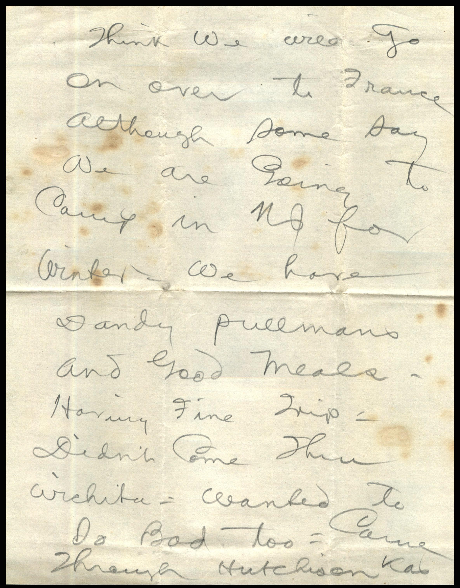
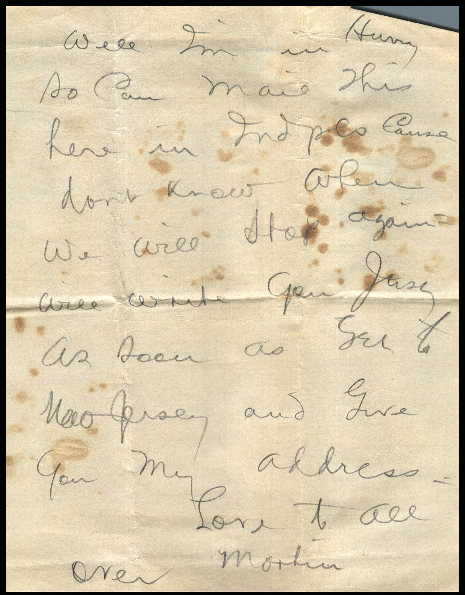
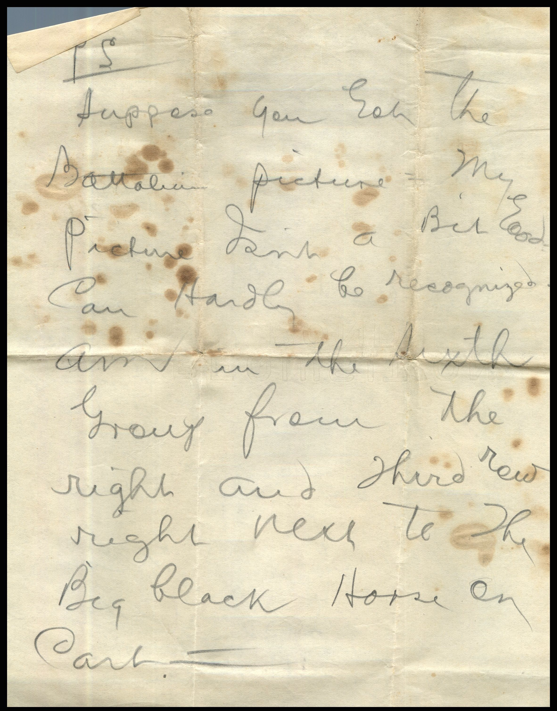
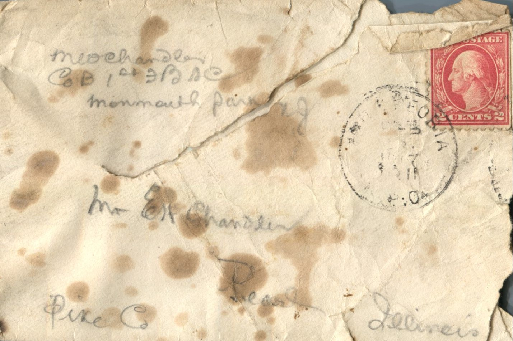

    

From: Martin Chandler, To: Elijah H. Chandler and Family

Mailing Address:  
Mr. E.H. Chandler  
Pearl, Illinois  
Pike County

Return Address:  
M. Chandler  
COB 1st BSC  
Mammouth Parking

9 am Indianapolis, Mo. 18th  
Dearest Papa, Mama, &amp; all  
En route to Mammouth Park, Mo. Cmae through K.C. &amp; St. Louis both but was only in each place 15 minutes and was way down in yards. We weren’t allowed to leave train at all. Just now pulling into Maple. Intended to write you from KC but no chance. We came through St. Louis at 11 pm last night. Rock bends El Paso to St. Louis and then St. Louis to destination. Should reach New Jersey about night. All the trains are taking siding for us and we have had a clear track since leaving Mt. Bliss. Delayed occasional by broken tunnel on one of the car horses and then we have to unload them every 3 hours and let them rest 8 hours. All the little towns in Missouri and Kansas had word of our coming and school was dismissed and they were all down to station with flags to wave at use. One girl passed out a basket of cigarettes. from way they are rushing us am inclined to think we will go on over to France although some say we are going to camp in NJ for winter. We have dandy pullman and good meals. Having fine trip. Didn’t come through Wichita. Wanted to bad too. Came through Hutchinson, Kans. Well I’m in hurry so can mail this here in Maples cause don’t know when we will stop again. Will write you just as soon as get to New Jersey and give you my address.  
Love to all  
Martin  
(over)  
P.S.  
Suppose you get the Battalion picture my picture isn’t a bit good. Can hardly be recognized. Am in the sixth grow from the right and third row right next to the big black horse on cart.