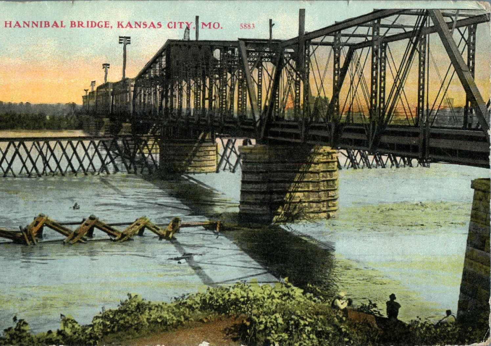
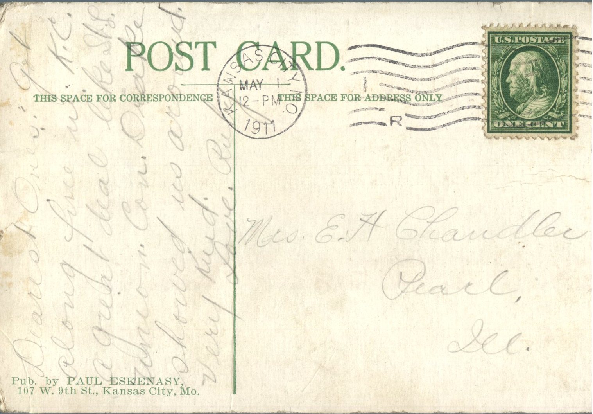

 

From: Ruby Chandler, To: Jeanette Knox Chandler  
Mailed From: Kansas City, Missouri on May 1, 1911  
Postcard Info: Published by Paul Eskenasy, 107 W. 9th St., Kansas City, Missouri  
Picture Info: Hannibal Bridge, Kansas City, Missouri

Mrs. E.H. Chandler  
Pearl, Illinois

Dearest Ones,  
Got along fine in Kansas City, a great deal like St. Louis. Union Colonel Drake showed us around. Very kind.  
Love, Ruby