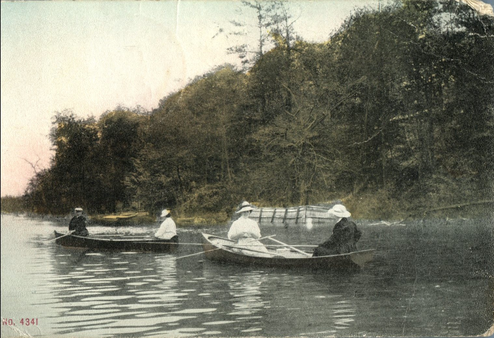
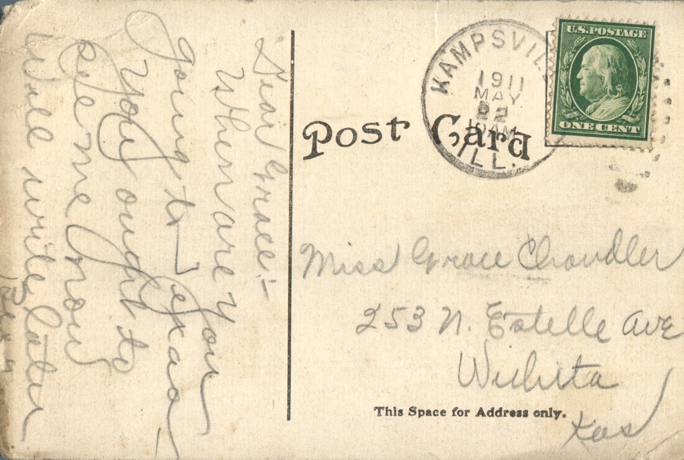

From: Bess Chandler, To: Grace Chandler  
Mailed From: Kampsville, Illinois on May 2, 1911

Miss Grace Chandler  
253 N. Estille Ave.  
Wichita, Kansas

Dear Grace,  
When are you going to answer? You ought to see me now. Will write later.  
Bess