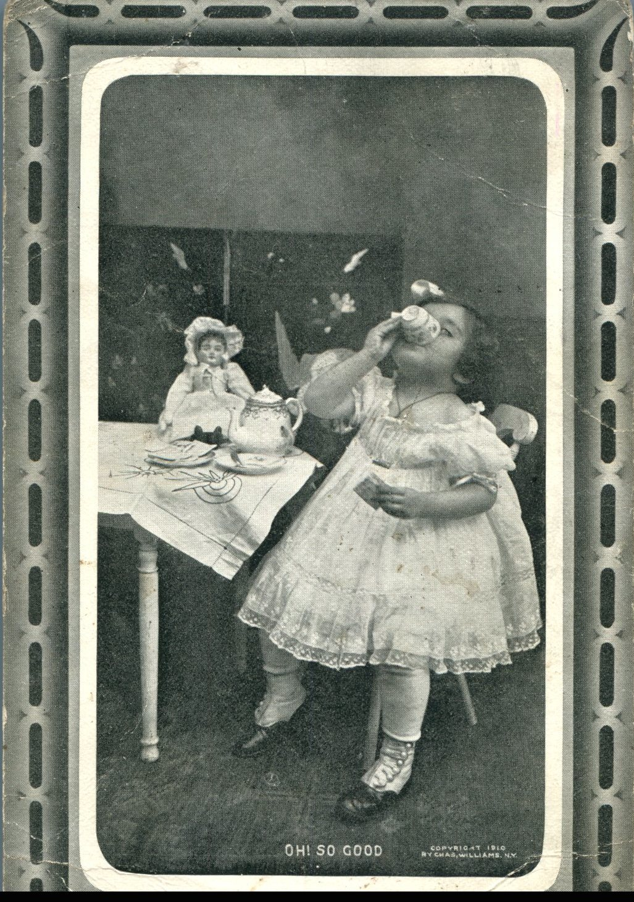
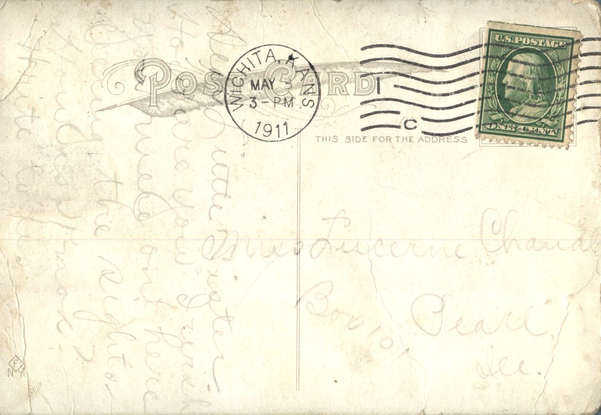

 

From: Grace Chandler, To: Lucerne Chandler  
Mailed From: Wichita, Kansas on May 8, 1911

Miss Lucerne Chandler  
Box 101  
Pearl, Illinois

Dear Little Sister,  
How are you? I wish you were out here seeing the sights. How are the Knox’s?  
Write to us,  
Grace