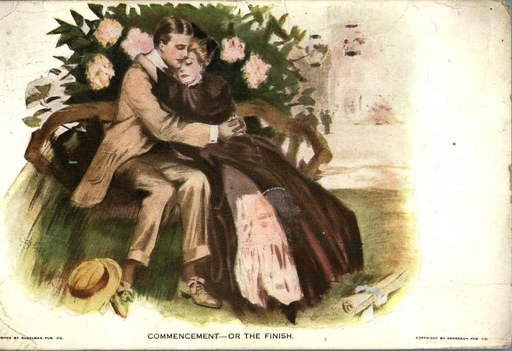
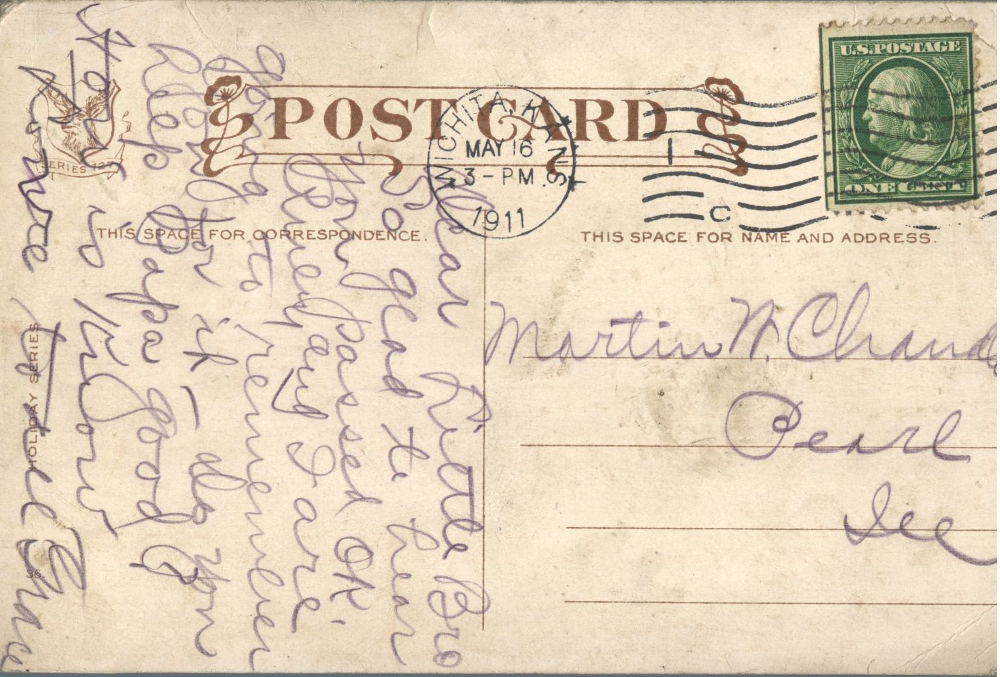

 

From: Grace Chandler, To: Martin Chandler  
Mailed From: Wichita, Kansas on May 16, 1911  
Postcard Info: Published by Gubelman Pub. Co.  
Picture Info: Copyright by Anderson Pub. Co.

Martin N. Chandler  
Pearl, Illinois

Dear Little Bro  
So glad to hear you passed O.K. Ruby and I are going to remember you for it. Do you keep Papa good? How is Knox’s?  
Love to all  
Grace