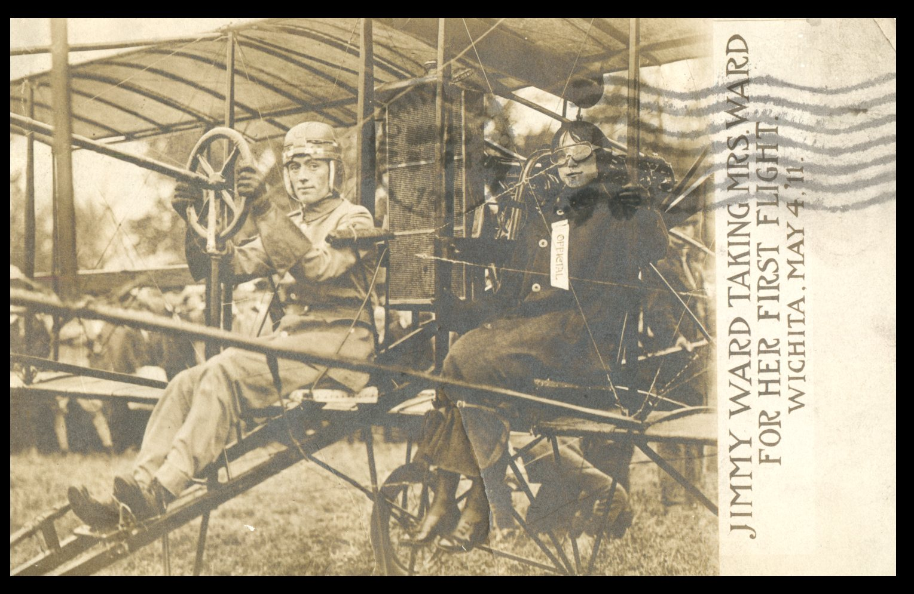
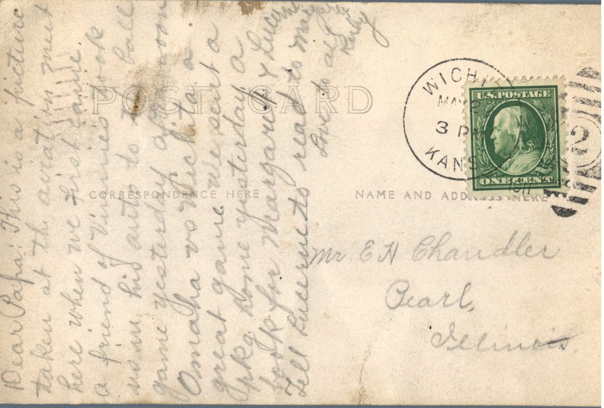

 

From: Ruby Chandler, To: Elijah H. Chandler  
Mailed From: Wichita, Kansas on May 20, 1911  
Photo Info: Jimmy Ward Taking Mrs. Ward for her First Flight. Wichita. May 4. 11

Mr. E.H. Chandler  
Pearl, Illinois

Dear Papa,  
This is a picture taken at the aviation meet here when we first came. A friend of Vinnie’s took us in his auto to the ball game yesterday afternoon. Omaha vs. Wichita. A great game. We sent a package home yesterday. A book for Margaret and Lucerne. Tell Lucerne to read to Margaret.  
Love to all,  
Ruby