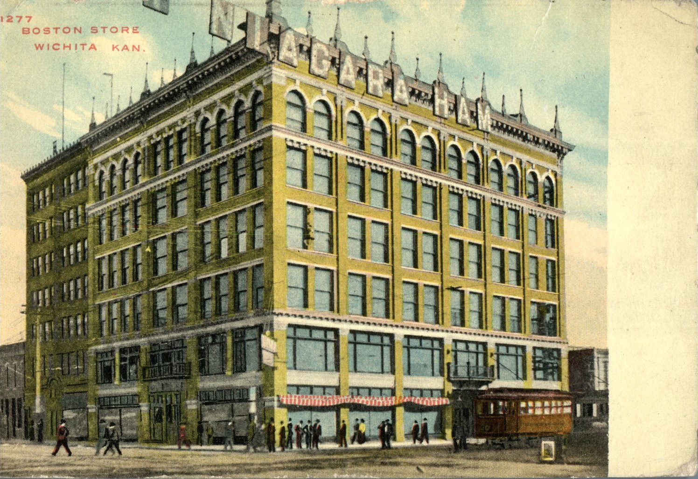
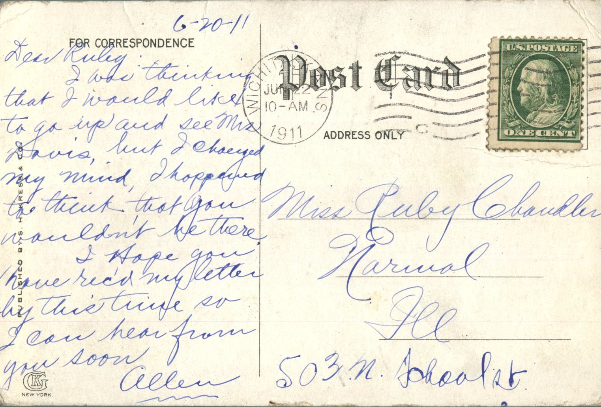

 From: Allen, To: Ruby Chandler  
Mailed From: Wichita, Kansas on June 22, 1911  
Postcard Info: Published by S.H. Kress &amp; Co.  
Picture Info: 1277 Boston Store. Wichita, Kan.

Miss Ruby Chandler  
Normal, Ill.  
503 N. School St.

6-20-11  
Dear Ruby,  
I was thinking that I would like to go up and see Mrs. Davis but I changed my mind. I happened to think that you wouldn’t be there.  
I hope you have received my letter by this time so I can hear from you soon.  
Allen