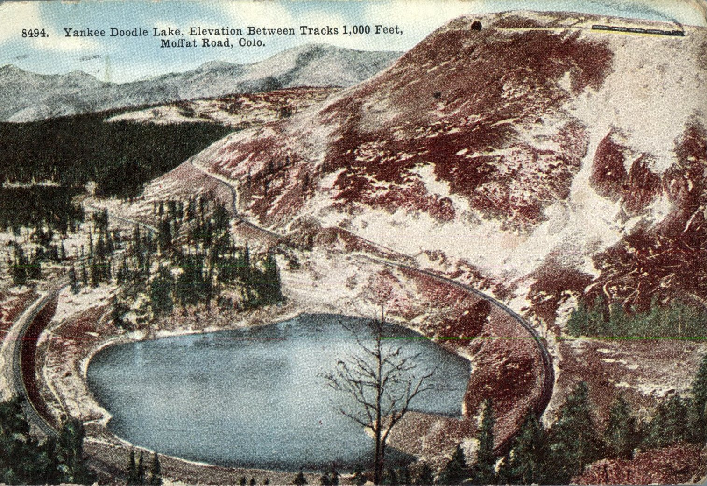
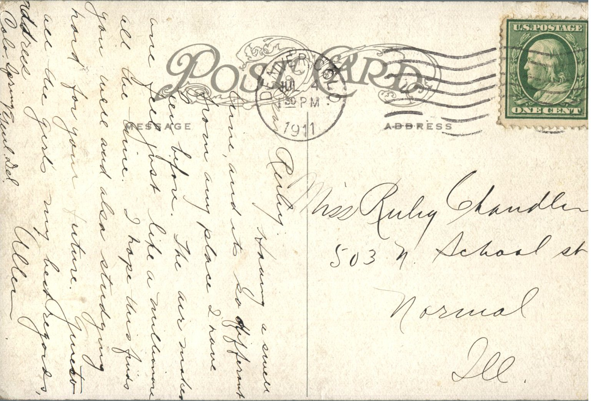

 

From: Allen, To: Ruby Chandler  
Picture Info: 8494. Yankee Doodle Lake, Elevation Between Tracks 1,000 Feet, Moffat Road, Colo.  
Mailed From: Denver, Colorado on July 4, 1911

Miss Ruby Chandler  
503 N. School St.  
Normal, Illinois

Ruby,  
Having a swell time, and its so different from any place I have been before. The air makes you feel just like a millionaire all the time. I hope this finds you well and also studying hard for your future. Give all the girls my best regards.  
Allen  
Address: Colorado Springs, Yeul Del.