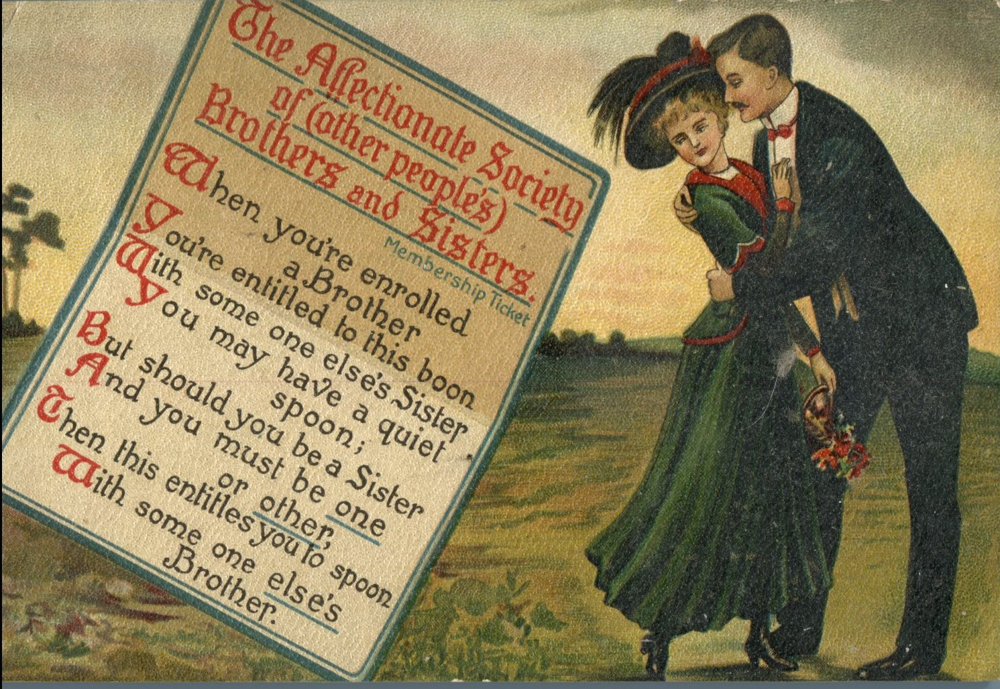
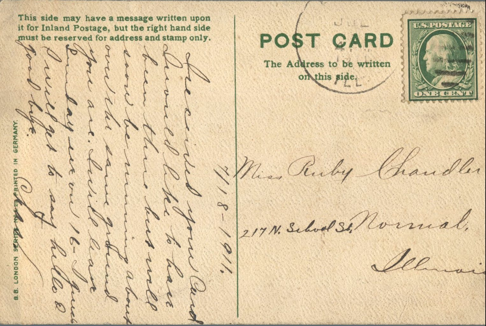

 

From: Chas., To: Ruby Chandler  
Postcard Info: B.B. London Series No. E.29. Printed in Germany

Miss Ruby Chandler  
217 N. School St.  
Normal, Illinois

7/18/1911  
Received your card. Should like to have been there but will soon be running about over the same ground you are. I will be there on Sunday, the 16th. I guess I will get to say hello and goodbye.  
Chas.