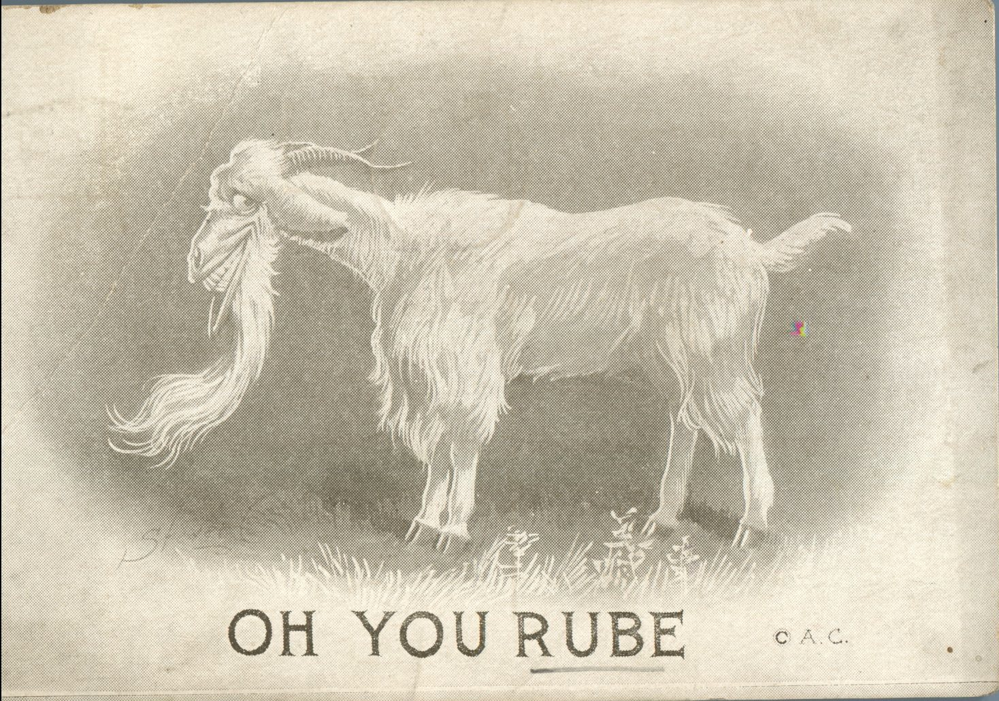
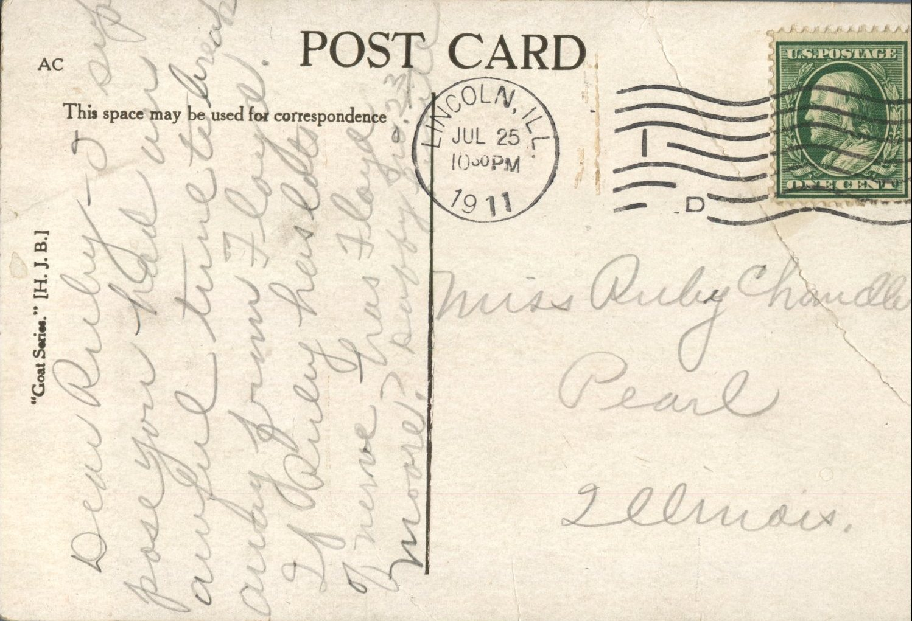

From: Duffy, To: Ruby Chandler  
Mailed From: Lincoln, Ill. on July 25, 1911  
Postcard Info: “Goat Series.” \[H. J. B.\]

Miss Ruby Chandler  
Pearl, Illinois

Dear Ruby,  
I suppose you had an awful time to break away from Floyd. If Ruby has lots of nerve has Floyd more?  
Duffy