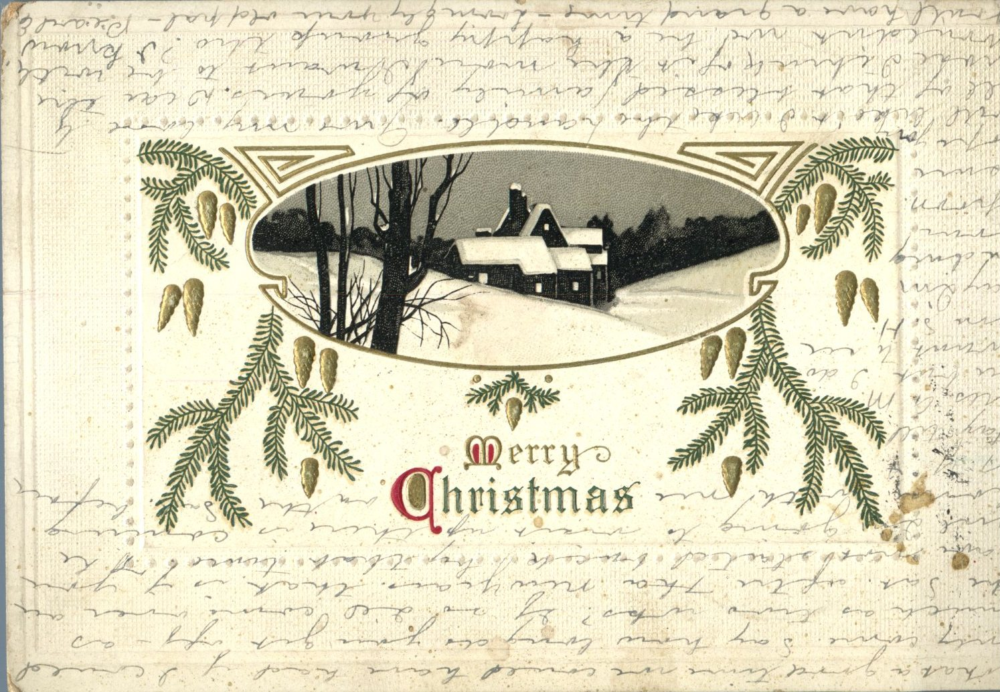
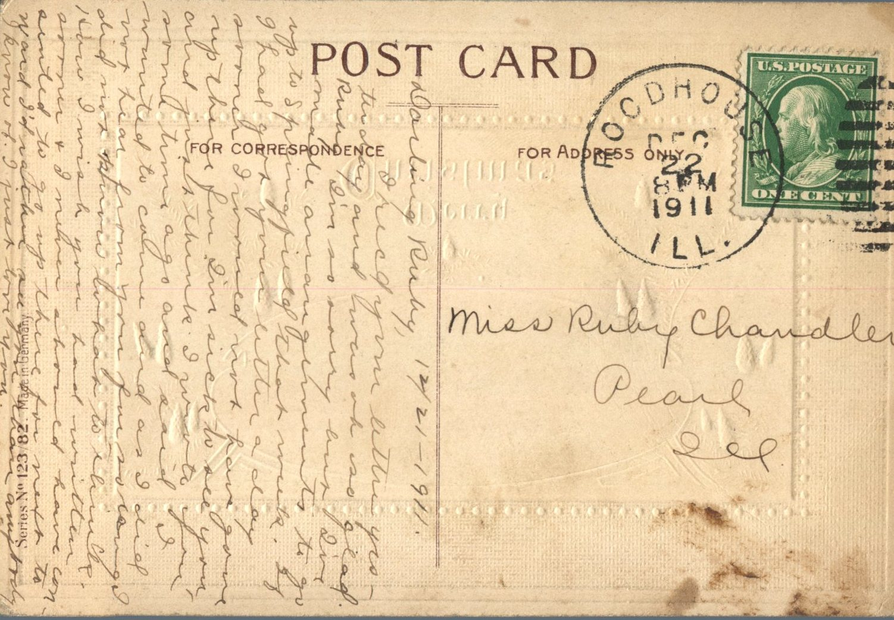

From: Pearl Ellis, To: Ruby Chandler  
Postcard Info: Series No. 123/82. Made in Germany  
Mailed From: Roadhouse, Illinois on December 22, 1911

Miss Ruby Chandler  
Pearl, Illinois

12/21-91  
Darling Ruby,  
I received your letter yesterday and was oh so glad. Ruby I’m so sorry but I’ve made arrangements to go up to Springfield that week. If I had got your letter a day sooner I would no have gone up there, for I’m sick to see you and just think, I wrote you some time ago and said I wanted to come and as I did not hear from you for so long I did not know what to think. How I wish you had written sooner and I need would have consented to go up there for I’d rather see you than anybody I know of. I just love you.  
What a good time we could have had if I could only come. Say, how long do you get off-as much as two weeks? If so, I’ll come over on the Saturday after the New Year’s. This is if you have not started back by that time. The girl I’m going to visit up there is coming up with me on the Saturday before New Year’s and staying til Tuesday a.m. Say, I’m sending your apron. I sure hope you will like it. I like the handle. Give all my love to all that blessed family of yours. Dear the more I think of it the more I want to be with you all. Wouldn’t we be a happy group though? I know you’ll have a grand time.  
Lovingly your old pal,  
Pearl E.