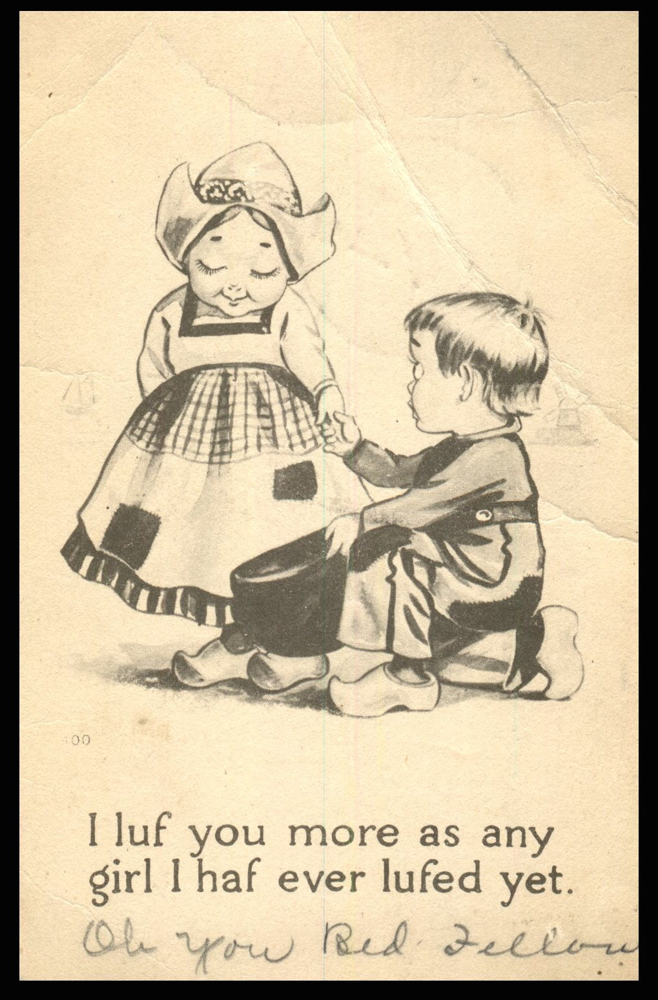
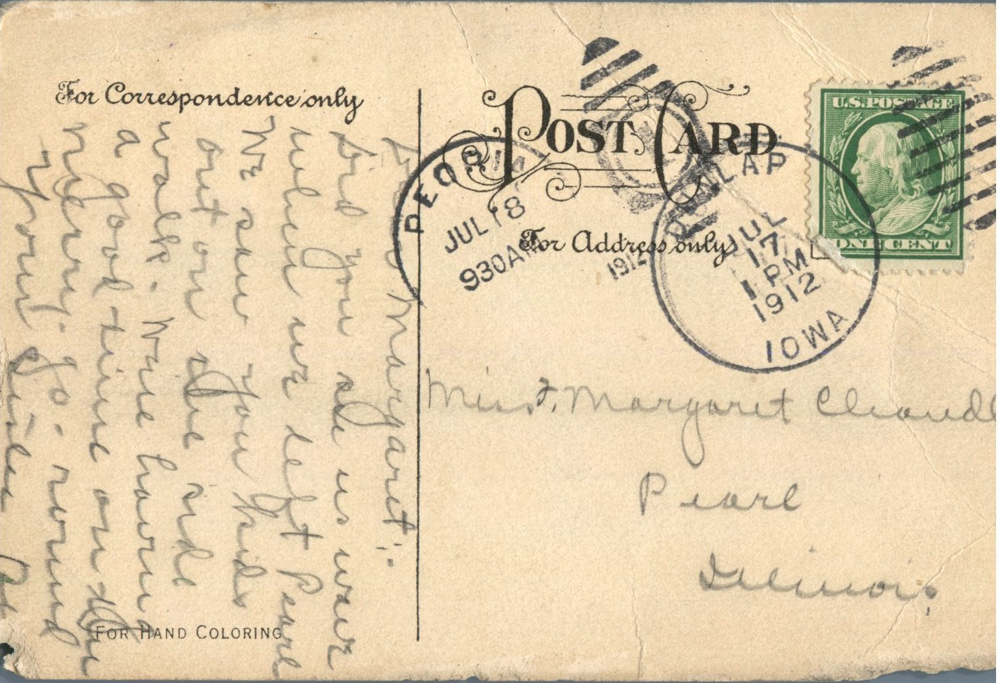

From: Unknown, To: Margaret Chandler  
Mailed From: Dunlap, Iowa on July 17, 1912

Miss Margaret Chandler  
Pearl, Illinois

Dear Margaret,  
Did you see us wave when we left Pearl? We saw you kids out on the side walk. Were having a good time on the merry-go-round.  
Your Sister,  
Ruby